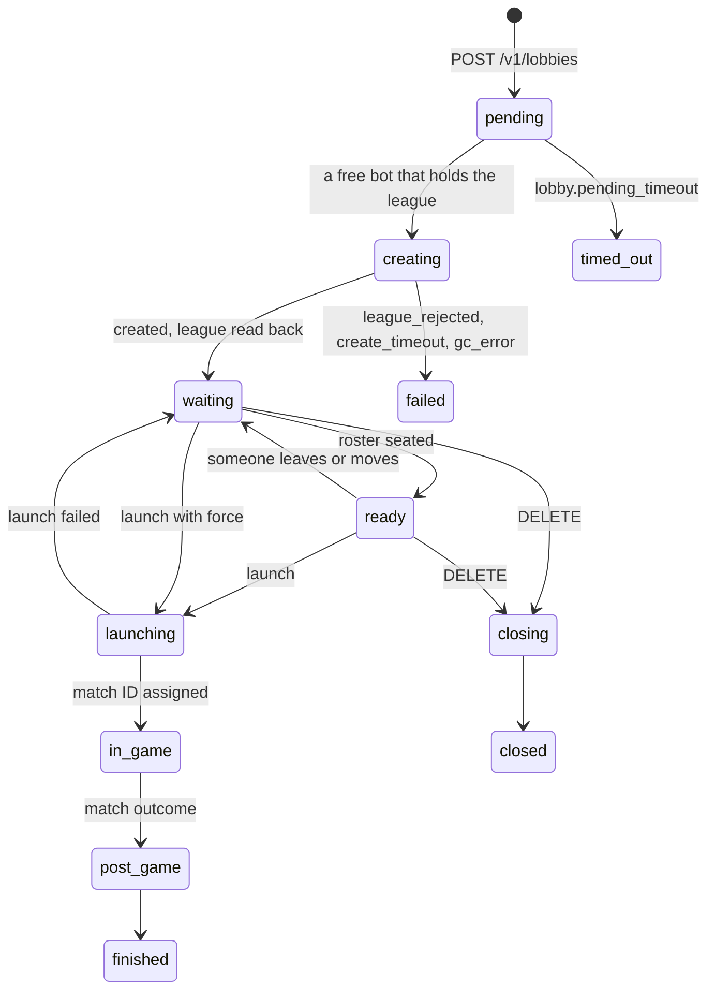

# API reference

The service exposes an HTTP API, by default on port `8080`. It speaks plain HTTP: there is no
TLS, so put a reverse proxy in front of it before exposing it beyond localhost (see
[Exposing it beyond localhost](../deployment/docker-compose.md#exposing-it-beyond-localhost)).

The examples use `http://127.0.0.1:8080`, which is where the default `compose.yaml` publishes
the API.

!!! warning "Lobby hosting is new and untested live"

    The lobby endpoints are tested against a fake game coordinator only. How the host bot gets
    out of a player slot before a launch, and how a match end shows in the lobby, have not been
    seen on live Steam yet. See [Known limitations](../known-limitations.md).

## Overview

| Method | Path | Auth | Purpose |
|---|---|---|---|
| `GET` | `/livez` | Never | Liveness: the process serves and no bot loop is stuck |
| `GET` | `/readyz` | Never | Readiness: enough bots are connected to the game coordinator |
| `GET` | `/health` | Never | Always `200`, with counts per bot state |
| `GET` | `/v1/bots` | When an API key is set | Every bot and its state |
| `GET` | `/v1/bots/{name}` | When an API key is set | One bot |
| `POST` | `/v1/bots/{name}/retry` | When an API key is set | Make a waiting bot try again now |
| `GET` | `/v1/bots/{name}/leagues` | When an API key is set | One bot's leagues, its last league refresh and recent ticket changes |
| `POST` | `/v1/bots/{name}/leagues/refresh` | When an API key is set | Fetch one bot's leagues from the game coordinator now |
| `GET` | `/v1/leagues` | When an API key is set | Every league a bot may host, which bots hold it and how many are free |
| `GET` | `/v1/leagues/{id}` | When an API key is set | One league in that shape |
| `POST` | `/v1/leagues/refresh` | When an API key is set | Fetch every ready bot's leagues now |
| `GET` | `/v1/leagues/{id}/nodes` | When an API key is set | A league's lobby nodes, asked from the game coordinator |
| `POST` | `/v1/lobbies` | When an API key is set | Ask for a lobby; it is created in the background |
| `GET` | `/v1/lobbies` | When an API key is set | List lobbies, newest first |
| `GET` | `/v1/lobbies/{id}` | When an API key is set | One lobby, with its password |
| `PATCH` | `/v1/lobbies/{id}` | When an API key is set | Change a lobby's settings |
| `DELETE` | `/v1/lobbies/{id}` | When an API key is set | Close a lobby that has not launched |
| `POST` | `/v1/lobbies/{id}/invite` | When an API key is set | Send invites again |
| `POST` | `/v1/lobbies/{id}/kick` | When an API key is set | Move a member to the pool or out of the lobby |
| `POST` | `/v1/lobbies/{id}/roster` | When an API key is set | Replace both rosters |
| `POST` | `/v1/lobbies/{id}/launch` | When an API key is set | Start the match |
| `POST` | `/v1/lobbies/{id}/teams/flip` | When an API key is set | Swap the sides |
| `POST` | `/v1/lobbies/{id}/teams/shuffle` | When an API key is set | Balanced shuffle of an open lobby |
| `GET` | `/v1/lobbies/{id}/events` | When an API key is set | A lobby's events, oldest first |
| any | `/bots`, `/lobby/create`, `/lobby/info` | When an API key is set | `410`, the old endpoints are gone |
| `GET` | `/openapi.json`, `/openapi.yaml` | Never | The OpenAPI 3.1 description of the `/v1` API |

`GET` endpoints also answer `HEAD`. A known path with the wrong method gets `405` with an
`Allow` header; an unknown path gets `404`. Request bodies are limited to
`server.max_body_bytes` (64 KiB).

## OpenAPI

The `/v1` operations, their request and response schemas, the error format and the
[webhook](../operations/webhooks.md) event envelope are described in an OpenAPI 3.1 document.
Generate clients from it rather than from the examples on this page.

- The running service serves it at `/openapi.json` and `/openapi.yaml`, without the API key
  (`/openapi-3.0.json` and `/openapi-3.0.yaml` hold an OpenAPI 3.0.3 version for older
  generators). There is no built-in docs UI.
- The same document is in the repository as
  [`api/openapi.yaml`](https://github.com/kettleofketchup/dota_lobby/blob/main/api/openapi.yaml),
  regenerated with `just go::openapi`; a test fails when it no longer matches the code.
- Each operation has a stable `operationId` (`create-lobby`, `list-lobby-events`, ...) that client
  generators use for method names. The event a webhook receives is the `LobbyEvent` schema:
  a `oneOf` with a discriminator on `type`, one schema per data shape (`MatchEndedEvent` with
  `MatchEndedData`, for example), so a generated receiver gets typed `data`. The delivery is
  described under `webhooks.lobby-event`.
- `info.version` is the version of the `/v1` API, not of the service.

## Authentication

Authentication is on when `secrets.api_key` is set (see
[Configuration](../configuration/index.md#secrets)). Without it, everything is public and the
startup log says `API key authentication disabled; /v1 endpoints are public`. The health
endpoints never need the key.

Send the key in either header:

```text
X-API-Key: <your api_key>
Authorization: Bearer <your api_key>
```

- `X-API-Key` is checked first; if it is present, `Authorization` is ignored.
- The `Bearer` scheme is matched case-insensitively.
- The key is compared in constant time.

A missing or wrong key gets `401 unauthorized` with a
`WWW-Authenticate: Bearer realm="dota_lobby"` header. The key is checked before the method: a wrong method on a
protected path such as `/v1/bots` gets `401` without a valid key, so the `Allow` list is not
revealed, and `405` with one. The open probe paths (`/livez`, `/readyz`, `/health`) answer `405`
to a wrong method without a key.

## Errors

Every error is an [RFC 9457](https://www.rfc-editor.org/rfc/rfc9457) problem, sent as
`Content-Type: application/problem+json`:

```json
{
  "title": "Conflict",
  "status": 409,
  "detail": "lobby is in_game",
  "code": "invalid_state",
  "retryable": false
}
```

| Field | Meaning |
|---|---|
| `status` | The HTTP status |
| `title` | The status text |
| `detail` | What went wrong, for people. Do not parse it |
| `code` | Stable and machine-readable; see below. Key on this, not on `detail` |
| `retryable` | `true` only for `503` and `504`: the same request may work later |
| `errors` | For `400`, `415` and `422` only: one entry per problem, each with a `message` and a `location` such as `body.teams.radiant.players[0]` or `query.limit`, and the offending `value` where it is a single value |

A request that fails validation gets `422` with every problem listed in `errors`:

```json
{
  "title": "Unprocessable Entity",
  "status": 422,
  "detail": "validation failed",
  "errors": [
    {"message": "unexpected property", "location": "body.nmae"},
    {"message": "expected number >= 1", "location": "query.limit", "value": 0}
  ],
  "code": "invalid_request",
  "retryable": false
}
```

| Status | `code` | When |
|---|---|---|
| `400` | `invalid_request` | The body is not JSON, is empty where one is required, or holds more than one value |
| `401` | `unauthorized` | Missing or wrong API key |
| `404` | `not_found` | Unknown path, no bot with that name, no lobby with that ID, or no configured bot holds that league |
| `405` | `method_not_allowed` | Wrong method on a known path |
| `409` | `conflict` | `external_ref` is used by an active lobby whose request was different |
| `409` | `invalid_state` | The action is not allowed in the lobby's current state; `detail` names the state. Also a league refresh while `league.sources` does not include `gc` |
| `409` | `not_ready` | A launch without `force` while the lobby is `waiting`; `detail` lists what is missing |
| `409` | `host_not_seated` | A launch while the host bot is still on a team |
| `410` | `gone` | One of the removed pre-v1 endpoints |
| `413` | `payload_too_large` | The body is over `server.max_body_bytes` |
| `415` | `unsupported_media_type` | A body with a `Content-Type` other than `application/json` (none is read as JSON) |
| `422` | `invalid_request` | A path parameter, query parameter or body field that fails validation: a wrong type, an unknown field, a missing required field, a value out of range, or a rule such as "account_id or steam_id" |
| `422` | `league_not_held` | No configured bot holds the requested league, ready or not |
| `422` | `unknown_game_mode`, `unknown_region` | A name that is not in `lobby.game_modes` or `lobby.regions`, and not a number |
| `429` | `invite_limited` | Every requested invite is within `lobby.invite.min_resend` or past `lobby.invite.max_per_player`. `Retry-After` is set unless every player reached the cap |
| `500` | `internal` | A bug. The cause is logged, never sent |
| `503` | `unavailable` | A bot did not take a `retry` within 5 s because its run loop is backed up, no ready bot can answer a game coordinator request (a league refresh for a bot that is not `gc_ready` included), or the service is shutting down |
| `504` | `gc_timeout` | The game coordinator did not answer within `gc.request_timeout` |

A rejected body is never echoed back whole, so a lobby password in it does not end up in a
client's error log. The cause of a `5xx` goes to the service log only.

## `GET /livez`

```json
{"status":"ok"}
```

`200` while the process serves and every bot's run loop has moved in the last 30 seconds.
Otherwise `503`:

```json
{"status":"stalled","stalled_bots":1}
```

The names of stalled bots go to the log (`bot run loop stalled`), not into this open
endpoint. `/livez` **does not depend on Steam**: a Steam outage or a bot that cannot log in
leaves it at `200`, so a container healthcheck on it never turns an outage into a restart loop.
The container image's `HEALTHCHECK` uses it through `dota_lobby healthcheck`.

## `GET /readyz`

```json
{"status":"ready","draining":false,"bots_ready":2,"bots_total":2,"min_ready_bots":1}
```

`200` when at least `readiness.min_ready_bots` bots are `gc_ready`. `503` otherwise, with
`status` set to `not_ready`, and also while the service shuts down (`draining`).

## `GET /health`

Always `200`, for dashboards and old monitors:

```json
{
  "status": "healthy",
  "ready": false,
  "draining": false,
  "bots_ready": 0,
  "bots_total": 1,
  "min_ready_bots": 1,
  "states": {"cooling_down": 1},
  "stalled_bots": 0,
  "version": "1.2.3",
  "uptime_seconds": 742,
  "time": "2026-11-08T12:00:00Z"
}
```

`states` counts bots per [state](#bot-states). Bot names are only shown under `/v1`.

## `GET /v1/bots`

```json
{
  "bots": [
    {
      "name": "league_bot_1",
      "username": "my_league_bot",
      "state": "gc_ready",
      "ready": true,
      "reason": null,
      "last_error": null,
      "last_error_message": null,
      "since": "2026-11-08T11:48:03Z",
      "steam_id": "76561190000000000",
      "limited": false,
      "lobby_stale": false,
      "token_expires_at": "2027-05-27T11:47:52Z",
      "renew_blocked": null,
      "attempt": 0,
      "gc_queue_position": null,
      "ready_since": "2026-11-08T11:48:03Z",
      "leagues": [17929],
      "lobby": null
    }
  ]
}
```

| Field | Meaning |
|---|---|
| `name` | The bot's name from the config |
| `username` | The Steam account name |
| `state` | See [Bot states](#bot-states) |
| `ready` | `true` only in `gc_ready`, and not while the bot is being torn down |
| `reason` | Why the bot is in its state, for example `rate_limited`, `logged_in_elsewhere`, `bad_credentials`, `guard_required`, `dead_token`, `totp_mismatch`, `no_credentials`, `agreement_required`, `transient` |
| `last_error` | The last Steam EResult name, for example `RateLimitExceeded` |
| `last_error_message` | The last error text, which may have no EResult |
| `since` | When the bot entered its state |
| `steam_id` | 64-bit Steam ID **as a string**, or `null` before the first logon |
| `limited` | Steam reports the account as limited |
| `lobby_stale` | The game coordinator session dropped while the bot was ready |
| `token_expires_at` | Expiry of the stored refresh token, or `null` |
| `renew_blocked` | Why background token renewal stopped (`bad_credentials`, `guard_required`, `totp_mismatch`, ...), or `null`. The bot stays connected; see [token renewal](../operations/troubleshooting.md#token-renewal-stopped) |
| `attempt` | Retry counter for the current failure |
| `gc_queue_position` | Position in the game coordinator logon queue, only in `gc_queued` |
| `ready_since` | When the bot last reached `gc_ready`, or `null` while it is not ready |
| `leagues` | League IDs this bot may host lobbies for, sorted; `[]` when none. See [`GET /v1/leagues`](#get-v1leagues) for where each comes from |
| `lobby` | ID of the lobby this bot hosts, or `null`. A bot hosts one lobby at a time, from the create until the lobby ends |

Unknown values are `null`, not zero. Passwords, secrets and tokens never appear.

```bash
curl -fsS -H "X-API-Key: $KEY" http://127.0.0.1:8080/v1/bots
```

## `GET /v1/bots/{name}`

One bot, in the same shape. The name is matched case-insensitively. `404` if there is no such
bot.

## `POST /v1/bots/{name}/retry`

```json
{"status":"retry_requested"}
```

`202`. A bot in `needs_attention`, `backoff` or `cooling_down` re-reads its token store and
tries again at once. For a bot in any other state it does nothing. `404` if there is no such
bot, and `503` (`unavailable`, `retryable: true`) if the bot's run loop does not take the request within 5 seconds. Use it after fixing the cause, typically after `dota_lobby auth --bot <name> --force`;
see [Recovering a bot](../operations/troubleshooting.md#recovering-a-bot-in-needs_attention).

```bash
curl -fsS -X POST -H "X-API-Key: $KEY" http://127.0.0.1:8080/v1/bots/league_bot_1/retry
```

Retrying a cooldown early is allowed but rarely wise: Steam set it for a reason.

## `GET /v1/bots/{name}/leagues`

```json
{
  "bot": "league_bot_1",
  "leagues": [
    {"league_id": 17929, "name": "Spring Cup", "source": "gc", "verified": true,
     "first_seen_at": "2026-11-01T09:12:40Z", "refreshed_at": "2026-11-08T11:48:04Z", "stale": false}
  ],
  "refresh": {"ok_at": "2026-11-08T11:48:04Z", "error": null, "error_at": null},
  "changes": [
    {"league_id": 20004, "change": "removed", "at": "2026-11-08T11:48:04Z"},
    {"league_id": 17929, "change": "added", "at": "2026-11-01T09:12:40Z"}
  ]
}
```

What one bot holds and how its list is kept. The name is matched case-insensitively; `404` if
there is no such bot.

| Field | Meaning |
|---|---|
| `leagues` | The leagues the bot may host, by `league_id`, with the fields of [`GET /v1/leagues`](#get-v1leagues); `[]` when none |
| `refresh.ok_at` | The last successful fetch of the bot's game coordinator list, or `null` if none yet |
| `refresh.error`, `refresh.error_at` | Why and when the last fetch failed, or `null` when none failed since `ok_at` |
| `changes` | Leagues that appeared in (`added`) or disappeared from (`removed`) the bot's game coordinator list, newest first, at most 50. `at` is the refresh that saw it, so a ticket granted between two refreshes shows up at the second. The first list a bot ever reports counts as added |

Changes and first-seen times are kept in the database, and each change is logged at info as
`bot league tickets changed` with `added` and `removed`.

```bash
curl -fsS -H "X-API-Key: $KEY" http://127.0.0.1:8080/v1/bots/league_bot_1/leagues
```

## `POST /v1/bots/{name}/leagues/refresh`

Fetches the bot's game coordinator list now, through the bot's GC worker, instead of waiting
for `league.refresh_interval`, and answers the updated
[`GET /v1/bots/{name}/leagues`](#get-v1botsnameleagues). Use it right after a ticket was added
or taken away.

| Status | When |
|---|---|
| `200` | The list was fetched |
| `404 not_found` | No bot with that name |
| `409 invalid_state` | `league.sources` does not include `gc` |
| `503 unavailable` | The bot is not `gc_ready`, or the request failed; the previous list stays. Retry later |
| `504 gc_timeout` | No answer within `gc.request_timeout` (10 s, capped at 12 s), time spent queued behind the bot's other GC requests included |

```bash
curl -fsS -X POST -H "X-API-Key: $KEY" http://127.0.0.1:8080/v1/bots/league_bot_1/leagues/refresh
```

## `GET /v1/leagues`

```json
{
  "leagues": [
    {
      "league_id": 17929,
      "name": "Spring Cup",
      "holders": [
        {"bot": "league_bot_1", "source": "gc", "verified": true,
         "first_seen_at": "2026-11-01T09:12:40Z", "refreshed_at": "2026-11-08T11:48:04Z",
         "bot_state": "gc_ready", "ready": true, "lobby_id": "lob_01JC9Z7Q8W5X2M3N4P5R6S7T8V"},
        {"bot": "league_bot_2", "source": "config", "verified": false,
         "first_seen_at": null, "refreshed_at": null,
         "bot_state": "gc_ready", "ready": true, "lobby_id": null}
      ],
      "holders_total": 2,
      "holders_free": 1,
      "bots": [
        {"name": "league_bot_1", "source": "gc", "verified": true,
         "refreshed_at": "2026-11-08T11:48:04Z", "stale": false},
        {"name": "league_bot_2", "source": "config", "verified": false,
         "refreshed_at": null, "stale": false}
      ]
    }
  ]
}
```

Every league at least one enabled bot may host lobbies for, by `league_id`, with those bots in
config order. League "tickets" are granted by hand: an organisation admin adds a bot's Steam
account to the league's admins (see
[Adding a league ticket](../configuration/bot-accounts.md#adding-a-league-ticket)), so bots
usually hold different leagues. A bot gets its leagues from two sources:

| `source` | Where the list comes from | `verified` |
|---|---|---|
| `gc` | The game coordinator's list of leagues the bot's Steam account administers, fetched when the bot reaches `gc_ready`, every `league.refresh_interval` (30 min) after, and on [`POST /v1/bots/{name}/leagues/refresh`](#post-v1botsnameleaguesrefresh) | `true` |
| `config` | The bot's `leagues` in `config.yaml` | `false` |

The game coordinator list wins. A bot's configured leagues count only until its list has been
fetched once, or always when `league.allow_unverified` is `true`. A league the game coordinator
does not list for a bot is not shown for that bot, even if it is configured; see
[A bot does not list my league](../operations/troubleshooting.md#a-bot-does-not-list-my-league).

A new lobby only ever goes to a holder listed here that is free. A league that appears in a
bot's list counts for the next lobby at once; one that disappears stops new lobbies going to
that bot but does not touch a lobby it already hosts.

| Field | Meaning |
|---|---|
| `name` | The league's name from the game coordinator, or `null` until a bot has fetched it in this run |
| `holders[].first_seen_at` | When the league first appeared in the bot's game coordinator list; `null` for `config`. Kept while the league stays in the list |
| `holders[].refreshed_at` | When the bot's game coordinator list was last fetched; `null` for `config` |
| `holders[].bot_state`, `holders[].ready` | The bot's `state` and `ready`, as in [`GET /v1/bots`](#get-v1bots) |
| `holders[].lobby_id` | The lobby the bot hosts now, or `null` |
| `holders_total` | How many bots hold the league |
| `holders_free` | How many of them could take a new lobby now: `gc_ready`, lobby cache current (`lobby_stale` false) and no `lobby_id` |
| `bots` | The holders in the shape earlier releases answered, kept for existing clients; prefer `holders` |
| `bots[].stale` | The list was saved by an earlier run and has not been fetched again since the service started (the bot is not ready yet) |

Lists are kept in the database, so they are available right after a restart, marked `stale`.
`leagues` is `[]` when no bot holds any league.

## `GET /v1/leagues/{id}`

One league in the shape `GET /v1/leagues` lists. `404 not_found` when no enabled bot holds it,
`422 invalid_request` when `id` is not a positive 32-bit number.

```bash
curl -fsS -H "X-API-Key: $KEY" http://127.0.0.1:8080/v1/leagues/17929
```

## `POST /v1/leagues/refresh`

```json
{
  "results": [
    {"bot": "league_bot_1", "status": "ok", "error": null, "leagues": [17929, 20004]},
    {"bot": "league_bot_2", "status": "failed", "error": "the game coordinator did not answer in time", "leagues": [17929]},
    {"bot": "league_bot_3", "status": "not_ready", "error": null, "leagues": []}
  ]
}
```

Fetches the game coordinator list of every `gc_ready` bot now, four bots at a time, the whole
call bounded by `gc.request_timeout` (10 s, capped at 12 s). Every enabled bot gets a result, in
config order:

| `status` | Meaning |
|---|---|
| `ok` | The list was fetched; `leagues` is what the bot holds now |
| `failed` | The request failed (`error` says why); the previous list stays |
| `not_ready` | The bot was not `gc_ready` and was not asked |

`200` whatever each bot's outcome; `409 invalid_state` when `league.sources` does not include
`gc`.

```bash
curl -fsS -X POST -H "X-API-Key: $KEY" http://127.0.0.1:8080/v1/leagues/refresh
```

## `GET /v1/leagues/{id}/nodes`

```json
{
  "league_id": 17929,
  "bot": "league_bot_1",
  "nodes": [
    {"node_id": 3, "name": "Grand final", "group_name": "Playoffs", "team_id_1": 8255888, "team_id_2": null}
  ]
}
```

The league's lobby nodes (the bracket positions a league lobby can be attached to), asked from
the game coordinator through a ready bot that holds the league, verified holders first. If a
holder drops out of `gc_ready` or its request fails, the next ready holder is asked; a timeout
is not retried on another bot. `bot` is the bot that answered. Empty fields are `null`.

| Status | When |
|---|---|
| `422 invalid_request` | `id` is not a positive 32-bit number |
| `404 not_found` | No enabled bot holds the league |
| `503 unavailable` | Bots hold the league, but none is `gc_ready`, or the request failed. Retry later |
| `504 gc_timeout` | No answer within `gc.request_timeout` (10 s, capped at 12 s), time spent queued behind the bot's other GC requests included |

```bash
curl -fsS -H "X-API-Key: $KEY" http://127.0.0.1:8080/v1/leagues/17929/nodes
```

## Lobbies

A lobby goes through these states:



| State | Meaning |
|---|---|
| `pending` | Accepted. Waiting for a ready bot that holds the league and hosts no other lobby |
| `creating` | The bot is creating the lobby (up to `gc.create_timeout`, 2 min) |
| `waiting` | The lobby exists. Players are invited and seated |
| `ready` | Every rostered player sits on their side (see [Ready](#ready)) |
| `launching` | The launch was sent; waiting for a game server |
| `in_game` | The game coordinator gave the match an ID |
| `post_game` | The lobby reported an outcome; the bot leaves after `lobby.postgame_linger` (30 s) |
| `closing` | Being destroyed |
| `finished`, `failed`, `closed`, `timed_out` | Ended. `state_reason` says why. The bot is free again |

A bot hosts one lobby at a time. A lobby whose bot is busy stays `pending` until one is free,
for at most `lobby.pending_timeout` (10 min). A lobby in `waiting` or `ready` for longer than
`lobby.idle_timeout` (30 min) after it was accepted is destroyed (`timed_out`, `idle_timeout`).

### `POST /v1/lobbies`

```json
{
  "external_ref": "game-42",
  "name": "Spring Cup R2 Ravens vs Owls",
  "password": "k3tt1e",
  "league_id": 17929,
  "game_mode": "cm",
  "region": "us_east",
  "tv_delay_seconds": 120,
  "launch": "manual",
  "teams": {
    "radiant": {"team_ref": "team-7", "name": "Ravens",
                "players": [{"account_id": 11111111, "captain": true}, {"account_id": 22222222}]},
    "dire":    {"team_ref": "team-9", "name": "Owls",
                "players": [{"steam_id": "76561197993333333"}]}
  },
  "metadata": {"tournament_id": "3", "round": "2"}
}
```

`202` with the lobby in `pending` and a `Location` header. The lobby is created in the
background; follow it with `GET /v1/lobbies/{id}`.

| Field | Required | Meaning |
|---|---|---|
| `external_ref` | yes | Your key for the lobby, 1-128 letters, digits, `.`, `_`, `:` or `-`. See [Retries](#retries-and-external_ref) |
| `name` | yes | The lobby name, 1-64 characters |
| `teams` | yes | `radiant` and `dire`, each with an optional `team_ref`, `name` and up to 5 `players`. Both `players` lists may be empty for an open lobby |
| `password` | no | Up to 32 characters; empty means none |
| `league_id` | no | A league one of the bots administers; `0` or absent for no league |
| `league_node_id` | no | The league node (see [`GET /v1/leagues/{id}/nodes`](#get-v1leaguesidnodes)) |
| `game_mode` | no | A name from `lobby.game_modes` (`ap`, `cm`, `cd`, `ad`, `turbo`) or a number. Default All Pick |
| `region` | no | A name from `lobby.regions` or a number. Default: the game coordinator picks |
| `tv_delay_seconds` | no | `10`, `60`, `120`, `300` or `900`. Default: the game coordinator's |
| `visibility` | no | `public` (default), `friends` or `unlisted` |
| `allow_cheats` | no | Default `false` |
| `launch` | no | `manual` (default): launch through the API. `auto`: launch `lobby.auto_launch_delay` (10 s) after the lobby is `ready` |
| `allow_short_handed` | no | `ready` without every rostered player, as long as each side has one and nobody sits wrong |
| `kick_strangers` | no | Remove members who are not rostered from the lobby, not only from the teams, when they sit on a side or in the pool. The caster and spectator slots are left alone |
| `ready_check` | no | With lobby chat on and a roster, the lobby is only `ready` once every seated player typed `!ready`; see [Lobby chat](../operations/lobby-chat.md#the-ready-check). Default `false` |
| `admins` | no | Account IDs allowed admin commands in this lobby's chat, on top of `lobby.admins` |
| `metadata` | no | Up to 16 string pairs, returned in every response |

A player is `{"account_id": <32-bit number>}` or `{"steam_id": "<SteamID64 as a string>"}`,
with `"captain": true` optionally. A player may appear only once. Unknown fields are refused with `422`.

| Status | When |
|---|---|
| `202` | Accepted |
| `200` | An active lobby with this `external_ref` and the same request exists; it is returned |
| `409 conflict` | An active lobby with this `external_ref` has a different request |
| `422 league_not_held` | No configured bot holds `league_id` |
| `422 unknown_game_mode`, `unknown_region` | The name is not configured |

#### Retries and `external_ref`

`external_ref` is unique among lobbies that have not ended. Sending the same request again, for
example after a timeout, returns the existing lobby with `200` instead of creating a second one.
Once a lobby has ended (`finished`, `failed`, `closed`, `timed_out`), its `external_ref` can be
used for a new lobby.

### The lobby object

```json
{
  "id": "lob_01JC9Z7Q8W5X2M3N4P5R6S7T8V",
  "external_ref": "game-42",
  "state": "waiting",
  "state_reason": "created",
  "seq": 7,
  "bot": "league_bot_1",
  "gc_lobby_id": "27110012345678901",
  "league_id": 17929,
  "league_node_id": null,
  "league_verified": true,
  "name": "Spring Cup R2 Ravens vs Owls",
  "password": "k3tt1e",
  "game_mode": "cm", "region": "us_east", "tv_delay_seconds": 120,
  "visibility": "public", "allow_cheats": false, "launch": "manual", "ready_check": false,
  "allow_short_handed": false, "kick_strangers": false, "admins": [],
  "host_seat": {"strategy": "caster", "confirmed": true, "team": "broadcaster"},
  "teams": {
    "radiant": {"team_ref": "team-7", "name": "Ravens", "players": [
      {"account_id": 11111111, "steam_id": "76561197971376839", "captain": true,
       "status": "seated", "seat": "radiant", "ready": false,
       "invites_sent": 1, "last_invite_at": "2026-11-08T18:00:03Z", "invite_confirmed": true}]},
    "dire": {"team_ref": "team-9", "name": "Owls", "players": []}
  },
  "strangers": [{"account_id": 99999999, "seat": "player_pool"}],
  "pending_invites": ["76561197982487950"],
  "match": {"match_id": null, "outcome": null, "outcome_name": null, "winner_side": null,
            "winner_team_ref": null, "scored": null, "duration_seconds": null,
            "started_at": null, "ended_at": null},
  "launch_attempts": 0,
  "metadata": {"tournament_id": "3", "round": "2"},
  "created_at": "2026-11-08T18:00:00Z",
  "updated_at": "2026-11-08T18:01:10Z",
  "expires_at": "2026-11-08T18:30:00Z",
  "ended_at": null
}
```

| Field | Meaning |
|---|---|
| `id` | The service's lobby ID, `lob_` and a ULID. It sorts by creation time |
| `seq` | The number of the lobby's last event; it grows with every change |
| `gc_lobby_id` | The game coordinator's lobby ID (a string), `null` until created |
| `league_verified` | `true` when the game coordinator lists the league for the bot, `false` when only `bots[].leagues` does; `null` before a bot is chosen |
| `password` | Only in `POST` and `GET /v1/lobbies/{id}` responses, never in lists or logs |
| `host_seat` | How the bot got out of a player slot; see [Host seat](#host-seat) |
| `teams.*.players[].status` | `pending` (no invite yet), `invited`, `joined` (in the lobby, not on their side), `seated` (on their side), `left` |
| `teams.*.players[].ready` | The player typed `!ready` in the lobby chat and has not left their side since. Always `false` without chat |
| `teams.*.players[].seat` | Where the player sits now: `radiant`, `dire`, `player_pool`, `spectator`, `broadcaster`, `no_team`, `unknown` (the game coordinator sent no team), or `null` when not in the lobby |
| `strangers` | Members who are neither rostered nor the bot |
| `pending_invites` | Invites the game coordinator still shows as outstanding (SteamID64 strings). There is no way to cancel one |
| `match.outcome` | The raw `EMatchOutcome`: `2` Radiant win, `3` Dire win, `64`-`69` not scored. `winner_team_ref` maps the winner through the sides at launch |
| `match.duration_seconds` | From the first `RUN` state to the outcome, as the lobby showed them; an approximation |
| `expires_at` | When the lobby times out if it has not launched |

The match result here comes from the lobby alone and is **provisional**. For league games, the
Steam Web API's match data (by `match.match_id`) is the final word.

### `GET /v1/lobbies`

```json
{"lobbies": [ ... ], "next_cursor": "lob_01JC9Z7Q8W5X2M3N4P5R6S7T8V"}
```

Newest first. Query parameters, all optional:

| Parameter | Meaning |
|---|---|
| `state` | Comma-separated states, for example `waiting,ready`; spaces around the commas are ignored |
| `external_ref` | Only lobbies with this `external_ref` (ended ones included) |
| `active` | `true` for lobbies that have not ended |
| `limit` | 1-200, default 50 |
| `cursor` | The `next_cursor` of the previous page; `next_cursor` is `null` on the last page |

List entries have no `password`.

### `GET /v1/lobbies/{id}`

The lobby object, `404` for an unknown ID. Ended lobbies stay available for `store.retention`
(30 days).

### `PATCH /v1/lobbies/{id}`

```json
{"name": "Spring Cup R2 (restart)", "password": "n3w", "game_mode": "ap"}
```

Any of `name`, `password`, `game_mode`, `region`, `tv_delay_seconds`, `visibility`,
`allow_cheats`, `launch`, `ready_check`, `allow_short_handed`, `kick_strangers`, `admins` and
`metadata`. Allowed in `pending`, `waiting` and `ready`; `409 invalid_state` otherwise. In
`waiting` and `ready` the whole detail set is sent to the game coordinator again, because it
replaces every detail with what it gets. `200` with the lobby.

### `DELETE /v1/lobbies/{id}`

| State | Result |
|---|---|
| `pending` | `202`, `closed` at once |
| `creating`, `waiting`, `ready`, `launching` before a server is assigned | `202`, `closing`; the bot destroys the lobby, then `closed` |
| `in_game`, `post_game`, or `launching` once a server is assigned | `409 invalid_state`: the lobby ends with the match |
| `closing` or ended | `200`, nothing changes |

### `POST /v1/lobbies/{id}/invite`

```json
{"players": [22222222]}
```

or `{"missing": true}` for every rostered player not in the lobby. Only rostered players are
invited, in `waiting` and `ready`. Every rostered player gets one invite automatically when the
lobby is created (and new players when the roster changes); this endpoint sends them again.

```json
{"invited": [22222222], "skipped": [{"account_id": 11111111, "reason": "in_lobby"}]}
```

| `reason` | Meaning |
|---|---|
| `in_lobby` | Already a member |
| `pending_cooldown` | Invited less than `lobby.invite.min_resend` (30 s) ago |
| `cap` | Already invited `lobby.invite.max_per_player` (5) times, the automatic invite included |
| `not_rostered` | Not on either roster |

When every requested player is `pending_cooldown` or `cap`, the answer is `429 invite_limited`
with `Retry-After`.

### `POST /v1/lobbies/{id}/kick`

```json
{"account_id": 99999999, "from": "team"}
```

`from` is `team` (default: back to the unassigned pool) or `lobby` (out of the lobby). `202`;
the lobby object shows the result once the game coordinator applies it. Kicking the bot itself
is `422 invalid_request`.

### `POST /v1/lobbies/{id}/roster`

```json
{"teams": {"radiant": {...}, "dire": {...}}}
```

Replaces both rosters, in `waiting` and `ready`. Players already on a roster keep their invite
count. New players get their automatic invite; dropped players sitting on a side are moved to
the pool. `200` with the lobby.

### `POST /v1/lobbies/{id}/launch`

```json
{"force": false}
```

The body is optional. Allowed in `ready`, and in `waiting` with `"force": true`. `202` with the
lobby in `launching`.

- `force` skips the roster check and the `lobby.max_launch_attempts` limit. It never skips the
  host seat check: `409 host_not_seated` while the bot sits on Radiant or Dire.
- After the launch, the lobby moves to `in_game` when the game coordinator assigns a match ID.
- If it is still in the lobby screen after `lobby.launch_settle_timeout` (2 min), or goes back
  there after a server was assigned, the launch failed: the lobby returns to `waiting`,
  `launch_attempts` grows, and the next launch moves the host with the next strategy. After
  `lobby.max_launch_attempts` (3), `state_reason` is `launch_attempts_exhausted` and only a
  forced launch tries again.
- A server that takes longer than `lobby.server_stall_timeout` (10 min) ends the lobby as
  `timed_out` (`server_stall`).

### `POST /v1/lobbies/{id}/teams/flip`

Swaps Radiant and Dire in the lobby and in the rosters, so each team keeps its players and
`team_ref`. `202`, in `waiting` and `ready`. The rosters are swapped when the lobby shows the
flip, so seated players are not moved in between. The response waits for that up to
`gc.request_timeout`; if it comes later, the response still has the old sides and
`lobby.teams_flipped` marks the swap. While a flip has not shown, another flip or a
`roster` call answers `409 invalid_state`.

### `POST /v1/lobbies/{id}/teams/shuffle`

A balanced shuffle by the game coordinator. Only for an open lobby (both rosters empty);
`409 invalid_state` otherwise.

### Ready

A lobby is `ready` when every rostered player is in the lobby on their own side and nobody who
is not rostered sits on Radiant or Dire. For an open lobby, one player on each side is enough.
The bot itself and coaches are never counted. With lobby chat on and `ready_check: true`, every
seated rostered player must also have typed `!ready`; see
[Lobby chat](../operations/lobby-chat.md#the-ready-check).

While a lobby is `waiting` or `ready`, the bot moves rostered players who sit on the wrong side,
and strangers on a side, back to the pool. With `kick_strangers`, strangers on a side or in the
pool are removed from the lobby; casters and spectators stay. It acts on a
member at most once per `lobby.enforce_cooldown` (10 s) and stops after five tries. A member
whose team the game coordinator does not send is never moved.

### Host seat

The bot that creates a lobby starts on Radiant. It must not hold a player slot when the match
launches, or the load waits for a player who never connects. After the create, and again right
before every launch, it tries the strategies in `lobby.host_seat_strategy` in order until the
lobby shows it where the strategy puts it, within `lobby.host_seat_confirm_timeout` (3 s):

| Strategy | Puts the bot in |
|---|---|
| `caster` | The broadcaster (caster) slot |
| `self_kick` | The unassigned pool, by kicking itself from its team (also out of the caster slot) |
| `player_pool` | The unassigned pool, by joining it |
| `spectator` | The spectator team |
| `no_team` | No team |

`host_seat.confirmed` is `false` when every strategy failed; launches then answer
`409 host_not_seated`. Which strategy reaches a running game is not known yet; see
[Known limitations](../known-limitations.md).

### Events

Every change is stored as an event with a `seq` that grows by one per lobby, written together
with the change. Events are kept with the lobby, listed by
[`GET /v1/lobbies/{id}/events`](#get-v1lobbiesidevents) and pushed to the configured
[webhooks](../operations/webhooks.md), which also lists the `data` of each type.

| Type | When |
|---|---|
| `lobby.state_changed` | Every state change (`from`, `to`, `reason`) |
| `lobby.created`, `lobby.create_failed` | The create worked, or failed (`code`: `league_rejected`, `create_timeout`, `gc_error`) |
| `lobby.player_invited`, `lobby.player_joined`, `lobby.player_left`, `lobby.player_seated`, `lobby.player_kicked` | Invites and members |
| `lobby.enforcement_stopped` | A member was moved five times; the bot leaves them alone |
| `lobby.ready`, `lobby.unready` | The lobby became ready, or stopped being ready (`missing`) |
| `lobby.updated`, `lobby.roster_changed`, `lobby.teams_flipped` | Settings, rosters or sides changed |
| `lobby.player_ready`, `lobby.player_unready` | A player typed `!ready` or `!unready`, or lost the ready mark by leaving their side (`reason`: `chat`, `moved`, `left`) |
| `lobby.launching`, `lobby.launch_failed` | A launch started (`trigger`: `api`, `chat` or `auto`; `by_account_id` for a chat start), or did not reach a game |
| `match.started`, `match.ended` | Match ID assigned; outcome reported (`provisional: true`) |
| `lobby.finished`, `lobby.failed`, `lobby.closed`, `lobby.timed_out` | The lobby ended (`reason`) |

No event carries the password.

### `GET /v1/lobbies/{id}/events`

The lobby's events with `seq` above `after`, oldest first. Each is the same envelope a webhook
delivers (see [the request](../operations/webhooks.md#the-request)), including the lobby as it
was right after that change.

| Query | Default | Meaning |
|---|---|---|
| `after` | `0` | Only events with a higher `seq` |
| `limit` | `100` | 1-500 |

```bash
curl -s -H "X-API-Key: $API_KEY" \
  'http://127.0.0.1:8080/v1/lobbies/lob_01JC9Z7Q8W5X2M3N4P5R6S7T8V/events?after=7'
```

```json
{
  "events": [
    {"id": "evt_01JC9ZB2J4K6M8N0P2Q4R6S8T0", "type": "lobby.state_changed", "seq": 8,
     "occurred_at": "2026-11-08T18:05:00Z",
     "lobby": {"id": "lob_01JC9Z7Q8W5X2M3N4P5R6S7T8V", "external_ref": "game-42", "state": "in_game",
               "bot": "bot1", "gc_lobby_id": "27110012345678901", "league_id": 17929, "metadata": {}},
     "data": {"from": "launching", "to": "in_game", "reason": null}}
  ],
  "next_after": 8
}
```

`next_after` is the last `seq` returned, or `after` when there is nothing new: pass it as
`after` to read on. Unknown lobby: `404 not_found`. A bad `after` or `limit`: `422`. Events of
lobbies the retention sweep deleted are gone with them.

### Restarts

Lobbies are kept in the database. When the service starts, every lobby that had not ended gets
its bot back and waits up to `lobby.readopt_timeout` (5 min) for it to be ready. A lobby the bot
still hosts carries on; one that is gone fails (`lobby_lost`, or `lost_in_game` with its
`match_id` kept). At shutdown, lobbies are left for the next start unless
`lobby.destroy_on_shutdown` is `true`, which destroys those that have not launched. A lobby that
launched is never touched.

## Bot states

| State | Meaning |
|---|---|
| `disconnected` | Not connected; about to connect |
| `connecting` | Opening the connection to a Steam server |
| `logging_on` | Logging on with the stored token |
| `authenticating` | Getting a new token with password and Steam Guard code |
| `steam_online` | Logged on to Steam |
| `gc_hello` | Saying hello to the Dota 2 game coordinator until it answers |
| `gc_queued` | In the game coordinator's logon queue |
| `gc_ready` | Connected to the game coordinator. The only ready state |
| `backoff` | Waiting before a reconnect (jittered, `5s` up to `5m`) |
| `cooling_down` | Waiting out a rate limit (30 min) or another session on the account (10 min) |
| `needs_attention` | Stopped; an operator must fix something, then call `retry` |
| `suspended` | The game coordinator says the account is suspended |
| `stopped` | Shut down |

## Removed endpoints

The placeholders from the first version, `GET /bots`, `POST /lobby/create` and `/lobby/info`,
now answer `410 gone`. Use `/v1/bots` and `/v1/lobbies` instead.
