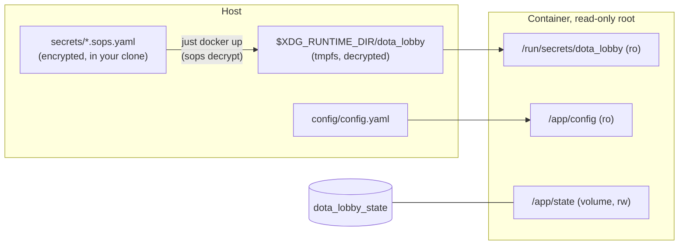

# Docker Compose

Docker Compose on a single Linux machine is the recommended way to run Dota Lobby. The
[Quick start](../getting-started/quick-start.md) walks through the first run; this page explains
the setup in more detail: the compose file, how credentials reach the container, the state
volume, health checks, upgrades, logs and exposing the API.

!!! danger "Run one instance per set of Steam accounts"

    Never run two copies of the service with the same bot accounts, and never log in to a bot
    account in the Steam client (or run `just probe` for it) while the service is running. Each
    login kicks the other off. The bot then logs `bot state changed` with
    `eresult=LoggedInElsewhere` or `LogonSessionReplaced` and cools down for 10 minutes.
    `compose.yaml` sets a fixed `container_name`, and the service holds a lock on its state
    volume, so a second copy cannot start on the same machine by accident. Nothing stops a
    second copy on another machine.

## How the pieces fit



- The **image** holds only the binary. It contains no config, no credentials and no sops or
  age keys.
- **`config/config.yaml`** holds settings and the bot list, nothing secret. It is mounted
  read-only.
- **Credentials** are decrypted on the host, at start, into a tmpfs directory, and mounted
  read-only. See [Credentials](#credentials).
- **State** (the token store and the `LOCK` file) lives in the named volume
  `dota_lobby_state`, the only writable path. See [The state volume](#the-state-volume).

## The compose file

This is `compose.yaml` from the repository, unchanged:

```yaml
# Single-machine deployment. See https://kettleofketchup.github.io/dota_lobby/deployment/docker-compose/
# Start and stop it with `just docker up` and `just docker down`: they decrypt
# the sops bot credentials into a tmpfs directory on the host and remove them
# again. DOTA_LOBBY_TAG and DOTA_LOBBY_SECRETS_HOST_DIR are Compose variables,
# not app settings.
name: dota_lobby

services:
  dota_lobby:
    image: ghcr.io/kettleofketchup/dota_lobby:${DOTA_LOBBY_TAG:-latest}
    container_name: dota_lobby # also blocks accidental --scale
    command: ["serve"]
    restart: unless-stopped
    ports:
      - "127.0.0.1:8080:8080"
    environment:
      # One decrypted credentials file per bot, written by `just docker up`.
      DOTA_LOBBY_CREDENTIALS_DIR: /run/secrets/dota_lobby/creds
    volumes:
      - ./config:/app/config:ro
      # Decrypted secrets on a host tmpfs: creds/<bot>.yaml and an optional
      # secrets.yaml. Read-only; the image holds no sops keys.
      - ${DOTA_LOBBY_SECRETS_HOST_DIR:-${XDG_RUNTIME_DIR:?set XDG_RUNTIME_DIR or DOTA_LOBBY_SECRETS_HOST_DIR}/dota_lobby}:/run/secrets/dota_lobby:ro
      # Token store and LOCK file. Renewed tokens are kept here, so keep the
      # volume across upgrades.
      - state:/app/state
    read_only: true
    cap_drop:
      - ALL
    security_opt:
      - "no-new-privileges:true"
    # Shutdown takes up to 5s for HTTP plus 15s for the bots to disconnect.
    stop_grace_period: 30s
    logging:
      driver: json-file
      options:
        max-size: "10m"
        max-file: "3"

volumes:
  state:
```

| Line | What it does |
|---|---|
| `name: dota_lobby` | A fixed project name, so the volume is always `dota_lobby_state`, whatever your clone's directory is called |
| `image: ...:${DOTA_LOBBY_TAG:-latest}` | The published image. The tag comes from the `DOTA_LOBBY_TAG` Compose variable and falls back to `latest`. See [Choosing the image tag](#choosing-the-image-tag) |
| `container_name: dota_lobby` | A fixed name, so `docker compose up --scale` cannot start a second copy |
| `command: ["serve"]` | Runs the service. It is also the image's default |
| `restart: unless-stopped` | Restarts the container if the process exits, until you stop it yourself |
| `ports: "127.0.0.1:8080:8080"` | Publishes the API on localhost only. See [Changing the port](#changing-the-port) and [Exposing it beyond localhost](#exposing-it-beyond-localhost) |
| `DOTA_LOBBY_CREDENTIALS_DIR` | Points `credentials_dir` at the decrypted bot files |
| `./config:/app/config:ro` | Your `config/` directory, read-only |
| `...:/run/secrets/dota_lobby:ro` | The decrypted secrets directory on the host, read-only. `DOTA_LOBBY_SECRETS_HOST_DIR` overrides the default `$XDG_RUNTIME_DIR/dota_lobby` |
| `state:/app/state` | The named volume with the token store and `LOCK` file |
| `read_only: true` | The root filesystem is read-only; only `/app/state` is writable |
| `cap_drop: ALL`, `no-new-privileges` | No Linux capabilities, no privilege gain |
| `stop_grace_period: 30s` | Time between SIGTERM and SIGKILL. The service needs up to 20 seconds: 5 for in-flight HTTP requests, then 15 for every bot to leave the game coordinator and disconnect |
| `logging:` | `json-file`, rotated at 10 MB, keeping 3 files |

The image runs as UID/GID `65532`, sets `DOTA_LOBBY_STATE_DIR=/app/state` and has a
[healthcheck](#health-checks).

## Credentials

### Recommended: `just docker up`

Keep each bot's credentials in `secrets/bots/<bot>.sops.yaml`, set up as described in
[Bot accounts](../configuration/bot-accounts.md). Then start and stop the stack with the just
recipes instead of plain `docker compose`:

```bash
just docker up      # decrypt, then docker compose up -d
just docker down    # docker compose down, then delete the decrypted files
```

`just docker up`:

1. checks that the parent directory (`$XDG_RUNTIME_DIR`, normally `/run/user/<uid>`) is yours,
   mode `0700`, and on tmpfs (it warns if it is not tmpfs);
2. recreates `$XDG_RUNTIME_DIR/dota_lobby/creds/` and runs `sops decrypt` for every
   `secrets/bots/*.sops.yaml` into `creds/<bot>.yaml`;
3. if `secrets/service.sops.yaml` exists, decrypts it to `$XDG_RUNTIME_DIR/dota_lobby/secrets.yaml`,
   which the service reads as its secrets file (use it for `secrets.api_key`);
4. runs `docker compose up -d`.

The decrypted files are mode `0644` so that the container user can read them however your
runtime maps UID 65532 (rootful Docker, rootless Docker, rootless Podman). Other local users
cannot reach them, because `$XDG_RUNTIME_DIR` itself is `0700` and owned by you. Root on the
host can read them, as it can read anything.

The files stay on the tmpfs while the stack runs, so `restart: unless-stopped` can restart the
container. They disappear on `just docker down` and on reboot.

!!! warning "After a reboot, run `just docker up` again"

    The tmpfs is empty after a reboot, so the container cannot start until the files are back:
    Docker fails the bind mount, or the service exits with `read credentials_dir: ...`. Run
    `just docker up` again after every reboot.

To keep the API key in sops too, create the service secrets file once:

```bash
sops edit secrets/service.sops.yaml
```

```yaml
secrets:
  api_key: "<long random value, for example from: openssl rand -hex 32>"
```

| Recipe | What it does |
|---|---|
| `just docker up` | Decrypt, then `docker compose up -d` |
| `just docker down` | `docker compose down`, then `just docker wipe`. The state volume is kept |
| `just docker restart` | Decrypt again, then restart the container so it re-reads them |
| `just docker decrypt` | Only decrypt |
| `just docker wipe` | Only delete the decrypted files |
| `just docker logs` | `docker compose logs -f` |
| `just docker ps` | `docker compose ps`, including the health status |
| `just docker auth <bot>` | Run `dota_lobby auth --bot <bot> --force` in the running container, see [Re-authenticating a bot](#re-authenticating-a-bot) |
| `just docker build [tag]` | Build the image locally as `ghcr.io/kettleofketchup/dota_lobby:local` |

The recipes call `docker`; set `DOCKER=podman` to use Podman directly. `DOTA_LOBBY_TAG` must
be set for them just as for `docker compose`.

### Alternative: Compose secrets and `*_FILE`

If you do not use sops, any file can become a secret. Put one value per file in a directory
only you can read, and add a `compose.override.yaml` next to `compose.yaml`:

```yaml
services:
  dota_lobby:
    environment:
      DOTA_LOBBY_SECRETS_API_KEY_FILE: /run/secrets/api_key
      DOTA_LOBBY_SECRETS_BOTS_LEAGUE_BOT_1_PASSWORD_FILE: /run/secrets/league_bot_1_password
      DOTA_LOBBY_SECRETS_BOTS_LEAGUE_BOT_1_SHARED_SECRET_FILE: /run/secrets/league_bot_1_shared_secret
    secrets:
      - api_key
      - league_bot_1_password
      - league_bot_1_shared_secret

secrets:
  api_key:
    file: ./private/api_key
  league_bot_1_password:
    file: ./private/league_bot_1_password
  league_bot_1_shared_secret:
    file: ./private/league_bot_1_shared_secret
```

Without Swarm, Compose bind-mounts these files as they are, so the container user must be
able to read them: apply the [file permission](#file-permissions) recipe for your runtime to
them. The `/run/secrets/dota_lobby` mount from `compose.yaml` is still there; point
`DOTA_LOBBY_SECRETS_HOST_DIR` at an empty directory (with an empty `creds/` inside) if you do
not use it.

Do not pass passwords as plain `environment:` values: they show up in `docker inspect`.

## The state volume

`/app/state` holds:

| Path | Content |
|---|---|
| `LOCK` | `flock` lock, held while `serve` runs. A second process on the same volume refuses to start |
| `bots/<username>/token.json` | The bot's refresh token, mode `0600`, written atomically |

The image ships `/app/state` empty and owned by UID 65532, and Docker and Podman copy that
ownership into a new named volume, so no `chown` is needed.

**Seeding:** on first start the token store is empty. A bot whose credentials file has a
`STEAM_REFRESH_TOKEN` (put there by `just probe auth`) copies it into the store. Otherwise it
logs in with password and Steam Guard code and stores the new token. From then on the token in
the volume is used and renewed in place. A newer `STEAM_REFRESH_TOKEN` in the sops file
replaces a stored token that expires earlier.

**Keep the volume.** `just docker down` and `docker compose down` keep it. `docker compose down
-v` or `docker volume rm dota_lobby_state` delete every stored token; bots with a
`shared_secret` then mint new ones, the others need [re-authenticating](#re-authenticating-a-bot).

Back it up with any volume backup tool, for example:

```bash
docker run --rm -v dota_lobby_state:/s:ro -v "$PWD:/b" busybox tar czf /b/state.tgz -C /s .
```

The archive holds live refresh tokens; protect it like the sops files.

## Re-authenticating a bot

A bot without a `shared_secret`, or one whose password changed, ends up in
`needs_attention`. Fix the credentials, then:

```bash
just docker restart                  # only if you changed a sops file
just docker auth <bot>               # password + code, stores the token in the volume
curl -X POST -H "X-API-Key: $KEY" http://127.0.0.1:8080/v1/bots/<bot>/retry
```

`just docker auth` runs `dota_lobby auth --bot <bot> --force` inside the running container
(`--force` because `serve` holds the lock). Without a `shared_secret` it asks for a Steam
Guard code on the terminal; pass `--code 12345` after the bot name instead if you prefer. See
[Recovering a bot](../operations/troubleshooting.md#recovering-a-bot-in-needs_attention).

## Choosing the image tag

`DOTA_LOBBY_TAG` is a **Compose variable, not an app setting**. Compose uses it to pick the
image; the service never sees it.

Pin it to a full version, such as `1.2.3`. A full version tag never moves, so the container
only changes when you change the variable. The image tags have **no leading `v`**: the git tag
`v1.2.3` is the image tag `1.2.3`, and `DOTA_LOBBY_TAG=v1.2.3` fails with `manifest unknown`.

There are also moving tags: `latest` (the newest release) and `1.2` (the newest `1.2.x`
patch). They change under you on the next `docker compose pull`, which is why the docs pin a
full version. The full list is under [Image tags](docker.md#image-tags).

!!! warning "Set the Compose variables in every shell that runs `docker compose`"

    `DOTA_LOBBY_TAG` must be set in **every shell that runs `docker compose` or `just docker`**:
    `pull`, `up`, `restart`, `logs`, `stop`, all of them. Either put it in front of each
    command:

    ```bash
    DOTA_LOBBY_TAG=1.2.3 just docker up
    ```

    or persist it in your shell profile:

    ```bash
    echo 'export DOTA_LOBBY_TAG=1.2.3' >> ~/.bashrc
    ```

    This project does not use a `.env` file. An unset `DOTA_LOBBY_TAG` silently means
    `latest`, and `up -d` recreates the container on that image.

### Using a local build

Before the first release, or to run your own changes, build the image yourself and point
`DOTA_LOBBY_TAG` at it:

```bash
just docker build
DOTA_LOBBY_TAG=local just docker up
```

See [Build the image locally](docker.md#build-the-image-locally) for build options.

## File permissions

With the recommended setup there is little to do:

- `config/` must be traversable by the container user: `chmod 755 config`.
- `config/config.yaml` holds no secrets, so `chmod 644 config/config.yaml` is fine.
- The decrypted credentials are handled by `just docker up`.

If `config/` is mode `700` (or SELinux blocks the mount), the service cannot see
`config.yaml`: it starts with defaults and the bots from `credentials_dir`, and logs
`no bots configured` if there are none. A readable directory with an unreadable `config.yaml`
is fatal instead:

```text
dota_lobby serve: load config: read config /app/config/config.yaml: open /app/config/config.yaml: permission denied
```

The recipes below are only needed for **secret files you keep yourself**: a
`config/secrets.yaml` from the old setup, or Compose secrets files. The container runs as
UID/GID `65532` and must be able to read them; how depends on how your runtime maps that UID.

!!! warning "Pick exactly one tab. The recipes must not be combined"

    The two easy mistakes: a host `chown 65532` (the rootful recipe) with a **rootless**
    runtime, where host UID 65532 is not the container's UID 65532; and a `user:` override
    on **rootless Docker**, which runs the container as a UID in your subuid range. A `user:`
    override also changes who owns new files in the state volume.

### Which runtime do I have?

The `docker` command is not always Docker: on many distributions it is Podman behind a
compatibility wrapper.

| Check | Result | Tab |
|---|---|---|
| `docker version` | the `Client:` line says `Podman Engine`, or you use `podman` | **Rootless Podman** if `podman info --format '{{.Host.Security.Rootless}}'` prints `true`, otherwise **Rootful Docker** |
| `docker info --format '{{.SecurityOptions}}'` | contains `name=rootless` | **Rootless Docker** |
| `docker context ls` | the active context is `desktop-linux`, or you are on macOS or Windows | **Docker Desktop** |
| none of the above | Docker Engine run as root | **Rootful Docker** |

Work down the table and stop at the first match.

=== "Rootful Docker"

    ```bash
    sudo chown 65532:65532 config/secrets.yaml && sudo chmod 600 config/secrets.yaml
    ```

    Edit later with `sudo -e config/secrets.yaml`, then `just docker restart`.

=== "Rootless Podman"

    This is the setup the project is tested on.

    ```bash
    chmod 600 config/secrets.yaml
    podman unshare chown 65532:65532 config/secrets.yaml
    ```

    `podman unshare` runs `chown` inside your user namespace, so the file ends up owned by the
    host UID that the container's 65532 maps to. Edit later with
    `podman unshare vi config/secrets.yaml`, then `just docker restart`.

=== "Rootless Docker (untested)"

    Under rootless Docker only container UID 0 maps to your host user. Chown through a
    throwaway container:

    ```bash
    chmod 600 config/secrets.yaml
    docker run --rm -v "$PWD/config:/c" busybox chown 65532:65532 /c/secrets.yaml
    ```

    To edit, hand it back with the same command and `chown 0:0`, edit, then chown it to
    `65532:65532` again and run `just docker restart`.

=== "Docker Desktop (unverified)"

    Bind mounts go through Docker Desktop's file sharing, so no `chown` is needed; keep the
    file owned by you at `chmod 600`. Do not run `sudo chown 65532`: it only locks you out.
    On Windows, use WSL2 and follow the Linux tab for the runtime inside it.

Never fall back to `chmod 644` on a file that holds a password.

**SELinux hosts** (Fedora, RHEL and similar) also need the `Z` option on the bind mounts, or
SELinux blocks the container from reading them. In `compose.override.yaml`:

```yaml
services:
  dota_lobby:
    volumes:
      - ./config:/app/config:ro,Z
```

Compose merges volumes by their container path, so this replaces the mount from
`compose.yaml` instead of adding a second one.

## Health checks

The image has a Docker `HEALTHCHECK` that runs `dota_lobby healthcheck` every 30 seconds. The
subcommand needs no shell or curl: it does `GET /livez` on the loopback address and the port
from `server.port` (`config.yaml` or `DOTA_LOBBY_SERVER_PORT`, default 8080) and exits `0` only
on `200`. It reads only the `server` section, never the secrets. `just docker ps` shows the
result.

| Endpoint | Meaning | Use it for |
|---|---|---|
| `/livez` | The process serves and no bot's run loop has been stuck for 30 seconds. **Does not depend on Steam** | The container healthcheck. A Steam outage never marks the container unhealthy, so it never turns into a restart loop and a login storm |
| `/readyz` | At least `readiness.min_ready_bots` bots are `gc_ready`, and the service is not shutting down | A load balancer or monitor deciding whether to send work |
| `/health` | Always `200`, with counts per bot state | Dashboards and old monitors |

Docker marks the container `unhealthy` but does not restart it on its own; `restart:` only
reacts to the process exiting.

!!! note "Podman and the healthcheck"

    Podman keeps `HEALTHCHECK` only in images in Docker format. The published images are built
    by Docker and keep it. When you build locally with Podman, use `just docker build`, which
    adds `--format docker`; a plain `podman build` drops the healthcheck with a warning.

From outside the container:

```bash
curl -fsS http://127.0.0.1:8080/livez
curl -s http://127.0.0.1:8080/readyz
```

## Upgrading

Check out the new release so `compose.yaml` and the example files match the image, then pull
and recreate:

```bash
git fetch --depth 1 origin tag v1.2.4
git checkout v1.2.4
export DOTA_LOBBY_TAG=1.2.4   # and update your shell profile if you persisted it there
docker compose pull
just docker up
```

- `docker compose pull` and `up` with an **unchanged** `DOTA_LOBBY_TAG` change nothing: a
  pinned full-version tag never moves.
- `config/`, `secrets/` and `compose.override.yaml` are ignored by git, so the checkout leaves
  them alone. The `dota_lobby_state` volume is kept, and with it the stored tokens.
- Compare `config.yaml.example` and `secrets.yaml.example` with your files. Unknown keys are
  an error now, so a stale key stops startup with a clear message.

### Upgrading from the password-only version

Releases before the headless bot work logged in with username and password only, kept no
state and read only `config/config.yaml` and `config/secrets.yaml`. Those files still load:

- the old `secrets.bots` list is accepted with the warning
  `secrets.bots as a list is deprecated; key it by bot name`, and each entry becomes a bot;
- `server.api_key` is moved to `secrets.api_key` with a deprecation warning;
- `sentry_hash` is ignored with a warning.

But the new `compose.yaml` mounts the decrypted secrets directory, so start it with
`just docker up` (it works with no sops files and warns about it), and the old accounts have
Steam Guard turned off. Plan to move each bot to the headless setup: link an authenticator
and create its sops file as described in [Bot accounts](../configuration/bot-accounts.md),
then remove it from `config/secrets.yaml`.

## Logs

```bash
just docker logs
docker compose logs --tail 100
```

The service logs JSON lines to stdout (`log.format: text` in `config.yaml` for plain text).
Each bot's lines carry `"bot":"<name>"`; state changes are `bot state changed` with `from`,
`to`, `reason` and `eresult`. Compose keeps the logs with the `json-file` driver, rotated at
10 MB and keeping 3 files. Podman accepts `json-file` as an alias for its `k8s-file` driver.

## Changing the port

Leave `server.port` at `8080` and change only the **host** side of the mapping, in
`compose.override.yaml`:

```yaml
services:
  dota_lobby:
    ports: !override
      - "127.0.0.1:9000:8080"
```

`!override` replaces the port list from `compose.yaml` instead of adding to it (Docker
Compose 2.24.4 or newer).

If you change `server.port` anyway, the container side of the mapping must match. The
healthcheck reads the same `server.port` as the service, from `config.yaml` or
`DOTA_LOBBY_SERVER_PORT`, so it follows the change. Setting only `DOTA_LOBBY_SERVER_PORT` in
`environment:` covers both.

## Exposing it beyond localhost

By default the API is reachable only from the machine itself. The service speaks plain HTTP
with no TLS. Before anything else can reach it:

1. set `secrets.api_key` (in `secrets/service.sops.yaml`, see [Credentials](#credentials)) and
   check that the startup log no longer says `API key authentication disabled`;
2. put a reverse proxy with TLS in front of it.

If the proxy runs on the same machine, keep the localhost binding. A minimal
[Caddy](https://caddyserver.com/) `Caddyfile`:

```text
league.example.com {
    reverse_proxy 127.0.0.1:8080
}
```

Only change the mapping to `8080:8080` (all interfaces) if the proxy runs on another machine,
and only with an API key set. Without it, everything under `/v1` is public.

## Hardening already in place

- a non-root user, UID/GID `65532`, in a distroless image with no shell;
- no sops or age key in the image or the container; secrets mounted read-only from a tmpfs;
- a read-only root filesystem, with config mounted read-only and one writable volume;
- all Linux capabilities dropped (`cap_drop: ALL`) and `no-new-privileges`;
- the API published on localhost only.

The [`docker run`](docker.md) page has the same settings as `docker run` flags.
