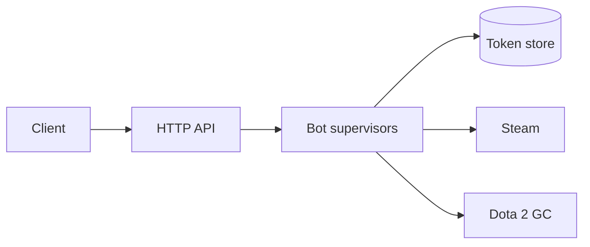

# Dota Lobby

Dota Lobby is a Go service for league lobby hosting. It keeps one or more Steam bot accounts
logged in to Steam and the Dota 2 game coordinator, with no one at a keyboard, and exposes an
HTTP API that reports their state and hosts league lobbies. You run it
yourself, on your own machine, with your own bot accounts.

!!! warning "Project status"

    - **Bots log in headless.** Each bot has a Steam Guard authenticator linked once with
      steamguard-cli; the service computes its Steam Guard codes, stores refresh tokens and
      renews them. This is built and tested against fakes, **not yet against live Steam**.
    - **Lobby hosting is tested against fakes only.** Which way of moving the host bot off its
      team lets a launch reach a game has not been seen live yet.

    Use dedicated Steam accounts and start with a single bot. See
    [Known limitations](known-limitations.md) for the full list.

## Quick links

- [Quick start](getting-started/quick-start.md): from nothing to a running container
- [Bot accounts](configuration/bot-accounts.md): the one-time setup for each bot
- [Configuration reference](configuration/index.md): every key, file and environment variable
- [API](api/index.md): endpoints, authentication and examples
- [Troubleshooting](operations/troubleshooting.md): log lines and what they mean
- [Known limitations](known-limitations.md): what does not work yet
