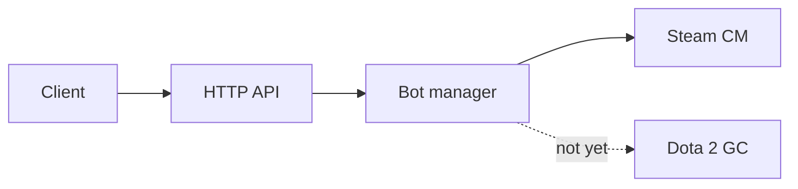

# Dota Lobby

Dota Lobby is a small Go service for league lobby hosting. It logs one or more Steam bot
accounts in and exposes an HTTP API that reports their status, with endpoints reserved for
creating and inspecting Dota 2 lobbies. You run it yourself, on your own machine, with your
own bot accounts.

!!! warning "Project status"

    - **Steam login is reported to fail.** Login with the pinned go-steam library is reported
      to fail against current Steam. This project has not verified that report either way.
    - **Lobby creation is not implemented yet.** `POST /lobby/create` is a placeholder and
      does not create a lobby.

    Use throwaway Steam accounts and start with a single bot. See
    [Known limitations](known-limitations.md) for the full list.

## Quick links

- [Quick start](getting-started/quick-start.md): from nothing to a running container
- [Configuration reference](configuration/index.md): every key in `config.yaml` and `secrets.yaml`
- [API](api/index.md): endpoints, authentication and examples
- [Troubleshooting](operations/troubleshooting.md): log lines and what they mean
- [Known limitations](known-limitations.md): what does not work yet
