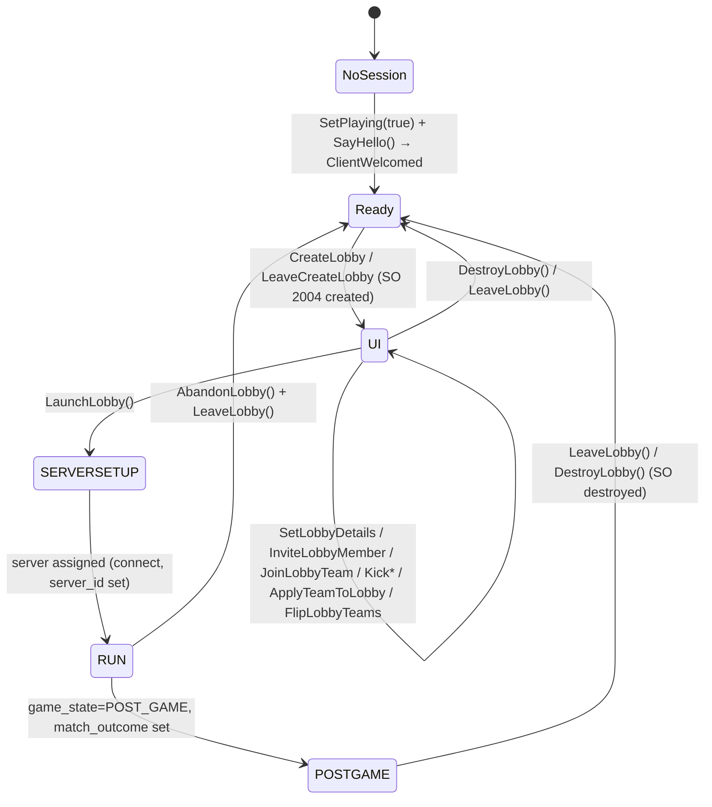

# 01 — Dota 2 Practice-Lobby Protocol (go-dota2)

> Research track: **Lobby lifecycle protobufs**
> Pinned versions: `github.com/paralin/go-dota2 v0.0.0-20250623204622-532cb1851217`,
> `github.com/paralin/go-steam v0.0.0-20250502043548-f167ff28a93a` (from `go.mod`).
>
> Paths written `go-dota2@532cb1851217/...` are relative to the root of the pinned go-dota2 module.
> Every message, field, enum value and wrapper named here was grepped from that tree. Anything not
> seen in source is marked **INFERRED** or **UNCERTAIN**. Results of the 2026-11-08 live run are in
> [09 - Live probe](09-live-probe.md) and are cited inline as VERIFIED live.

All Go snippets in this document compile and pass `go vet` against the pinned versions. The full
file is reproduced in [Appendix A](#appendix-a-compile-checked-helper-file).

---

## Contents

1. [TL;DR for this service](#1-tldr-for-this-service)
2. [Transport model: how go-dota2 talks to the GC](#2-transport-model-how-go-dota2-talks-to-the-gc)
3. [Message ID map (lobby, invite, chat)](#3-message-id-map)
4. [CMsgPracticeLobbySetDetails — every field](#4-cmsgpracticelobbysetdetails--every-field)
5. [CMsgPracticeLobbyCreate and the create response](#5-cmsgpracticelobbycreate-and-the-create-response)
6. [CSODOTALobby — the lobby shared object](#6-csodotalobby--the-lobby-shared-object)
7. [Enums referenced by lobbies](#7-enums)
8. [Full lifecycle flow](#8-full-lifecycle-flow)
9. [go-dota2 lobby wrappers (complete inventory)](#9-go-dota2-lobby-wrappers)
10. [Finding and listing lobbies](#10-finding-and-listing-lobbies)
11. [Lobby chat](#11-lobby-chat)
12. [Reading the lobby via the SOCache](#12-reading-the-lobby-via-the-socache)
13. [Pitfalls and gaps in go-dota2](#13-pitfalls-and-gaps)
14. [Verified vs Uncertain](#14-verified-vs-uncertain)
15. [Sources](#15-sources)
16. [Appendix A — compile-checked helper file](#appendix-a-compile-checked-helper-file)

---

## 1. TL;DR for this service

- A bot can only do anything **after it has a GC session**: `SetPlaying(true)`, then `SayHello()`
  repeatedly until `ClientWelcomed` arrives or `GCConnectionStatusChanged` reports `HAVE_SESSION`.
- **Creating a lobby is fire-and-forget.** `CreateLobby` writes `k_EMsgGCPracticeLobbyCreate (7038)`
  and returns nothing. Success shows up as a `CSODOTALobby` object (SO type `2004`) appearing in the
  SOCache. The GC also replies `k_EMsgGCPracticeLobbyResponse (7055)`, which go-dota2 does **not**
  decode. It only surfaces as an `*events.UnhandledGCPacket`. Its body is `CMsgGenericResult`, and a
  successful create returns `eresult` 1 with our source job ID echoed (VERIFIED live 2026-11-08, see
  [09](09-live-probe.md)). 7055 is not specific to create: node-dota2 routes the replies to kick,
  kick-from-team, team-slot, flip, shuffle, config, launch and leave through it as well.
- `LeaveCreateLobby(ctx, details, destroyOld)` is the practical primitive. It leaves (and
  optionally destroys) any current lobby, creates the new one, and returns once the new lobby
  object appears. **If creation fails it blocks until `ctx` expires**, so always pass a deadline.
- **League lobbies are just `leagueid` (field 16) on `CMsgPracticeLobbySetDetails`.** The bot
  account must be authorised for that league. Optionally set `league_node_id` (49), with nodes
  discovered via `RequestLeagueAvailableLobbyNodes(leagueID)`.
- One Steam account is in **at most one lobby at a time**. The SOCache holds one `CSODOTALobby`,
  and `LeaveCreateLobby` leaves the old one. So *N concurrent lobbies need N bot accounts*.
- Lobby state lives in `CSODOTALobby.state` (`UI → SERVERSETUP → RUN → POSTGAME`, plus
  `READYUP/NOTREADY/SERVERASSIGN`) and `game_state` (`DOTA_GameState`). The result is in
  `match_outcome` and `match_id`.
- Lobby chat is channel `"Lobby_<decimal lobby_id>"` with `DOTAChannelType_Lobby (3)` (VERIFIED live,
  see §11). go-dota2's `JoinChatChannel` never returns for it because the GC does not echo the job ID,
  so match the 7010 reply by channel name. `SendChannelMessage` takes the numeric `channel_id` from
  the join response, not the name.
- Before launching, move the host out of a player slot. The maintainer suggests the
  spectator/caster slot, while other users report that unassigned/player-pool works. Otherwise
  the game server waits for the bot to load (go-dota2 issues #69 and #77). See §8.6. **UNCERTAIN**:
  this is GC behaviour that go-dota2 does not encode. Only a live test can settle it.

---

## 2. Transport model: how go-dota2 talks to the GC

| Concern | Mechanism | Ref |
|---|---|---|
| Packet routing | `dota2.New(client, le)` calls `client.GC.RegisterPacketHandler(c)` itself | `go-dota2@532cb1851217/client.go:52-66` |
| Outgoing | `d.write(msgType, proto)` → `client.GC.Write(NewGCMsgProtobuf(570, ...))` | `go-dota2@532cb1851217/client.go:116-118` |
| Hand-coded handlers | welcome, conn status, SO cache (subscribed/update-multiple/unsubscribed/destroy), ping, chat message, join-chat response, invitation created | `go-dota2@532cb1851217/client.go:83-113` |
| Generated event emitters | `registerGeneratedHandlers()` (e.g. `LobbyMVPAwarded`, `LobbyUpdateBroadcastChannelInfo`) | `go-dota2@532cb1851217/client_generated.go:7577` (called from `go-dota2@532cb1851217/client.go:112`); event structs in `go-dota2@532cb1851217/events/generated.go` |
| Request/response | `MakeRequest(ctx, reqID, req, respID, resp, matchers...)` registers a pending handler **keyed only by response msg type**, not by job ID | `go-dota2@532cb1851217/client_request.go:17-90` |
| Unhandled | anything not handled → `client.Emit(&events.UnhandledGCPacket{Packet})` | `go-dota2@532cb1851217/client.go:156-177` |
| Events | all go-dota2 events are delivered on the **go-steam** event channel `steamClient.Events()` | `go-dota2@532cb1851217/client.go:121-123` |

Consequences:

- A wrapper without a `ctx` parameter (e.g. `CreateLobby`, `LaunchLobby`, `InviteLobbyMember`) is
  **fire-and-forget**. Observe its effect through the SOCache.
- `MakeRequest` matches by response type, not by job ID. `handleResponsePacket`
  (`go-dota2@532cb1851217/client_request.go:93-110`) hands each incoming packet to **every** pending handler for that
  type and removes each one that accepts it. So when two `ListLobbies` calls are in flight on the
  *same* bot, the first response completes both with the same body. The second response then finds
  no handler and is emitted as `UnhandledGCPacket`. `client_generated.go` never passes a
  `matchesRequest` filter. This is read from the code and has not been reproduced live. Serialise
  per-bot requests of the same type.
- `MakeRequest` fails fast with `dota2.ErrNotReady` when there is no GC session
  (`validateConnectionContext`, `go-dota2@532cb1851217/client_session.go:41`).

### 2.1 Session bootstrap (required before any lobby call)

The maintainer's advice in issue #28 is to call `SetPlaying(true)`, wait about 0.5 s, call
`SayHello()`, resend hello every few seconds, and act only once the client is ready.

```go
func WaitForGCSession(ctx context.Context, sc *steam.Client, d *dota2.Dota2) error {
	d.SetPlaying(true)
	time.Sleep(500 * time.Millisecond)
	d.SayHello()

	hello := time.NewTicker(5 * time.Second)
	defer hello.Stop()
	for {
		select {
		case <-ctx.Done():
			return ctx.Err()
		case <-hello.C:
			d.SayHello()
		case ev := <-sc.Events():
			switch e := ev.(type) {
			case *devents.ClientWelcomed:
				return nil
			case *devents.GCConnectionStatusChanged:
				if e.NewState == protocol.GCConnectionStatus_GCConnectionStatus_HAVE_SESSION {
					return nil
				}
			case devents.ClientStateChanged: // NOTE: emitted by value, not pointer
				if e.NewState.IsReady() {
					return nil
				}
			}
		}
	}
}
```

> In the real service this logic belongs inside the bot's single event loop
> (`Manager.connectBot`), not in a second reader of `sc.Events()`. Two readers would steal events
> from each other.

`ClientStateChanged` is emitted as a value (`d.emit(devents.ClientStateChanged{...})`,
`go-dota2@532cb1851217/client.go:136-139`), whereas `ClientWelcomed`, `GCConnectionStatusChanged` and
`UnhandledGCPacket` are emitted as pointers. A type switch must match each one accordingly.

---

## 3. Message ID map

All values were grepped from `go-dota2@532cb1851217/protocol/dota_gcmessages_msgid.proto` and
`go-dota2@532cb1851217/protocol/base_gcmessages.proto`.

| ID | Enum constant (Go: `protocol.EDOTAGCMsg_…` / `protocol.EGCBaseMsg_…`) | Direction | Body type | go-dota2 wrapper |
|---|---|---|---|---|
| 4502 | `k_EMsgGCInvitationCreated` | GC→C | `CMsgInvitationCreated` | event `InvitationCreated` |
| 4512 | `k_EMsgGCInviteToLobby` | C→GC | `CMsgInviteToLobby` | `InviteLobbyMember` |
| 4513 | `k_EMsgGCLobbyInviteResponse` | C→GC | `CMsgLobbyInviteResponse` | `RespondLobbyInvite` |
| 7009/7010 | `k_EMsgGCJoinChatChannel` / `…Response` | C↔GC | `CMsgDOTAJoinChatChannel` / `…Response` | `JoinChatChannel` (+ event `JoinedChatChannel`) |
| 7013/7014 | `k_EMsgGCOtherJoinedChannel` / `k_EMsgGCOtherLeftChannel` | GC→C | `CMsgDOTAOtherJoinedChatChannel` / `…LeftChatChannel` | (not hand-wired; arrive as generated events or `UnhandledGCPacket`) |
| 7035 | `k_EMsgGCAbandonCurrentGame` | C→GC | `CMsgAbandonCurrentGame` | `AbandonLobby` |
| 7038 | `k_EMsgGCPracticeLobbyCreate` | C→GC | `CMsgPracticeLobbyCreate` | `CreateLobby`, `LeaveCreateLobby` |
| 7040 | `k_EMsgGCPracticeLobbyLeave` | C→GC | `CMsgPracticeLobbyLeave` | `LeaveLobby` |
| 7041 | `k_EMsgGCPracticeLobbyLaunch` | C→GC | `CMsgPracticeLobbyLaunch` | `LaunchLobby` |
| 7042/7043 | `k_EMsgGCPracticeLobbyList` / `…Response` | C↔GC | `CMsgPracticeLobbyList` / `…Response` | `ListLobbies` |
| 7044/7113 | `k_EMsgGCPracticeLobbyJoin` / `k_EMsgGCPracticeLobbyJoinResponse` | C↔GC | `CMsgPracticeLobbyJoin` / `CMsgPracticeLobbyJoinResponse` | `JoinLobby` |
| 7046 | `k_EMsgGCPracticeLobbySetDetails` | C→GC | `CMsgPracticeLobbySetDetails` | `SetLobbyDetails` |
| 7047 | `k_EMsgGCPracticeLobbySetTeamSlot` | C→GC | `CMsgPracticeLobbySetTeamSlot` | `JoinLobbyTeam`, `SetLobbySlotBotDifficulty` |
| **7055** | `k_EMsgGCPracticeLobbyResponse` | GC→C | **not declared in proto**. node-dota2 decodes it as `CMsgGenericResult`. Shared reply path for create, kick, kick-from-team, team-slot, flip, shuffle, config, launch and leave | **none** → `UnhandledGCPacket` |
| 7070 | `k_EMsgGCReadyUp` | C→GC | `CMsgReadyUp` | `SendReadyUp` (matchmaking, not practice lobbies) |
| 7081 | `k_EMsgGCPracticeLobbyKick` | C→GC | `CMsgPracticeLobbyKick` | `KickLobbyMember` |
| 7111/7112 | `k_EMsgGCFriendPracticeLobbyListRequest` / `…Response` | C↔GC | `CMsgFriendPracticeLobbyList{Request,Response}` | `ListFriendLobby` |
| 7142 | `k_EMsgGCApplyTeamToPracticeLobby` | C→GC | `CMsgApplyTeamToPracticeLobby` | `ApplyTeamToLobby` |
| 7149 | `k_EMsgGCPracticeLobbyJoinBroadcastChannel` | C→GC | `CMsgPracticeLobbyJoinBroadcastChannel` | `JoinLobbyBroadcastChannel` |
| 7188 | `k_EMsgGCBalancedShuffleLobby` | C→GC | `CMsgBalancedShuffleLobby` | `SendBalancedShuffleLobby` |
| 7199 | `k_EMsgGCBotGameCreate` | C→GC | `CMsgBotGameCreate` | `CreateBotGame` |
| 7272 | `k_EMsgGCLeaveChatChannel` | C→GC | `CMsgDOTALeaveChatChannel` | `LeaveChatChannel` |
| 7273 | `k_EMsgGCChatMessage` | C↔GC | `CMsgDOTAChatMessage` | `SendChannelMessage`, `SendChatMessage`, event `ChatMessage` |
| 7320 | `k_EMsgGCFlipLobbyTeams` | C→GC | `CMsgFlipLobbyTeams` | `FlipLobbyTeams` |
| 7346 | `k_EMsgGCPracticeLobbySetCoach` | C→GC | `CMsgPracticeLobbySetCoach` | `SetLobbyCoach` |
| 7367 | `k_EMsgGCLobbyUpdateBroadcastChannelInfo` | GC→C | `CMsgGCLobbyUpdateBroadcastChannelInfo` | event |
| 7505 | `k_EMsgGCPracticeLobbyToggleBroadcastChannelCameramanStatus` | C→GC | (empty) | `ToggleLobbyBroadcastChannelCameramanStatus` |
| 7650/7651 | `k_EMsgDOTALeagueAvailableLobbyNodesRequest` / `k_EMsgDOTALeagueAvailableLobbyNodes` | C↔GC | `CMsgDOTALeagueAvailableLobbyNodes{Request,}` | `RequestLeagueAvailableLobbyNodes` |
| 8008 | `k_EMsgGCClearPracticeLobbyTeam` | C→GC | unknown (go-dota2 sends an empty `CMsgFlipLobbyTeams`) | `ClearTeamFromLobby` |
| 8011/8012 | `k_EMsgGCLobbyList` / `…Response` | — | `CMsgLobbyList` / `…Response` | none (marked `MsgSenderNone` in apigen) |
| 8047 | `k_EMsgGCPracticeLobbyKickFromTeam` | C→GC | `CMsgPracticeLobbyKickFromTeam` | `KickLobbyMemberFromTeam` |
| 8054 | `k_EMsgGCPracticeLobbyCloseBroadcastChannel` | C→GC | `CMsgPracticeLobbyCloseBroadcastChannel` | `CloseLobbyBroadcastChannel` |
| 8246/8247 | `k_EMsgDestroyLobbyRequest` / `…Response` | C↔GC | `CMsgDOTADestroyLobbyRequest/Response` | `DestroyLobby` |

SO cache traffic (`k_ESOMsg_CacheSubscribed`, `k_ESOMsg_UpdateMultiple`, `k_ESOMsg_CacheUnsubscribed`,
`k_ESOMsg_Destroy`) carries the `CSODOTALobby` object itself (§12).

---

## 4. CMsgPracticeLobbySetDetails — every field

Source: `go-dota2@532cb1851217/protocol/dota_gcmessages_client_match_management.proto:121-169`.
Go struct: `protocol.CMsgPracticeLobbySetDetails` in `…/dota_gcmessages_client_match_management.pb.go`.
All fields are proto2 `optional`, so in Go they are pointers. Set them with `proto.String`,
`proto.Uint32`, `proto.Bool`, or `<Enum>.Enum()`.

The same message is used both **embedded in `CMsgPracticeLobbyCreate.lobby_details`** (initial
settings) and **standalone via `SetLobbyDetails`** (modify an existing lobby; host only).

| # | proto field | Go field / type | Proto default | Meaning, valid values | Status |
|---|---|---|---|---|---|
| 1 | `lobby_id` | `LobbyId *uint64` | — | Target lobby for `SetLobbyDetails`. Leave unset on create. | verified field; semantics **INFERRED** |
| 2 | `game_name` | `GameName *string` | — | Lobby name shown in the lobby browser. | verified |
| 3 | `team_details` | `TeamDetails []*CLobbyTeamDetails` | — | Per-side team name, tag, id, logos (index 0 = Radiant, 1 = Dire **INFERRED**). See §4.1. | verified field |
| 4 | `server_region` | `ServerRegion *uint32` | — | Server region ID. **No enum in the proto.** Community table in §7.10. `0` = unspecified/auto. | field verified, values **UNCERTAIN** |
| 5 | `game_mode` | `GameMode *uint32` | — | A `DOTA_GameMode` value cast to uint32 (e.g. `DOTA_GAMEMODE_CM = 2`, `AP = 1`, `ALL_DRAFT = 22`, `TURBO = 23`). | verified |
| 6 | `cm_pick` | `CmPick *DOTA_CM_PICK` | `DOTA_CM_RANDOM` | Captains-mode first pick: `RANDOM(0)`, `GOOD_GUYS(1)`, `BAD_GUYS(2)`. | verified |
| 9 | `bot_difficulty_radiant` | `BotDifficultyRadiant *DOTABotDifficulty` | `BOT_DIFFICULTY_PASSIVE` | Difficulty for bots filling Radiant (with `fill_with_bots`). | verified |
| 10 | `allow_cheats` | `AllowCheats *bool` | — | sv_cheats in lobby. | verified |
| 11 | `fill_with_bots` | `FillWithBots *bool` | — | Fill empty slots with AI bots. | verified |
| 13 | `allow_spectating` | `AllowSpectating *bool` | — (lobby SO default `true`) | Allow DotaTV/spectators. | verified |
| 15 | `pass_key` | `PassKey *string` | — | Lobby password. `CreateLobby` copies it into `CMsgPracticeLobbyCreate.pass_key` too. | verified |
| 16 | `leagueid` | `Leagueid *uint32` | — | **League (tournament ticket) ID.** Requires the creating account to be authorised for the league. Match is then recorded as a league match. | field verified; permission semantics from node-dota2 docs |
| 17 | `penalty_level_radiant` | `PenaltyLevelRadiant *uint32` | — | League penalty level applied to Radiant. Semantics **UNCERTAIN** (likely pick/ban or time penalties used by league admins). | field verified |
| 18 | `penalty_level_dire` | `PenaltyLevelDire *uint32` | — | Same for Dire. | field verified |
| 20 | `series_type` | `SeriesType *uint32` | — | `0` none, `1` best-of-3, `2` best-of-5 (node-dota2 `SeriesType`). No enum in proto. | values **UNCERTAIN** (community) |
| 21 | `radiant_series_wins` | `RadiantSeriesWins *uint32` | — | Prior wins in the series for the Radiant team. | verified field |
| 22 | `dire_series_wins` | `DireSeriesWins *uint32` | — | Prior wins for Dire. | verified field |
| 23 | `allchat` | `Allchat *bool` | `false` | Allow all-chat in game. | verified |
| 24 | `dota_tv_delay` | `DotaTvDelay *LobbyDotaTVDelay` | `LobbyDotaTV_120` | Vendored: `LobbyDotaTV_10(0)`, `_120(1)`, `_300(2)`, `_900(3)`. **Stale:** current Valve numbering since 2026-08-12 (GameTracking `c592bf50`) is `10=0, 60=1, 120=2, 300=3, 900=4` seconds ([gap-04](gap-04-proto-freshness-audit.md)). Send raw integers from the current table. | verified (vendored) / stale |
| 25 | `lan` | `Lan *bool` | — | LAN lobby (requires LAN host). | verified field |
| 26 | `custom_game_mode` | `CustomGameMode *string` | — | Custom-game (Arcade) mode name. | verified field |
| 27 | `custom_map_name` | `CustomMapName *string` | — | Custom-game map. | verified field |
| 28 | `custom_difficulty` | `CustomDifficulty *uint32` | — | Custom-game difficulty. | verified field |
| 29 | `custom_game_id` | `CustomGameId *uint64` | — | Workshop/custom game ID. | verified field |
| 30 | `custom_min_players` | `CustomMinPlayers *uint32` | — | Custom-game min players. | verified field |
| 31 | `custom_max_players` | `CustomMaxPlayers *uint32` | — | Custom-game max players. | verified field |
| 33 | `visibility` | `Visibility *DOTALobbyVisibility` | `DOTALobbyVisibility_Public` | `Public(0)`, `Friends(1)`, `Unlisted(2)`. | verified |
| 34 | `custom_game_crc` | `CustomGameCrc *uint64` (fixed64) | — | Custom-game content CRC. | verified field |
| 37 | `custom_game_timestamp` | `CustomGameTimestamp *uint32` (fixed32) | — | Custom-game content timestamp. | verified field |
| 38 | `previous_match_override` | `PreviousMatchOverride *uint64` | — | Explicit previous match ID for series chaining. If omitted, "the GC will try to find it automatically based on the teams and the players" (node-dota2 docs). | verified field |
| 42 | `pause_setting` | `PauseSetting *LobbyDotaPauseSetting` | `LobbyDotaPauseSetting_Unlimited` | `Unlimited(0)`, `Limited(1)`, `Disabled(2)`. | verified |
| 43 | `bot_difficulty_dire` | `BotDifficultyDire *DOTABotDifficulty` | `BOT_DIFFICULTY_PASSIVE` | Difficulty for Dire bots. | verified |
| 44 | `bot_radiant` | `BotRadiant *uint64` | — | Bot script ID for Radiant (workshop bot script). **INFERRED** | verified field |
| 45 | `bot_dire` | `BotDire *uint64` | — | Bot script ID for Dire. **INFERRED** | verified field |
| 46 | `selection_priority_rules` | `SelectionPriorityRules *DOTASelectionPriorityRules` | `k_DOTASelectionPriorityRules_Manual` | `Manual(0)` or `Automatic(1)` (coin toss / series winner chooses side/pick). | verified |
| 47 | `custom_game_penalties` | `CustomGamePenalties *bool` | — | Apply abandon penalties in custom games. | verified field |
| 48 | `lan_host_ping_location` | `LanHostPingLocation *string` | — | Ping location string for LAN host. | verified field |
| 49 | `league_node_id` | `LeagueNodeId *uint32` | — | Bracket node within the league. Valid IDs come from `RequestLeagueAvailableLobbyNodes(leagueID)` → `CMsgDOTALeagueAvailableLobbyNodes.node_infos[].node_id`. | field verified; linkage **INFERRED** |
| 50 | `requested_hero_ids` | `RequestedHeroIds []int32` | — | Restrict/request heroes (e.g. 1v1 or demo use). **UNCERTAIN** | verified field |
| 51 | `scenario_save` | `ScenarioSave *CMsgLobbyScenarioSave{version int32, data bytes}` | — | Load a saved scenario. | verified field |
| 52 | `ability_draft_specific_details` | `*CMsgPracticeLobbySetDetails_AbilityDraftSpecificDetails{shuffle_draft_order bool}` | — | Ability Draft option. | verified |
| 53 | `do_player_draft` | `DoPlayerDraft *bool` | — | Enable player-draft (captains draft players) phase (`DOTA_GAMERULES_STATE_PLAYER_DRAFT`). **INFERRED** | verified field |
| 54 | `requested_hero_teams` | `RequestedHeroTeams []int32` | — | Teams for `requested_hero_ids`. **UNCERTAIN** | verified field |

**Field numbers that are absent** (7, 8, 12, 14, 19, 32, 35, 36, 39-41) were removed by Valve.
Older libraries still reference some of them. For example, ValvePython sends
`game_version`/`tournament_game`/`tournament_id` fields that do not exist in the current
`CMsgPracticeLobbyCreate`. Do not port them.

### 4.1 CLobbyTeamDetails

`go-dota2@532cb1851217/protocol/dota_gcmessages_common_lobby.proto:144-159`:
`team_name(1) string`, `team_tag(3) string`, `team_id(4) uint32`, `team_logo(5) uint64`,
`team_base_logo(6) uint64`, `team_banner_logo(7) uint64`, `team_complete(8) bool`, `rank(15) uint32`,
`rank_change(16) sint32`, `is_home_team(17) bool`, `is_challenge_match(18) bool`,
`challenge_match_token_account(19) uint64`, `team_logo_url(20) string`, `team_abbreviation(21) string`.

Normally you do **not** fill this by hand. Use `ApplyTeamToLobby(teamID)`, which has the GC copy
a registered Dota team's details onto the side the caller sits on (**INFERRED** from message name
and usage in other bots).

### 4.2 Example: league lobby details

```go
func LeagueLobbyDetails(name, pass string, leagueID uint32) *protocol.CMsgPracticeLobbySetDetails {
	return &protocol.CMsgPracticeLobbySetDetails{
		GameName:               proto.String(name),
		PassKey:                proto.String(pass),
		ServerRegion:           proto.Uint32(2), // US East (community table, §7.10)
		GameMode:               proto.Uint32(uint32(protocol.DOTA_GameMode_DOTA_GAMEMODE_CM)),
		CmPick:                 protocol.DOTA_CM_PICK_DOTA_CM_RANDOM.Enum(),
		AllowCheats:            proto.Bool(false),
		FillWithBots:           proto.Bool(false),
		AllowSpectating:        proto.Bool(true),
		Allchat:                proto.Bool(false),
		Lan:                    proto.Bool(false),
		Leagueid:               proto.Uint32(leagueID),
		SeriesType:             proto.Uint32(1), // 0 none, 1 Bo3, 2 Bo5
		RadiantSeriesWins:      proto.Uint32(0),
		DireSeriesWins:         proto.Uint32(0),
		DotaTvDelay:            protocol.LobbyDotaTVDelay(2).Enum(), // 120 s in the current numbering; vendored _120 (=1) now means 60 s (gap-04)
		Visibility:             protocol.DOTALobbyVisibility_DOTALobbyVisibility_Unlisted.Enum(),
		PauseSetting:           protocol.LobbyDotaPauseSetting_LobbyDotaPauseSetting_Limited.Enum(),
		SelectionPriorityRules: protocol.DOTASelectionPriorityRules_k_DOTASelectionPriorityRules_Manual.Enum(),
		BotDifficultyRadiant:   protocol.DOTABotDifficulty_BOT_DIFFICULTY_HARD.Enum(),
		BotDifficultyDire:      protocol.DOTABotDifficulty_BOT_DIFFICULTY_HARD.Enum(),
	}
}
```

Multiple leagues: a lobby has exactly one `leagueid`. To offer several league "drop-downs", keep a
per-bot list of league IDs the account is authorised for, and choose a bot plus `leagueid` per
request. Discovering that list belongs to the league track, not this document.

---

## 5. CMsgPracticeLobbyCreate and the create response

```proto
// dota_gcmessages_client_match_management.proto:171-176
message CMsgPracticeLobbyCreate {
	optional string search_key = 1;
	optional string pass_key = 5;
	optional uint32 client_version = 6;
	optional CMsgPracticeLobbySetDetails lobby_details = 7;
}
```

`Dota2.CreateLobby` (`go-dota2@532cb1851217/client_lobby.go:13-18`) fills only `PassKey` (copied from
`details.PassKey`) and `LobbyDetails`. It leaves `client_version` unset. Several older libraries
also leave it unset, so it does not appear to be required (**INFERRED**).

### 5.1 Create response codes

- go-dota2 has **no handler** for `k_EMsgGCPracticeLobbyResponse (7055)`. The apigen tool even
  marks it `MsgSenderNone` (`go-dota2@532cb1851217/apigen/msg_overrides.go:33`). It reaches your event loop only
  as `*events.UnhandledGCPacket`.
- node-dota2 (`handlers/lobbies.js`) decodes 7055 as `CMsgGenericResult` and treats
  `practiceLobbyResponse.result === 1` as success. It reads a field named **`result`** and never
  `eresult`. In go-dota2's proto (`go-dota2@532cb1851217/protocol/econ_shared_enums.proto:37-40`) the field is
  `optional uint32 eresult = 1 [default = 2]`. Unless node-dota2's bundled proto names field 1
  `result`, its check may never pass, so it is weak evidence for "1 = success". node-dota2's JSDoc
  also wrongly claims the callback gets a `CMsgPracticeLobbyJoinResponse`.
- node-dota2 routes many requests through this one handler: create, kick, kick-from-team,
  team-slot, flip, shuffle, config, launch, leave, abandon and add-bot. A 7055 therefore cannot be
  tied to a particular request unless only one is in flight.
- **VERIFIED live (success case):** the codes are Steam `EResult` values (`1 = OK`, `2 = Fail` by
  default), **not** `DOTAJoinLobbyResult`. Four league creates sent with a source job each got a
  7055 `{eresult: 1}` with `job_id_target` equal to our job ID, 0.4-1.1 s after the send and together
  with the lobby SO ([09](09-live-probe.md) §5). **Still UNCERTAIN:** the body of a failed create
  (e.g. an unauthorised `leagueid`) and whether 7055 is sent when the create carries no source job.
  Keep "lobby object appeared in the SOCache" plus the field read-back as the authoritative signal.

```go
func DecodePracticeLobbyResponse(ev *devents.UnhandledGCPacket) (*protocol.CMsgGenericResult, bool) {
	if ev.Packet.MsgType != uint32(protocol.EDOTAGCMsg_k_EMsgGCPracticeLobbyResponse) {
		return nil, false
	}
	res := &protocol.CMsgGenericResult{}
	if err := proto.Unmarshal(ev.Packet.Body, res); err != nil {
		return nil, false
	}
	return res, true // res.GetEresult() == 1 means k_EResultOK
}
```

### 5.2 DOTAJoinLobbyResult (join, not create)

`CMsgPracticeLobbyJoinResponse { optional DOTAJoinLobbyResult result = 1; }`
(`…match_management.proto:272`), returned by `JoinLobby` and `JoinQuickCustomLobby`.
The enum is in `go-dota2@532cb1851217/protocol/dota_shared_enums.proto:324-340`:

| Value | Name |
|---|---|
| 0 | `DOTA_JOIN_RESULT_SUCCESS` |
| 1 | `DOTA_JOIN_RESULT_ALREADY_IN_GAME` |
| 2 | `DOTA_JOIN_RESULT_INVALID_LOBBY` |
| 3 | `DOTA_JOIN_RESULT_INCORRECT_PASSWORD` |
| 4 | `DOTA_JOIN_RESULT_ACCESS_DENIED` |
| 5 | `DOTA_JOIN_RESULT_GENERIC_ERROR` |
| 6 | `DOTA_JOIN_RESULT_INCORRECT_VERSION` |
| 7 | `DOTA_JOIN_RESULT_IN_TEAM_PARTY` |
| 8 | `DOTA_JOIN_RESULT_NO_LOBBY_FOUND` |
| 9 | `DOTA_JOIN_RESULT_LOBBY_FULL` |
| 10 | `DOTA_JOIN_RESULT_CUSTOM_GAME_INCORRECT_VERSION` |
| 11 | `DOTA_JOIN_RESULT_TIMEOUT` |
| 12 | `DOTA_JOIN_RESULT_CUSTOM_GAME_COOLDOWN` |
| 13 | `DOTA_JOIN_RESULT_BUSY` |
| 14 | `DOTA_JOIN_RESULT_NO_PLAYTIME` |

### 5.3 CMsgDOTADestroyLobbyResponse

`go-dota2@532cb1851217/protocol/dota_gcmessages_client.proto:1900-1907`: `enum Result { SUCCESS = 0; ERROR_UNKNOWN = 1; }`.

---

## 6. CSODOTALobby — the lobby shared object

Source: `go-dota2@532cb1851217/protocol/dota_gcmessages_common_lobby.proto:208-328`. The SO type ID is
`cso.Lobby = 2004` (`go-dota2@532cb1851217/cso/cso_types.go:39`). Every field has a `GetXxx()` accessor on
`*protocol.CSODOTALobby`.

### 6.1 Nested enums

`CSODOTALobby.State` (Go `protocol.CSODOTALobby_State`, constants `protocol.CSODOTALobby_UI` etc.):

| Value | Name | Meaning (INFERRED from names, other bots) |
|---|---|---|
| 0 | `UI` | In lobby UI; not launched (default). |
| 4 | `READYUP` | Ready-check phase (matchmaking style). |
| 1 | `SERVERSETUP` | Launch pressed; GC allocating/setting up server. |
| 2 | `RUN` | Game server running; match in progress. |
| 3 | `POSTGAME` | Match finished; `match_outcome` populated. |
| 5 | `NOTREADY` | Ready-check failed. |
| 6 | `SERVERASSIGN` | Waiting for server assignment. |

`CSODOTALobby.LobbyType` (`protocol.CSODOTALobby_LobbyType`): `INVALID(-1)` (default),
`CASUAL_MATCH(0)`, `PRACTICE(1)`, `COOP_BOT_MATCH(4)`, `COMPETITIVE_MATCH(7)`, `WEEKEND_TOURNEY(9)`,
`LOCAL_BOT_MATCH(10)`, `SPECTATOR(11)`, `EVENT_MATCH(12)`, `NEW_PLAYER_POOL(14)`, `FEATURED_GAMEMODE(15)`.
Upstream added `AUTOMATED_BOT_ONLY_MATCH(16)` (GameTracking `b25cf388`); it is not in the vendored pin ([gap-04](gap-04-proto-freshness-audit.md)).
Our lobbies should be `PRACTICE`.

### 6.2 Fields

| # | Field | Type | Default | Notes |
|---|---|---|---|---|
| 1 | `lobby_id` | uint64 (key_field) | | Lobby ID, used for chat channel name, joins and list lookups. |
| 120 | `all_members` | `repeated CSODOTALobbyMember` | | All members ever seen (see 6.3). |
| 121 | `member_indices` | repeated uint32 | | Indices into `all_members` of **current** members (**INFERRED**). |
| 122 | `left_member_indices` | repeated uint32 | | Indices of members who left (**INFERRED**). |
| 123 | `free_member_indices` | repeated uint32 | | Reusable/free slots in `all_members` (**INFERRED**). |
| 11 | `leader_id` | fixed64 | | SteamID64 of host. `LeaveCreateLobby` compares this to the bot's SteamID. |
| 6 | `server_id` | fixed64 | 0 | Game server SteamID once assigned. |
| 3 | `game_mode` | uint32 | | `DOTA_GameMode` value. |
| 10 | `pending_invites` | repeated fixed64 | | SteamID64s with outstanding lobby invites. |
| 4 | `state` | `CSODOTALobby.State` | `UI` | Lifecycle state (6.1). |
| 5 | `connect` | string | | Server connect string (IP:port) for clients once running. |
| 12 | `lobby_type` | `LobbyType` | `INVALID` | |
| 13 | `allow_cheats` | bool | | |
| 14 | `fill_with_bots` | bool | | |
| 16 | `game_name` | string | | |
| 17 | `team_details` | `repeated CLobbyTeamDetails` | | Index 0 Radiant, 1 Dire (**INFERRED**). |
| 19 | `tournament_id` | uint32 | | Legacy tournament ID. |
| 20 | `tournament_game_id` | uint32 | | Legacy tournament game ID. |
| 21 | `server_region` | uint32 | 0 | |
| 22 | `game_state` | `DOTA_GameState` | `DOTA_GAMERULES_STATE_INIT` | In-game phase (§7.1). |
| 23 | `num_spectators` | uint32 | | |
| 25 | `matchgroup` | uint32 | | |
| 28 | `cm_pick` | `DOTA_CM_PICK` | `DOTA_CM_RANDOM` | |
| 30 | `match_id` | uint64 | | Set once the server starts the match. Use it for the Web API / OpenDota. |
| 31 | `allow_spectating` | bool | **true** | |
| 36 | `bot_difficulty_radiant` | `DOTABotDifficulty` | **BOT_DIFFICULTY_HARD** | Note: differs from SetDetails default (PASSIVE). |
| 39 | `pass_key` | string | | Visible to members, so treat it as a secret in logs. |
| 42 | `leagueid` | uint32 | | League the lobby is bound to. |
| 43/44 | `penalty_level_radiant/dire` | uint32 | 0 | |
| 46 | `series_type` | uint32 | | |
| 47/48 | `radiant_series_wins` / `dire_series_wins` | uint32 | | |
| 51 | `allchat` | bool | false | |
| 53 | `dota_tv_delay` | `LobbyDotaTVDelay` | **LobbyDotaTV_10** | Note: differs from SetDetails default (`_120`). Decode as an integer with the current table: vendored names mislabel 1 (60 s shows as `_120`) and 3 (300 s shows as `_900`), and do not name 4 ([gap-04](gap-04-proto-freshness-audit.md) §2.1). A league lobby created without the field reads back 2 = 120 s (VERIFIED live, [09](09-live-probe.md) §6). |
| 54-56 | `custom_game_mode`, `custom_map_name`, `custom_difficulty` | | | |
| 57 | `lan` | bool | | |
| 58 | `broadcast_channel_info` | `repeated CLobbyBroadcastChannelInfo{channel_id, country_code, description, language_code}` | | Caster channels. |
| 59 | `first_leaver_accountid` | uint32 | | |
| 60 | `series_id` | uint32 | | GC series ID for chained games. |
| 61 | `low_priority` | bool | | |
| 62 | `extra_messages` | `repeated CExtraMsg{id uint32, contents bytes}` | | Opaque extra payloads. |
| 65 | `first_blood_happened` | bool | | |
| 70 | `match_outcome` | `EMatchOutcome` | `k_EMatchOutcome_Unknown` | **Result** (§7.6). |
| 67 | `mass_disconnect` | bool | | |
| 68 | `custom_game_id` | uint64 | | |
| 71/72 | `custom_min_players` / `custom_max_players` | uint32 | | |
| 75 | `visibility` | `DOTALobbyVisibility` | Public | |
| 76 | `custom_game_crc` | fixed64 | | |
| 77 | `custom_game_auto_created_lobby` | bool | | |
| 80 | `custom_game_timestamp` | fixed32 | | |
| 81 | `previous_series_matches` | repeated uint64 | | Previous match IDs in series. |
| 82 | `previous_match_override` | uint64 | | |
| 87 | `game_start_time` | uint32 | | Unix time (**INFERRED**). |
| 88 | `pause_setting` | `LobbyDotaPauseSetting` | Unlimited | |
| 90-92 | `weekend_tourney_division_id`, `_skill_level`, `_bracket_round` | uint32 | | Battle Cup only. |
| 93 | `bot_difficulty_dire` | `DOTABotDifficulty` | HARD | |
| 94/95 | `bot_radiant` / `bot_dire` | uint64 | | |
| 96 | `event_progression_enabled` | repeated `EEvent` | | |
| 97 | `selection_priority_rules` | `DOTASelectionPriorityRules` | Manual | |
| 98/99 | `series_previous_selection_priority_team_id`, `series_current_selection_priority_team_id` | uint32 | | |
| 100/101 | `series_current_priority_team_choice`, `series_current_non_priority_team_choice` | `DOTASelectionPriorityChoice` | Invalid | |
| 102 | `series_current_selection_priority_used_coin_toss` | bool | | |
| 103 | `current_primary_event` | `EEvent` | `EVENT_ID_NONE` | |
| 105 | `emergency_disabled_hero_ids` | repeated int32 | | |
| 106 | `custom_game_private_key` | fixed64 | | |
| 107 | `custom_game_penalties` | bool | | |
| 109 | `lan_host_ping_location` | string | | |
| 110 | `league_node_id` | uint32 | | |
| 111 | `match_duration` | uint32 | | Seconds (**INFERRED**). |
| 113 | `league_phase` | uint32 | | `ELeaguePhase` value (**INFERRED**; enum at `dota_shared_enums.proto:562`). |
| 116 | `experimental_gameplay_enabled` | bool | | |
| 117 | `guild_challenges` | `repeated CLobbyGuildChallenge` | | |
| 118 | `guild_details` | `repeated CLobbyGuildDetails` | | |
| 124 | `requested_hero_ids` | repeated int32 | | |
| 125 | `coach_friend_requests` | `repeated CMsgLobbyCoachFriendRequest` | | |
| 126 | `is_in_steam_china` | bool | | |
| 127 | `with_scenario_save` | bool | | |
| 128 | `lobby_creation_time` | uint32 | | Unix time (**INFERRED**). |
| 129 | `event_game_definition` | string | | |
| 131 | `match_quality_data` | `CDOTALobbyMatchQualityData` | | |
| 132 | `requested_hero_teams` | repeated int32 | | |

### 6.3 CSODOTALobbyMember (team/slot assignment)

`dota_gcmessages_common_lobby.proto:96-111`:

| # | Field | Type | Notes |
|---|---|---|---|
| 1 | `id` | fixed64 (key) | **SteamID64** of the member. |
| 2 | `hero_id` | int32 | Picked hero, once in game. |
| 3 | `team` | `DOTA_GC_TEAM` (default GOOD_GUYS) | `GOOD_GUYS` = Radiant, `BAD_GUYS` = Dire, `BROADCASTER`, `SPECTATOR`, `PLAYER_POOL` (unassigned), `NOTEAM`, … |
| 7 | `slot` | uint32 | Slot index within team (0-4 for players; broadcaster channel slot for casters, **INFERRED**). |
| 16 | `leaver_status` | `DOTALeaverStatus_t` | §7.7 |
| 28 | `leaver_actions` | uint32 | |
| 23 | `coach_team` | `DOTA_GC_TEAM` (default NOTEAM) | Team being coached. |
| 31 | `custom_game_product_ids` | repeated uint32 | |
| 40 | `live_spectator_team` | `DOTA_GC_TEAM` | |
| 44/45 | `pending_awards`, `pending_awards_on_victory` | repeated `CMsgPendingEventAward` | |
| 52 | `reports_available` | uint32 | |
| 55 | `live_spectator_account_id` | uint32 | |
| 56 | `comms_reports_available` | uint32 | |

Note: `team` defaults to `GOOD_GUYS (0)` when unset on the wire. Use `GetTeam()` but be aware that
"unset" and "Radiant" are indistinguishable without `m.Team != nil`.

Related objects (not in go-dota2's CSO constructor map, so they are **not** decoded into the
cache): `CSODOTAStaticLobby` (member names, `party_id`, broadcast `channel`, `cameraman`,
`is_player_draft`, `is_last_match_in_series`), `CSODOTAServerLobby` and `CSODOTAServerStaticLobby`
(`go-dota2@532cb1851217/protocol/dota_gcmessages_common_lobby.proto:113-142, 330-347`). **UNCERTAIN** whether the GC
sends `CSODOTAStaticLobby` to clients today. If it does, those objects are logged as
"unknown shared object type" and dropped.

```go
type Seat struct {
	SteamID uint64
	Team    protocol.DOTA_GC_TEAM
	Slot    uint32
}

func Seats(lob *protocol.CSODOTALobby) (radiant, dire, other []Seat) {
	for _, m := range lob.GetAllMembers() {
		s := Seat{SteamID: m.GetId(), Team: m.GetTeam(), Slot: m.GetSlot()}
		switch m.GetTeam() {
		case protocol.DOTA_GC_TEAM_DOTA_GC_TEAM_GOOD_GUYS:
			radiant = append(radiant, s)
		case protocol.DOTA_GC_TEAM_DOTA_GC_TEAM_BAD_GUYS:
			dire = append(dire, s)
		default:
			other = append(other, s)
		}
	}
	return
}
```

> If `left_member_indices` is populated, filter `all_members` by `member_indices` to get only
> current members. **INFERRED**: validate against a live lobby.

---

## 7. Enums

All from `go-dota2@532cb1851217/protocol/dota_shared_enums.proto` unless stated otherwise.

### 7.1 DOTA_GameState (`:33-48`) → `CSODOTALobby.game_state`

`INIT(0)`, `WAIT_FOR_PLAYERS_TO_LOAD(1)`, `HERO_SELECTION(2)`, `STRATEGY_TIME(3)`, `PRE_GAME(4)`,
`GAME_IN_PROGRESS(5)`, `POST_GAME(6)`, `DISCONNECT(7)`, `TEAM_SHOWCASE(8)`, `CUSTOM_GAME_SETUP(9)`,
`WAIT_FOR_MAP_TO_LOAD(10)`, `SCENARIO_SETUP(11)`, `PLAYER_DRAFT(12)`, `LAST(13)`.
All are prefixed `DOTA_GAMERULES_STATE_`. Go: `protocol.DOTA_GameState_DOTA_GAMERULES_STATE_POST_GAME`.

### 7.2 DOTA_GC_TEAM (`:50-66`)

`GOOD_GUYS(0)`, `BAD_GUYS(1)`, `BROADCASTER(2)`, `SPECTATOR(3)`, `PLAYER_POOL(4)`, `NOTEAM(5)`,
`CUSTOM_1..8(6-13)`, `NEUTRALS(14)`. Go: `protocol.DOTA_GC_TEAM_DOTA_GC_TEAM_PLAYER_POOL`.

### 7.3 DOTA_GameMode (`:4-31`) → `game_mode` (as uint32)

`NONE 0, AP 1, CM 2, RD 3, SD 4, AR 5, INTRO 6, HW 7, REVERSE_CM 8, XMAS 9, TUTORIAL 10, MO 11,
LP 12, POOL1 13, FH 14, CUSTOM 15, CD 16, BD 17, ABILITY_DRAFT 18, EVENT 19, ARDM 20, 1V1MID 21,
ALL_DRAFT 22, TURBO 23, MUTATION 24, COACHES_CHALLENGE 25`.
Go: `protocol.DOTA_GameMode_DOTA_GAMEMODE_CM`. (Issue #41 mentions an "Immortal Draft" lobby, but no
such enum value exists in this proto version. **UNCERTAIN** how the client exposes it.)

### 7.4 DOTA_CM_PICK (`:304-308`)

`DOTA_CM_RANDOM(0)`, `DOTA_CM_GOOD_GUYS(1)`, `DOTA_CM_BAD_GUYS(2)`.

### 7.5 DOTABotDifficulty (`:389-400`)

`PASSIVE(0)`, `EASY(1)`, `MEDIUM(2)`, `HARD(3)`, `UNFAIR(4)`, `INVALID(5)`, `EXTRA1(6)`, `EXTRA2(7)`,
`EXTRA3(8)`, `NPX(9)`. All are prefixed `BOT_DIFFICULTY_`.

### 7.6 EMatchOutcome (`:453-473`) → `match_outcome`

`k_EMatchOutcome_Unknown(0)`, `RadVictory(2)`, `DireVictory(3)`, `NeutralVictory(4)`,
`NoTeamWinner(5)`, `Custom1Victory..Custom8Victory(6-13)`, `NotScored_PoorNetworkConditions(64)`,
`NotScored_Leaver(65)`, `NotScored_ServerCrash(66)`, `NotScored_NeverStarted(67)`,
`NotScored_Canceled(68)`, `NotScored_Suspicious(69)`.

### 7.7 DOTALeaverStatus_t (`:135-146`)

`NONE(0)`, `DISCONNECTED(1)`, `DISCONNECTED_TOO_LONG(2)`, `ABANDONED(3)`, `AFK(4)`, `NEVER_CONNECTED(5)`,
`NEVER_CONNECTED_TOO_LONG(6)`, `FAILED_TO_READY_UP(7)`, `DECLINED(8)`, `DECLINED_REQUEUE(9)`.
All are prefixed `DOTA_LEAVER_`.

### 7.8 Visibility / pause / TV delay / selection priority

- `DOTALobbyVisibility` (`:361-365`): `Public(0)`, `Friends(1)`, `Unlisted(2)`.
- `LobbyDotaPauseSetting` (`dota_gcmessages_common_lobby.proto:21-25`): `Unlimited(0)`, `Limited(1)`, `Disabled(2)`.
- `LobbyDotaTVDelay` (`dota_gcmessages_common_lobby.proto:14-19`): vendored `LobbyDotaTV_10(0)`, `_120(1)`, `_300(2)`, `_900(3)`. **Stale:** since 2026-08-12 Valve uses `_10(0)`, `_60(1)`, `_120(2)`, `_300(3)`, `_900(4)` (GameTracking `c592bf50`, [gap-04](gap-04-proto-freshness-audit.md)). This is the only renumbered enum found across 2,255 shared symbols.
- `DOTASelectionPriorityRules` (`:342-345`): `Manual(0)`, `Automatic(1)`.
- `DOTASelectionPriorityChoice` (`:347-353`): `Invalid(0)`, `FirstPick(1)`, `SecondPick(2)`, `Radiant(3)`, `Dire(4)`.

### 7.9 DOTAChatChannelType_t (`:216-…`)

`Regional(0)`, `Custom(1)`, `Party(2)`, **`Lobby(3)`**, `Team(4)`, `Guild(5)`, `Fantasy(6)`,
`Whisper(7)`, `Console(8)`, `Tab(9)`, `Invalid(10)`, `GameAll(11)`, … All are prefixed
`DOTAChannelType_`. Go type name: **`protocol.DOTAChatChannelTypeT`**
(e.g. `protocol.DOTAChatChannelTypeT_DOTAChannelType_Lobby`).

### 7.10 Server region (no proto enum) — **UNCERTAIN**

`server_region` is a plain `uint32` (VERIFIED: `match_management.proto:129`). The table below is
**external and unverified locally**. It is node-dota2's "best effort" table and no local source
defines these mappings:

| ID | Region | ID | Region |
|---|---|---|---|
| 0 | UNSPECIFIED | 11 | SOUTHAFRICA |
| 1 | USWEST | 12 | PWTELECOMSHANGHAI |
| 2 | USEAST | 13 | PWUNICOM |
| 3 | EUROPE | 14 | CHILE |
| 4 | KOREA | 15 | PERU |
| 5 | SINGAPORE | 16 | INDIA |
| 6 | DUBAI | 17 | PWTELECOMGUANGZHOU |
| 7 | AUSTRALIA | 18 | PWTELECOMZHEJIANG |
| 8 | STOCKHOLM | 19 | JAPAN |
| 9 | AUSTRIA | 20 | PWTELECOMWUHAN |
| 10 | BRAZIL | | |

The authoritative list is the game's `regions.txt`, tracked by SteamDatabase. I could not fetch it
from the expected path, so newer regions such as Argentina or Russia may be missing.
Make region IDs configurable and do not hard-code an enum.

**Update ([gap-04](gap-04-proto-freshness-audit.md) §4):** the last tracked `scripts/regions.txt` (2023-02) gives
`0 unspecified, 1 USWest, 2 USEast, 3 Europe, 5 Singapore, 6 Dubai, 7 Australia, 8 Stockholm, 9 Austria,
10 Brazil, 11 SouthAfrica, 12 PW Telecom (Shanghai), 13 PW Unicom, 14 Chile, 15 Peru, 16 India,
17 PW Telecom Guangdong, 18 PW Telecom Zhejiang, 19 Japan, 20 PW Telecom Wuhan, 25 PW Unicom Tianjin,
37 Taiwan, 38 Argentina` (VERIFIED for 2023). `4 KOREA` is **not** in that file. A Warsaw display key exists
now, with an unknown ID. Region IDs stay operator-configured.

### 7.11 Series type (no proto enum) — **UNCERTAIN**

`series_type` is a plain `uint32` (VERIFIED: `match_management.proto:140`). The values come from
node-dota2 only (external, not verifiable locally): `NONE = 0`, `BEST_OF_THREE = 1`,
`BEST_OF_FIVE = 2`. A test lobby created with each value and then inspected in the client would
confirm them.

---

## 8. Full lifecycle flow



The state ordering `UI → SERVERSETUP → RUN → POSTGAME` follows the enum semantics and other
bots' behaviour. It is **INFERRED** and has not been traced on a live lobby here.

### 8.1 Create

```go
func CreateLobbyAndWait(ctx context.Context, d *dota2.Dota2, details *protocol.CMsgPracticeLobbySetDetails) (*protocol.CSODOTALobby, error) {
	ctx, cancel := context.WithTimeout(ctx, 30*time.Second)
	defer cancel()
	if err := d.LeaveCreateLobby(ctx, details, true); err != nil {
		return nil, fmt.Errorf("leave/create lobby: %w", err)
	}
	lob, err := CurrentLobby(d)
	if err != nil {
		return nil, err
	}
	if lob == nil {
		return nil, errors.New("lobby vanished after creation")
	}
	return lob, nil
}
```

How `LeaveCreateLobby` works (`go-dota2@532cb1851217/client_lobby.go:21-69`):

1. Subscribes to the Lobby SO container.
2. Loops over these steps:
   - If a lobby object exists and we already sent a create, it returns `nil`.
   - If a lobby object exists from before, it calls `DestroyLobby` (when `destroyOldLobby` is
     set and the bot is the leader), then `AbandonLobby()` if `state != UI`, then `LeaveLobby()`.
   - If no lobby exists, it calls `CreateLobby(details)`.
3. Waits for the next cache event or `ctx.Done()`.

Edge cases:

- If the GC rejects the create, no cache event arrives, so the call **blocks until ctx
  expires**. Always use a timeout. In parallel, watch for `UnhandledGCPacket` with
  `MsgType == 7055`.
- The returned lobby is whatever `GetOne()` sees first. Because of the destroy/leave dance, this
  could in theory be a stale object from the previous lobby. **INFERRED** risk. Check
  `lob.GetLeaderId() == steamClient.SteamId().ToUint64()` and `lob.GetGameName()`.
- **INFERRED / mixed evidence**: where the creator is seated. A node-dota2 maintainer's advice to
  "kick your bot from the radiant team" (node-dota2 issue #532) implies Radiant by default. A
  `CSODOTALobby` dump in the same issue shows the creating bot at `team: 4` (`PLAYER_POOL`),
  though it may have been moved before the dump. Do not assume a seat. After creation, find the
  host's own entry in `all_members` (`id == steamClient.SteamId().ToUint64()`) in the SOCache and
  read its `team`/`slot`.

### 8.2 Configure

`d.SetLobbyDetails(&protocol.CMsgPracticeLobbySetDetails{LobbyId: proto.Uint64(id), ...})`.
Host only, and only in `UI` state (**INFERRED**). It is not a partial update: resend the full
desired details every time (VERIFIED live, [09](09-live-probe.md) §7). Fields set on the create, such
as `game_mode`, read back correctly.

### 8.3 Invite

- `d.InviteLobbyMember(steamid.SteamId(id64))` sends `CMsgInviteToLobby{steam_id}`
  (`go-dota2@532cb1851217/client_lobby_members.go:9-14`). `client_version` (field 2) is left unset.
- The GC confirms with `k_EMsgGCInvitationCreated`, which go-dota2 emits as
  `*events.InvitationCreated{group_id, steam_id, user_offline}` (`go-dota2@532cb1851217/events/invite.go`).
  `user_offline=true` means the target is offline.
- Outstanding invites appear in `CSODOTALobby.pending_invites`. There is no GC message to cancel a
  lobby invite (cancel messages exist only for party and guild invites); destroying the lobby is the
  only way to void one.
- The invitee receives a `CSODOTALobbyInvite` SO (type 2011) and accepts with
  `RespondLobbyInvite(lobbyID, true)`. That is relevant only if *another bot* is the invitee.
- Players need not be Steam friends: an invite to a non-friend produced `InvitationCreated`
  (`user_offline=false`) and the player joined (VERIFIED live, [09](09-live-probe.md) §8). The bot
  must know their SteamID64. Alternatively, publish the lobby name and password and let players
  join via the lobby browser.
- Party invites (`CSODOTAPartyInvite`, `RespondPartyInvite`, `LeaveParty`) are a separate
  mechanism (`go-dota2@532cb1851217/client_party.go`) and are not needed for lobbies.

```go
func InviteAll(d *dota2.Dota2, ids []uint64) {
	for _, id := range ids {
		d.InviteLobbyMember(steamid.SteamId(id))
	}
}
```

### 8.4 Team / slot assignment

| Action | Wrapper | Message | Who |
|---|---|---|---|
| Move **self** to team+slot | `JoinLobbyTeam(team, slot)` | `CMsgPracticeLobbySetTeamSlot{team, slot}` | any member, self only |
| Put an AI bot in a slot | `SetLobbySlotBotDifficulty(team, slot, diff)` | same, with `bot_difficulty` | host |
| Kick member to unassigned | `KickLobbyMemberFromTeam(accountID)` | `CMsgPracticeLobbyKickFromTeam{account_id}` | host |
| Kick member from lobby | `KickLobbyMember(accountID)` | `CMsgPracticeLobbyKick{account_id}` | host |
| Swap Radiant/Dire | `FlipLobbyTeams()` | `CMsgFlipLobbyTeams{}` | host |
| Balanced shuffle | `SendBalancedShuffleLobby()` | `CMsgBalancedShuffleLobby{}` | host |
| Apply registered team to your side | `ApplyTeamToLobby(teamID)` | `CMsgApplyTeamToPracticeLobby{team_id}` | member of that team (**INFERRED**) |
| Clear team from your side | `ClearTeamFromLobby()` | id 8008, empty body | (**INFERRED**) |
| Coach a team | `SetLobbyCoach(team)` | `CMsgPracticeLobbySetCoach{team}` | self |
| Caster channel | `JoinLobbyBroadcastChannel(ch, desc, cc, lang)` / `CloseLobbyBroadcastChannel(ch)` / `ToggleLobbyBroadcastChannelCameramanStatus()` | 7149 / 8054 / 7505 | self / host |

**Important:** there is **no wrapper or message to place a *specific other* member into a
*specific* slot.** `CMsgPracticeLobbySetTeamSlot{team, slot, bot_difficulty}`
(`match_management.proto:178-182`) has no target-player field, so a human client can only seat
itself. The host still has other levers that move members: kick to the pool
(`KickLobbyMemberFromTeam`), kick out of the lobby (`KickLobbyMember`), swap sides
(`FlipLobbyTeams`, `client_generated.go:574`, msg 7320), balanced shuffle
(`SendBalancedShuffleLobby`, `client_generated.go:4775`, msg 7188) and clear a team
(`ClearTeamFromLobby`, `client_lobby.go:72`, msg 8008). It can also fill empty slots with AI
bots (`SetLobbySlotBotDifficulty`). To enforce a roster, compare `all_members` with the expected
roster and `KickLobbyMemberFromTeam` anyone sitting in the wrong place. That player then has to
re-seat themselves.

Kick wrappers take a **32-bit account ID**, while lobby members carry a **SteamID64**:

```go
func AccountID(steamID64 uint64) uint32 { return uint32(steamID64 & 0xFFFFFFFF) }

func KickFromTeam(d *dota2.Dota2, steamID64 uint64) {
	d.KickLobbyMemberFromTeam(AccountID(steamID64))
}
```

### 8.5 Launch

`d.LaunchLobby()` sends an empty `CMsgPracticeLobbyLaunch` (`client_version` unset). It is host
only, with no direct response. Watch `state` move to `SERVERSETUP`/`RUN`. If the GC rejects the
launch, a `k_EMsgGCPracticeLobbyResponse` may arrive (**UNCERTAIN**).

### 8.6 Keep the bot from blocking game start — **UNCERTAIN, conflicting reports**

Without a game client, the bot must not sit in a Radiant/Dire slot when launching. Several
GitHub threads cover this:

- Issue #69: the bot joined the *broadcaster* team and the game waited for it at load. One user
  says to leave the bot in **Player pool**. The maintainer says "join spectator slot!".
- Issue #77: `JoinLobbyTeam(PLAYER_POOL, 0)` was reportedly "silently ignored by GC for the lobby
  host". `JoinLobbyBroadcastChannel` still made the bot a member that must connect. The
  maintainer replied: "Join the caster slot and then start. Then once game starts you can leave."

- node-dota2 issue #532 (https://github.com/Arcana/node-dota2/issues/532). A collaborator says
  "usually you kick your bot from the radiant team so it sits in the unassigned/spectator slot",
  meaning the host kicks *itself* from the team.

None of this is encoded in go-dota2. Locally, only the enum values (`BROADCASTER=2`,
`SPECTATOR=3`, `PLAYER_POOL=4`) and `LaunchLobby()` (`client_generated.go:2030`, empty
`CMsgPracticeLobbyLaunch`) are verified. **UNCERTAIN** until a live launch test, with each option,
records whether `state` reaches `RUN` without the server waiting for the bot.

Recommended experiment order (after each step, check the host's own `all_members` entry):

1. `KickLobbyMemberFromTeam(uint32(ownSteamID64 & 0xFFFFFFFF))`, the host kicking itself to the
   unassigned pool (node-dota2 #532).
2. If that has no effect, `JoinLobbyTeam(DOTA_GC_TEAM_PLAYER_POOL, 0)`. #77 reports this is
   silently ignored for the host.
3. If ignored, `JoinLobbyTeam(DOTA_GC_TEAM_SPECTATOR, 0)`.
4. If that fails, `JoinLobbyTeam(DOTA_GC_TEAM_BROADCASTER, 0)` (caster).

Then `LaunchLobby()`. After `state == RUN`, the bot may `LeaveLobby()`, but it then loses SO
updates and the result. A bot that stays in the lobby keeps receiving updates through
`POSTGAME` (node-dota2 docs: "The bot will continue to receive lobby updates, but won't join the
actual game").

```go
// ParkHostAndLaunch is a sketch. Which step actually unseats the host is UNCERTAIN (see above).
// In real code, wait for the SOCache to show the host off Radiant/Dire before launching.
func ParkHostAndLaunch(d *dota2.Dota2, ownSteamID64 uint64) {
	d.KickLobbyMemberFromTeam(uint32(ownSteamID64 & 0xFFFFFFFF)) // #532: self-kick to pool
	d.JoinLobbyTeam(protocol.DOTA_GC_TEAM_DOTA_GC_TEAM_PLAYER_POOL, 0) // #77: may be ignored for host
	d.LaunchLobby()
}
```

### 8.7 In-game and post-game

Watch `CSODOTALobby` updates:

- `state`: `SERVERSETUP` → `RUN`.
- `connect` and `server_id` populated.
- `match_id` populated (**INFERRED**: at or shortly after server start).
- `game_state` advances through `HERO_SELECTION` / `STRATEGY_TIME` / `PRE_GAME` /
  `GAME_IN_PROGRESS` / `POST_GAME`.
- Per-member `hero_id` and `leaver_status`.
- `first_blood_happened`, `match_duration`.
- At the end: `state = POSTGAME`, `match_outcome` set.

```go
func Outcome(lob *protocol.CSODOTALobby) (done bool, matchID uint64, outcome protocol.EMatchOutcome) {
	done = lob.GetState() == protocol.CSODOTALobby_POSTGAME ||
		lob.GetGameState() == protocol.DOTA_GameState_DOTA_GAMERULES_STATE_POST_GAME
	return done, lob.GetMatchId(), lob.GetMatchOutcome()
}
```

Issue #72 reports that with ValvePython, GC lobby updates stopped after about 55-60 minutes of
match time. With go-dota2 the reporter saw no dropout ("N=2"). As a fallback, resolve the result
by `match_id` through the Steam Web API or OpenDota.

### 8.8 Teardown

| Wrapper | Message | Use |
|---|---|---|
| `DestroyLobby(ctx)` | 8246 → 8247 `CMsgDOTADestroyLobbyResponse{SUCCESS/ERROR_UNKNOWN}` | Host disbands the lobby (request/response). |
| `LeaveLobby()` | 7040 `CMsgPracticeLobbyLeave{}` | Leave the current lobby (fire-and-forget). |
| `AbandonLobby()` | 7035 `CMsgAbandonCurrentGame{}` | Abandon a running game. `LeaveCreateLobby` uses it when `state != UI`. |

The SO container then emits `EventTypeDestroy` (via `k_ESOMsg_CacheUnsubscribed` or `Destroy`).

```go
func Teardown(ctx context.Context, d *dota2.Dota2) error {
	resp, err := d.DestroyLobby(ctx)
	if err != nil {
		return err
	}
	if resp.GetResult() != protocol.CMsgDOTADestroyLobbyResponse_SUCCESS {
		return fmt.Errorf("destroy lobby: %s", resp.GetResult())
	}
	d.LeaveLobby()
	return nil
}
```

---

## 9. go-dota2 lobby wrappers

Hand-written: `go-dota2@532cb1851217/client_lobby.go`, `client_lobby_members.go`, `client_lobby_slot.go`,
`client_chat.go`, `client_party.go`. Generated: `go-dota2@532cb1851217/client_generated.go`.

| Method | Signature | Blocking? | File:line |
|---|---|---|---|
| `CreateLobby` | `(details *CMsgPracticeLobbySetDetails)` | no | `client_lobby.go:13` |
| `LeaveCreateLobby` | `(ctx, details, destroyOldLobby bool) error` | yes (SO cache) | `client_lobby.go:21` |
| `ClearTeamFromLobby` | `()` | no | `client_lobby.go:72` |
| `RespondLobbyInvite` | `(lobbyId uint64, accept bool)` | no | `client_lobby.go:81` |
| `InviteLobbyMember` | `(playerID steamid.SteamId)` | no | `client_lobby_members.go:9` |
| `JoinLobbyTeam` | `(team DOTA_GC_TEAM, slot uint32)` | no | `client_lobby_slot.go:9` |
| `SetLobbySlotBotDifficulty` | `(team, slot, DOTABotDifficulty)` | no | `client_lobby_slot.go:17` |
| `SendChannelMessage` | `(channelID uint64, message string)` | no | `client_chat.go:10` |
| `AbandonLobby` | `()` | no | `client_generated.go:14` |
| `ApplyTeamToLobby` | `(teamID uint32)` | no | `client_generated.go:77` |
| `CloseLobbyBroadcastChannel` | `(channel uint32)` | no | `client_generated.go:357` |
| `CreateBotGame` | `(req *CMsgBotGameCreate)` | no | `client_generated.go:369` |
| `DestroyLobby` | `(ctx) (*CMsgDOTADestroyLobbyResponse, error)` | yes | `client_generated.go:516` |
| `FlipLobbyTeams` | `()` | no | `client_generated.go:574` |
| `JoinChatChannel` | `(ctx, name string, type DOTAChatChannelTypeT, silentRejection bool) (*CMsgDOTAJoinChatChannelResponse, error)` | yes | `client_generated.go:1760` |
| `JoinLobby` | `(ctx, lobbyID uint64, passKey string, customGameCrc uint64, customGameTimestamp uint32) (*CMsgPracticeLobbyJoinResponse, error)` | yes | `client_generated.go:1810` |
| `JoinLobbyBroadcastChannel` | `(channel uint32, desc, country, lang string)` | no | `client_generated.go:1837` |
| `JoinQuickCustomLobby` | `(ctx, *CMsgQuickJoinCustomLobby)` | yes | `client_generated.go:1924` |
| `KickLobbyMember` | `(accountID uint32)` | no | `client_generated.go:1967` |
| `KickLobbyMemberFromTeam` | `(accountID uint32)` | no | `client_generated.go:1979` |
| `LaunchLobby` | `()` | no | `client_generated.go:2030` |
| `LeaveChatChannel` | `(channelID uint64)` | no | `client_generated.go:2038` |
| `LeaveLobby` | `()` | no | `client_generated.go:2073` |
| `ListChatChannel` | `(ctx) (*CMsgDOTARequestChatChannelListResponse, error)` | yes | `client_generated.go:2134` |
| `ListFriendLobby` | `(ctx, friends []uint32) (*CMsgFriendPracticeLobbyListResponse, error)` | yes | `client_generated.go:2168` |
| `ListLobbies` | `(ctx, passKey string, region uint32, gameMode DOTA_GameMode) (*CMsgPracticeLobbyListResponse, error)` | yes | `client_generated.go:2191` |
| `ListLobbySpectator` | `(ctx) (*CMsgSpectatorLobbyListResponse, error)` | yes | `client_generated.go:2218` |
| `RequestJoinableCustomLobbies` | `(ctx, …)` | yes | `client_generated.go:3474` |
| `RequestLeagueAvailableLobbyNodes` | `(ctx, leagueID uint32) (*CMsgDOTALeagueAvailableLobbyNodes, error)` | yes | `client_generated.go:3519` |
| `SendBalancedShuffleLobby` | `()` | no | `client_generated.go:4775` |
| `SendChatMessage` | `(req *CMsgDOTAChatMessage)` | no | `client_generated.go:5066` |
| `SendReadyUp` | (matchmaking ready-check) | — | `client_generated.go:6136` |
| `SetLobbyCoach` | `(team DOTA_GC_TEAM)` | no | `client_generated.go:6829` |
| `SetLobbyDetails` | `(req *CMsgPracticeLobbySetDetails)` | no | `client_generated.go:6841` |
| `ToggleLobbyBroadcastChannelCameramanStatus` | `()` | no | `client_generated.go:7427` |

> The skill notes at `~/.claude/skills/go-dota2-steam/references/go-dota2*.md` list
> `d.KickLobbyMember(memberId, team)`, `SetLobbyTeamSlot` and `InviteToLobby`. **None of those
> signatures or names exist** in this version. The real names are `KickLobbyMember(accountID uint32)`,
> `JoinLobbyTeam` and `InviteLobbyMember`. The notes also reference `state.Lobby`, which is never
> populated (§13).

---

## 10. Finding and listing lobbies

There is **no "get lobby by ID" RPC**. The options are:

1. **Own lobby:** read the SOCache (§12). This is the only reliable full view, and only for the
   lobby the bot is in.
2. **`ListLobbies(ctx, passKey, region, gameMode)`** sends `CMsgPracticeLobbyList{pass_key=2,
   region=3, game_mode=4}` (`…match_management.proto:221-225`) and returns
   `CMsgPracticeLobbyListResponse{lobbies=2}`. Each `CMsgPracticeLobbyListResponseEntry`
   (`:227-249`) contains:
   `id(1)`, `members(5){account_id, player_name}`, `requires_pass_key(6)`, `leader_account_id(7)`,
   `name(10)`, `custom_game_mode(11)`, `game_mode(12)`, `friend_present(13)`, `players(14)`,
   `custom_map_name(15)`, `max_player_count(16)`, `server_region(17)`, `league_id(19)`,
   `lan_host_ping_location(20)`, `min_player_count(21)`, `penalties_enabled(22)`.
   Filtering by the lobby's pass key is the usual way to find a specific private lobby
   (**INFERRED**). Unlisted lobbies may not appear at all (**UNCERTAIN**).
3. **`ListFriendLobby(ctx, friendAccountIDs)`** returns lobbies that the given friends (32-bit
   account IDs) are in, using the same entry type.
4. `k_EMsgGCLobbyList (8011)` with `CMsgLobbyList{server_region, game_mode}` also exists, but
   apigen marks it non-client, so there is no wrapper.
5. **Custom-game lobbies:** `RequestJoinableCustomLobbies` / `JoinQuickCustomLobby`.

Join by ID: `JoinLobby(ctx, id, pass, 0, 0)` → check
`resp.GetResult() == DOTAJoinLobbyResult_DOTA_JOIN_RESULT_SUCCESS`.

```go
func FindLobby(ctx context.Context, d *dota2.Dota2, passKey string, id uint64) (*protocol.CMsgPracticeLobbyListResponseEntry, error) {
	resp, err := d.ListLobbies(ctx, passKey, 0, protocol.DOTA_GameMode_DOTA_GAMEMODE_NONE)
	if err != nil {
		return nil, err
	}
	for _, l := range resp.GetLobbies() {
		if l.GetId() == id {
			return l, nil
		}
	}
	return nil, nil
}
```

**Service design implication:** the service is the source of truth for "which bot hosts which
lobby". Keep a map `lobbyID → bot`, and answer `/lobby/info` from that bot's SOCache, not from
`ListLobbies`.

---

## 11. Lobby chat

- **Channel naming (VERIFIED live, [09](09-live-probe.md) §9):** `"Lobby_" + decimal(lobby_id)`,
  type `DOTAChannelType_Lobby (3)` (`dota_shared_enums.proto:219`) returns `JOIN_SUCCESS` with
  `gc_initiated_join=false`. Nothing in go-dota2 builds this name. node-dota2 issue #9 warns that
  omitting the type creates a new *custom* channel with that name instead.
- **Join:** `JoinChatChannel(ctx, name, protocol.DOTAChatChannelTypeT_DOTAChannelType_Lobby, false)`
  returns `CMsgDOTAJoinChatChannelResponse` (`dota_gcmessages_client_chat.proto:149-183`). Its
  fields are `channel_id` (fixed64; needed to send), `result` (enum `JOIN_SUCCESS(0)` …
  `NEW_PLAYER_USER_BANNED(18)`), `members`, `max_members`, `channel_user_id`, `welcome_message`,
  `special_privileges`, `gc_initiated_join`. The same response is also emitted as
  `*events.JoinedChatChannel`. GC-initiated joins (`gc_initiated_join=true`) may occur on lobby
  entry (**INFERRED**).
- **Send:** `SendChannelMessage(channelID uint64, text)` (`go-dota2@532cb1851217/client_chat.go:10-15`) takes the
  numeric `channel_id` from `CMsgDOTAJoinChatChannelResponse`, **not** the channel name. It sends
  `CMsgDOTAChatMessage{channel_id, text}`. For richer messages, `SendChatMessage(&CMsgDOTAChatMessage{…})`
  supports fields like `coin_flip`, `dice_roll`, `share_lobby_id`, `share_lobby_passkey`.
- **Receive:** `*events.ChatMessage` (embeds `CMsgDOTAChatMessage`: `account_id`, `channel_id`,
  `persona_name`, `text`, `timestamp`, …). Filter by `channel_id`. Messages are pushed to every
  joined client; there is no polling API. This makes simple in-lobby commands possible: `!`-prefixed
  text arrives, while `/`-prefixed text is eaten by the Dota client as a console command and never
  sent (VERIFIED live).
- Join/leave notifications (`k_EMsgGCOtherJoinedChannel 7013`, `…OtherLeftChannel 7014`) are not
  hand-wired in `client.go`. They arrive as generated events if registered, otherwise as
  `UnhandledGCPacket`.
- **Leave:** `LeaveChatChannel(channelID)`.

```go
func JoinLobbyChat(ctx context.Context, d *dota2.Dota2, lobbyID uint64) (uint64, error) {
	resp, err := d.JoinChatChannel(ctx, fmt.Sprintf("Lobby_%d", lobbyID),
		protocol.DOTAChatChannelTypeT_DOTAChannelType_Lobby, false)
	if err != nil {
		return 0, err
	}
	if resp.GetResult() != protocol.CMsgDOTAJoinChatChannelResponse_JOIN_SUCCESS {
		return 0, fmt.Errorf("join lobby chat: %s", resp.GetResult())
	}
	return resp.GetChannelId(), nil
}
```

Caveat: on the pinned version `JoinChatChannel` uses `MakeRequest`, which matches any
`JoinChatChannelResponse`, so a GC-initiated join response arriving at the same time could satisfy
the wrong waiter. On go-dota2 master `MakeRequest` matches by job ID, and the GC does **not** echo
the job ID on 7010 (VERIFIED live), so the snippet above never returns there. On master, send 7009
yourself and match the 7010 reply by `channel_name` on a packet tap.

---

## 12. Reading the lobby via the SOCache

Implementation: `go-dota2@532cb1851217/socache/*.go`.

- `d.GetCache()` returns a `*socache.SOCache`.
- `GetContainerForTypeID(uint32(cso.Lobby))` returns a `*SOCacheContainer`.
- Container API: `GetOne()`, `Get(id uint64)`, `Range(cb)`, `Subscribe()`.
- `SOCache.SubscribeType(cso.Lobby)` is shorthand for `GetContainerForTypeID(...).Subscribe()`.
- Events are `*socache.CacheEvent{EventType, Object}`, where `EventType` is one of
  `EventTypeCreate`, `EventTypeUpdate`, `EventTypeDestroy`.
- Objects are stored **keyed by the owner SOID's id** (`soid.GetId()`), not by `lobby_id`
  (`socache_container.go:81-108`). For lobby caches the owner SOID is almost certainly the
  lobby itself, so `Get(lobbyID)` should work (**INFERRED**). Since a bot has one lobby,
  `GetOne()` is simplest.
- Subscriber channels have a **buffer of 10**. On overflow the oldest event is dropped with
  `"dropping event due to channel overflow"` (`socache_container.go:57-79`). Always re-read the
  latest object from the event (each event carries a full snapshot) and drain promptly.
- Each update replaces the whole object, so events are full snapshots, not diffs.
- On reconnect, `ClientWelcome` carries up-to-date and out-of-date caches. go-dota2 requests
  refreshes and re-ingests them (`client_session.go:59-79`), so a lobby survives a GC reconnect.

```go
func CurrentLobby(d *dota2.Dota2) (*protocol.CSODOTALobby, error) {
	ctr, err := d.GetCache().GetContainerForTypeID(uint32(cso.Lobby))
	if err != nil {
		return nil, err
	}
	obj := ctr.GetOne()
	if obj == nil {
		return nil, nil
	}
	return obj.(*protocol.CSODOTALobby), nil
}

func WatchLobby(ctx context.Context, d *dota2.Dota2, onUpdate func(*protocol.CSODOTALobby)) error {
	ch, unsub, err := d.GetCache().SubscribeType(cso.Lobby)
	if err != nil {
		return err
	}
	defer unsub()
	for {
		select {
		case <-ctx.Done():
			return ctx.Err()
		case ev := <-ch:
			lob := ev.Object.(*protocol.CSODOTALobby)
			if ev.EventType == socache.EventTypeDestroy {
				return nil
			}
			onUpdate(lob)
		}
	}
}
```

Other SO types relevant to lobbies: `cso.LobbyInvite (2011)` → `*CSODOTALobbyInvite`
(`group_id`, `sender_id`, `sender_name`, `members`, `custom_game_*`, `invite_gid`), and
`cso.Party (2003)` / `cso.PartyInvite (2006)`.

---

## 13. Pitfalls and gaps

### In go-dota2 (pinned version)

1. **`state.Dota2State.Lobby` is never set.** Grepping the go-dota2 module for assignments to `.Lobby` finds
   none, so `ClientStateChanged.NewState.Lobby` is always nil. Use the SOCache instead.
2. **No 7055 decoder.** Create failures only appear as `UnhandledGCPacket`.
3. **`LeaveCreateLobby` hangs on failure** until ctx expires (§8.1).
4. **`MakeRequest` correlates by message type only.** Avoid concurrent same-type requests on one
   bot (§2).
5. **`ClearTeamFromLobby`** sends an empty `CMsgFlipLobbyTeams` body under ID 8008, with the
   comment "unknown proto type" (`client_lobby.go:71-78`). Behaviour is **UNCERTAIN**.
6. Kick wrappers take **32-bit account IDs** (`client_generated.go:1967,1979`), while members
   (`CSODOTALobbyMember.id`, `fixed64`, `common_lobby.proto:97`) and invites use **SteamID64**.
   Convert with `uint32(steamID64 & 0xFFFFFFFF)`.
7. `CSODOTAStaticLobby` and the server lobby SOs are not in the CSO constructor map, so they are
   dropped if sent.
8. Events are multiplexed on `steamClient.Events()`. Only **one** goroutine may consume it per
   bot, so a fan-out is needed (e.g. per-bot event bus).

---

## 14. Verified vs Uncertain

### VERIFIED live (2026-11-08, [09](09-live-probe.md))

- 7055 `CMsgGenericResult{eresult: 1}` for a successful create, job ID echoed.
- Lobby chat channel `Lobby_<decimal id>` with `DOTAChannelType_Lobby`; 7010 does not echo the job ID.
- Invites to non-friends work; `SetLobbyDetails` must resend the full details.

### VERIFIED (read in source)

- Every field number, type and default of `CMsgPracticeLobbySetDetails`, `CMsgPracticeLobbyCreate`,
  `CSODOTALobby`, `CSODOTALobbyMember`, `CLobbyTeamDetails`, `CMsgPracticeLobbyList*`,
  `CMsgPracticeLobbyJoin*`, `CMsgDOTADestroyLobby*`, `CMsgInviteToLobby`, `CMsgLobbyInviteResponse`,
  `CMsgInvitationCreated`, `CMsgDOTAChatMessage`, `CMsgDOTAJoinChatChannel*`, and
  `CMsgDOTALeagueAvailableLobbyNodes*`, with paths listed in each section.
- All enum values in §7.1-7.9, and `CSODOTALobby.State` and `LobbyType`, verified against the vendored pin (= GameTracking `ab1f047d`, 2025-06-17). Against current Valve, §7.8 TV delay is renumbered and `LobbyType` gained 16; everything else is unchanged ([gap-04](gap-04-proto-freshness-audit.md)).
- Message IDs in §3.
- All wrapper signatures and their message mapping in §9. `CreateLobby`, `LaunchLobby`,
  `InviteLobbyMember`, `JoinLobbyTeam`, `Kick*` and `SetLobbyDetails` are fire-and-forget.
  `DestroyLobby`, `JoinLobby`, `ListLobbies`, `ListFriendLobby`, `JoinChatChannel` and
  `RequestLeagueAvailableLobbyNodes` are request/response.
- `k_EMsgGCPracticeLobbyResponse` has no handler in go-dota2. Unhandled packets are emitted as
  `UnhandledGCPacket`.
- `LeaveCreateLobby` algorithm (§8.1). SOCache keying, the 10-slot subscriber buffer, and the
  drop-oldest policy.
- `state.Lobby` is never populated. `ClientStateChanged` is emitted by value.
- `dota2.New` registers the GC packet handler.
- All Go snippets compile and `go vet` cleanly against the pinned module versions.

### VERIFIED from external sources (cited)

- node-dota2 decodes 7055 as `CMsgGenericResult` and checks `.result === 1` (not `.eresult`). It
  also uses 7055 as the reply handler for kick, kick-from-team, team-slot, flip, shuffle, config,
  launch and leave.
- GC-session bootstrap guidance (go-dota2 issue #28). Advice about which slot the host should
  take before launch (issues #69, #77).
- node-dota2 `ServerRegion` (0-20) and `SeriesType` (0-2) tables, and the `createPracticeLobby`
  defaults. These are external only. Locally, only the plain `uint32` typing is verified.

### INFERRED / UNCERTAIN

- Semantics of `member_indices`, `left_member_indices`, `free_member_indices`.
- Exact ordering and timing of `state` transitions and when `match_id` is populated.
- The 7055 body for a failed create, and whether 7055 is sent for a create without a source job.
- Where the creator is seated after create (Radiant slot 0 vs player pool).
- Server region IDs beyond the node-dota2 table, and whether any IDs were renumbered.
- `penalty_level_*`, `requested_hero_*`, `bot_radiant/bot_dire` and `league_phase` semantics.
- The best non-blocking seat for the host bot at launch (player pool, spectator or caster).
  Reports conflict.
- Whether `ListLobbies` returns `Unlisted` or friends-only lobbies.
- Whether the lobby SO owner SOID equals `lobby_id` (so `Get(lobbyID)` works).
- `ApplyTeamToLobby` permission requirements. Behaviour of `ClearTeamFromLobby` with an empty body.
- Exact league-permission checks for `leagueid` (covered by the league track).

---

## 15. Sources

### Local (ground truth)

- `go-dota2@532cb1851217/protocol/dota_gcmessages_client_match_management.proto` — lines 98-121 (ReadyUp, Abandon, ScenarioSave), 121-169 (SetDetails), 171-176 (Create), 178-217 (TeamSlot, Coach, Broadcast, Kick, Leave, Launch, ApplyTeam), 221-282 (List/Join/Friend list).
- `go-dota2@532cb1851217/protocol/dota_gcmessages_common_lobby.proto` — 14-25 (TV delay, pause), 80-142 (invite, members), 144-206 (team/guild/broadcast details), 208-328 (`CSODOTALobby`), 330-347 (server/static lobby).
- `go-dota2@532cb1851217/protocol/dota_shared_enums.proto` — 4-31, 33-48, 50-66, 135-146, 216-228, 304-308, 317-322, 324-340, 342-365, 389-400, 453-473.
- `go-dota2@532cb1851217/protocol/dota_gcmessages_msgid.proto`, `go-dota2@532cb1851217/protocol/base_gcmessages.proto:8-33, 85-109`.
- `go-dota2@532cb1851217/protocol/dota_gcmessages_client.proto:122, 580, 1897-1907`.
- `go-dota2@532cb1851217/protocol/dota_gcmessages_client_chat.proto:50-60, 71-147, 149-198`.
- `go-dota2@532cb1851217/protocol/dota_gcmessages_common_league.proto:236-251`.
- `go-dota2@532cb1851217/protocol/econ_shared_enums.proto:37-40` (`CMsgGenericResult`).
- `go-dota2@532cb1851217/client.go`, `client_lobby.go`, `client_lobby_members.go`, `client_lobby_slot.go`, `client_chat.go`, `client_party.go`, `client_cache.go`, `client_request.go`, `client_session.go`, `client_generated.go`.
- `go-dota2@532cb1851217/socache/socache.go`, `socache_container.go`, `socache_sub.go`. `go-dota2@532cb1851217/cso/cso_types.go`. `go-dota2@532cb1851217/state/state.go`. `go-dota2@532cb1851217/events/{chat,invite,event,state,session,generated}.go`.
- `go-dota2@532cb1851217/apigen/msg_overrides.go`, `apigen/snapshot-messages.txt`.
- go-steam: `go-steam@f167ff28a93a/gamecoordinator.go:24-30, 68-` (`RegisterPacketHandler`, `SetGamesPlayed`).

### Web

- go-dota2 issue #28 (GC session before CreateLobby): https://github.com/paralin/go-dota2/issues/28
- go-dota2 issue #69 (launching lobby; bot slot): https://github.com/paralin/go-dota2/issues/69
- go-dota2 issue #72 (GC updates stop ~60 min, ValvePython vs go-dota2): https://github.com/paralin/go-dota2/issues/72
- go-dota2 issue #77 (host leaves / caster slot before launch): https://github.com/paralin/go-dota2/issues/77
- go-dota2 issue list (lobby): https://github.com/paralin/go-dota2/issues?q=lobby
- node-dota2 lobbies handler (7055 decode, create defaults): https://github.com/Arcana/node-dota2/blob/master/handlers/lobbies.js
- node-dota2 chat handler: https://github.com/Arcana/node-dota2/blob/master/handlers/chat.js
- node-dota2 README (ServerRegion, SeriesType, lobby notes): https://github.com/Arcana/node-dota2/blob/master/README.md
- node-dota2 issue #9 (lobby channel name decimal + type): https://github.com/Arcana/node-dota2/issues/9
- node-dota2 issue #178 (lobby message): https://github.com/Arcana/node-dota2/issues/178
- node-dota2 PR #305 (`Lobby_##########` channel doc): https://github.com/Arcana/node-dota2/pull/305
- ValvePython dota2 lobby feature: https://github.com/ValvePython/dota2/blob/master/dota2/features/lobby.py
- ValvePython dota2 chat feature: https://github.com/ValvePython/dota2/blob/master/dota2/features/chat.py
- ValvePython chat docs: https://dota2.readthedocs.io/en/stable/dota2.features.chat.html
- Source 2 schema explorer, `DOTAChatChannelType_t`: https://s2v.app/SchemaExplorer/dota2/client/DOTAChatChannelType_t
- Dota 2 Fandom, Lobby: https://dota2.fandom.com/wiki/Lobby

---

## Appendix A: compile-checked helper file

The snippets above come from one file that builds and passes `go vet ./...` against the pinned
`go.mod`. Imports:

```go
import (
	"context"
	"errors"
	"fmt"
	"time"

	"github.com/golang/protobuf/proto"
	dota2 "github.com/paralin/go-dota2"
	"github.com/paralin/go-dota2/cso"
	devents "github.com/paralin/go-dota2/events"
	"github.com/paralin/go-dota2/protocol"
	"github.com/paralin/go-dota2/socache"
	"github.com/paralin/go-steam"
	"github.com/paralin/go-steam/steamid"
)
```

`github.com/golang/protobuf/proto` is already an indirect dependency in `go.mod`. When used
directly, `go mod tidy` promotes it to a direct requirement. `google.golang.org/protobuf/proto`
also works (`proto.String`, `proto.Uint32`, `proto.Bool`, `proto.Unmarshal` have the same names).

Remaining helper from the file, not shown above:

```go
func LeagueNodes(ctx context.Context, d *dota2.Dota2, leagueID uint32) ([]*protocol.CMsgDOTALeagueAvailableLobbyNodes_NodeInfo, error) {
	resp, err := d.RequestLeagueAvailableLobbyNodes(ctx, leagueID)
	if err != nil {
		return nil, err
	}
	return resp.GetNodeInfos(), nil
}

func Join(ctx context.Context, d *dota2.Dota2, id uint64, pass string) error {
	resp, err := d.JoinLobby(ctx, id, pass, 0, 0)
	if err != nil {
		return err
	}
	if resp.GetResult() != protocol.DOTAJoinLobbyResult_DOTA_JOIN_RESULT_SUCCESS {
		return fmt.Errorf("join lobby: %s", resp.GetResult())
	}
	return nil
}

func SayInLobby(d *dota2.Dota2, channelID uint64, text string) {
	d.SendChannelMessage(channelID, text)
}
```

