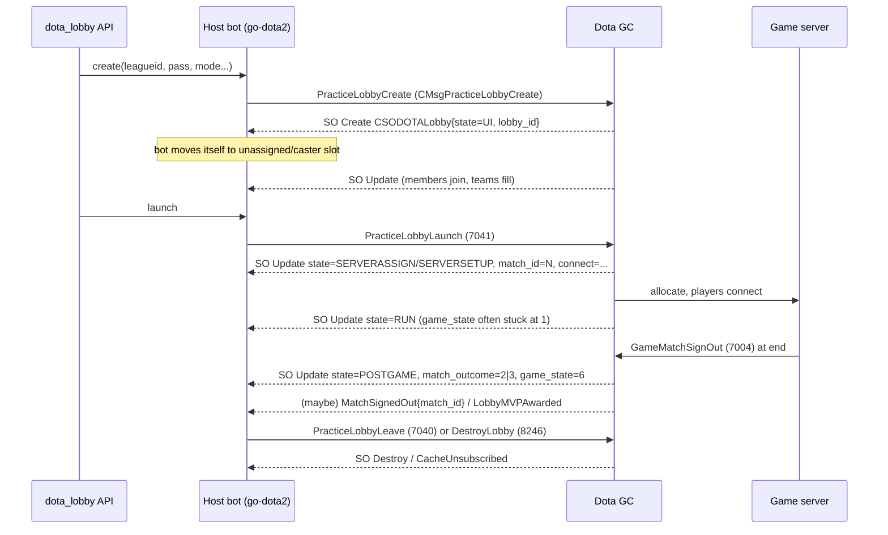
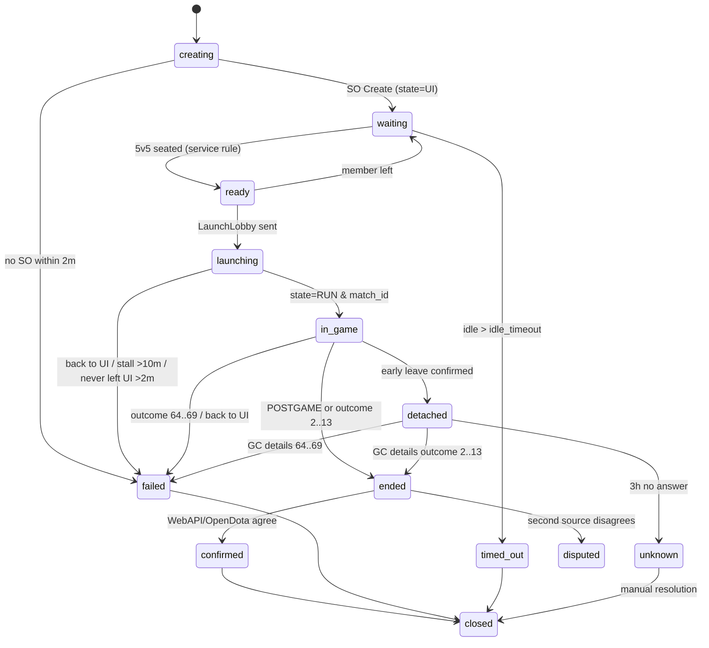

# 06 - Match Tracking and Results

> Track: **Match tracking and results**. This covers how `dota_lobby` should follow a lobby from launch to a final result and report it to callers.
> Scope: CSODOTALobby state transitions, `game_state`, `match_id`, `match_outcome`, GC match details, post-game notifications, lobby teardown, no-show timeouts, the Steam Web API, OpenDota and STRATZ fallbacks, league listings, replays, and the proposed webhook/event payloads.
>
> Pinned sources: `github.com/paralin/go-dota2 v0.0.0-20250623204622-532cb1851217`. Code paths are relative to
> that module's root and proto paths to its `protocol/` directory.
>
> Labels: **[V]** means verified in local source or an upstream document. **[R]** means reported by a real production bot (field experience, not Valve documentation). **[I]** means inferred or uncertain.

---

## 0. TL;DR

1. **The lobby object is the primary result signal.** The bot that hosts the lobby gets `CSODOTALobby` shared-object (SO) updates. In those updates, `state` moves `UI -> SERVERSETUP/SERVERASSIGN -> RUN -> POSTGAME`, `match_id` is set when the launch happens, and `match_outcome` (`EMatchOutcome`) names the winner at the end. [V] (fields), [R] (sequence)
2. **The host bot cannot reliably leave during `RUN`.** An open-source league bot found that the GC ignores `PracticeLobbyLeave` (7040) during RUN [R]. Whether `AbandonCurrentGame` (7035) followed by Leave ("early leave") works is **UNCERTAIN**: there are only mixed third-party reports (node-dota2 #179), and the production bot's own live test has no published outcome [I]. After an early leave, the bot would no longer get lobby updates and would have to poll `GCMatchDetailsRequest` (7095/7096). That poll path is untested in production as well [I].
3. **Do not rely on `game_state` inside the lobby SO.** The same bot logged `WAIT_FOR_PLAYERS_TO_LOAD (1)`, and the next update was already the post-game. Intermediate game states (HERO_SELECTION, GAME_IN_PROGRESS) only showed up after a forced GC resync. [R]
4. **The Steam Web API does not return unticketed practice lobbies.** A practice lobby without a ticket gets "Practice matches are not available via GetMatchDetails", or currently HTTP 500 `{}` [R, community reports]. Ticketed (league) matches are **generally** listed in `GetMatchHistory?league_id=` and `GetMatchDetails`, but this is not guaranteed. In node-dota2 #442 one league-tagged match (3491092220) was missing from both endpoints and the cause was never found, and a Dota2-Gameplay #33427 commenter reports `GetMatchDetails` as broken in general "since facets were added". Plan for absent matches and for HTTP 500s even on ticketed games, and keep OpenDota/GC as fallbacks [R]. None of this is documented by Valve.
5. **Recommended result pipeline (most to least authoritative for speed):**
   lobby SO `match_outcome` -> GC `RequestMatchDetails(match_id)` -> Steam Web API `GetMatchDetails` (ticketed only) -> OpenDota `/matches/{id}` (ticketed or parsed) -> manual or replay import.
   Treat the lobby or GC outcome as **provisional**. Mark a result **final** once a second source confirms it, or after a configurable settle time.
6. **go-dota2 caveats that matter here.** (a) `MakeRequest` matches responses **by message type only**, so `RequestMatchDetails` calls on the same bot must be serialized. (b) SO cache subscriber channels hold 10 events and **drop the oldest when full**, so always re-read `GetOne()` and never rely on every intermediate event. (c) `state.Dota2State.Lobby` is never populated by the library, so use the SO cache. [V]
7. **Webhook design.** The service should emit signed, idempotent events: `lobby.created`, `lobby.member_joined/left`, `lobby.launched`, `match.started`, `match.ended`, `match.result_confirmed`, `lobby.failed`, `lobby.timed_out`, `lobby.closed`. Payloads are in section 9.

---

## 1. Protocol primitives (ground truth)

### 1.1 `CSODOTALobby` fields relevant to tracking

From `dota_gcmessages_common_lobby.proto` (pinned go-dota2). The same numbering was checked against SteamDatabase GameTracking-Dota2 master, where 132 (`requested_hero_teams`) is still the highest field number. [V]

| Field | # | Type | Line | Use for tracking |
|---|---|---|---|---|
| `lobby_id` | 1 | uint64 (key) | 238 | Primary key of the lobby. Stable until the lobby is destroyed |
| `state` | 4 | `CSODOTALobby.State` | 247 | **Coarse lifecycle** (see 1.2) |
| `connect` | 5 | string | 248 | Server connect string. Present once a server is assigned [I] |
| `server_id` | 6 | fixed64 | 244 | Game server steam id. Non-zero after assignment [I] |
| `leader_id` | 11 | fixed64 | 243 | Lobby leader. Compare it to the bot SteamID |
| `game_name` | 16 | string | — | Display name |
| `game_state` | 22 | `DOTA_GameState` | 257 | Fine-grained in-game phase. **Unreliable in practice** (see 3.3) |
| `match_id` | 30 | uint64 | 261 | **Assigned at launch**. Key for every result lookup |
| `pass_key` | 39 | string | 264 | Password |
| `leagueid` | 42 | uint32 | 265 | Ticket/league. Decides Web API visibility |
| `series_type`, `radiant_series_wins`, `dire_series_wins` | 46–48 | uint32 | 268–270 | Bo-N series context |
| `first_leaver_accountid` | 59 | uint32 | 278 | First abandon. Useful for no-show and abandon handling |
| `series_id` | 60 | uint32 | 279 | League series id |
| `first_blood_happened` | 65 | bool | 282 | Rough "game really started" signal [I] |
| `mass_disconnect` | 67 | bool | 284 | Server or network failure indicator |
| `match_outcome` | 70 | `EMatchOutcome` | 283 | **Winner / not-scored reason** |
| `previous_series_matches` | 81 | repeated uint64 | 292 | Earlier match ids in the series |
| `game_start_time` | 87 | uint32 | 294 | Unix time the game started [I semantics] |
| `league_node_id` | 110 | uint32 | 314 | League bracket node |
| `match_duration` | 111 | uint32 | 315 | Duration in seconds, presumably filled at the end [I] |
| `lobby_creation_time` | 128 | uint32 | 324 | Unix time of creation |
| `all_members` / `member_indices` / `left_member_indices` / `free_member_indices` | 120–123 | — | 239–242 | **Current members are `all_members[i]` for i in `member_indices`**. Members who left are in `left_member_indices` |

`CSODOTALobbyMember` (lines 96–111): `id` (SteamID64), `hero_id`, `team` (`DOTA_GC_TEAM`), `slot`, `leaver_status` (`DOTALeaverStatus_t`), `leaver_actions`, `coach_team`. [V]

> Indexing caveat [V/I]: `all_members` is a superset. The GC uses the index arrays to say who is currently present. A tracker that iterates `all_members` directly will count players who have left.

### 1.2 `CSODOTALobby.State` enum (lines 214–222) [V]

| Value | Name | Meaning (field experience) |
|---|---|---|
| 0 | `UI` | Lobby screen. Players join or swap. Launch has not happened, or the lobby **returned** here after a failed launch |
| 5 | `NOTREADY` | Ready-check related, mostly matchmaking [I] |
| 4 | `READYUP` | Ready-up phase, mostly matchmaking [I] |
| 6 | `SERVERASSIGN` | GC is finding a game server |
| 1 | `SERVERSETUP` | Server allocated and loading |
| 2 | `RUN` | Game running (draft through end). `match_id` is known |
| 3 | `POSTGAME` | Game over. `match_outcome` set |

The numeric order is **not** the lifecycle order. Compare by name and never with `<`/`>`.

Practice-lobby path [R]: `UI(0) -> SERVERASSIGN(6) -> SERVERSETUP(1) -> RUN(2) -> POSTGAME(3)`. On a failed load or a server that never starts, the lobby goes `... -> UI(0)` again, often with the dead launch's `match_id` still present. `READYUP` and `NOTREADY` are not expected for practice lobbies [I].

### 1.3 `DOTA_GameState` (`dota_shared_enums.proto:33-48`) [V]

`INIT 0, WAIT_FOR_PLAYERS_TO_LOAD 1, HERO_SELECTION 2, STRATEGY_TIME 3, PRE_GAME 4, GAME_IN_PROGRESS 5, POST_GAME 6, DISCONNECT 7, TEAM_SHOWCASE 8, CUSTOM_GAME_SETUP 9, WAIT_FOR_MAP_TO_LOAD 10, SCENARIO_SETUP 11, PLAYER_DRAFT 12, LAST 13`.

### 1.4 `EMatchOutcome` (`dota_shared_enums.proto:453-473`) [V]

| Value | Name | Service mapping |
|---|---|---|
| 0 | `k_EMatchOutcome_Unknown` | still running / not yet known |
| 2 | `k_EMatchOutcome_RadVictory` | `winner: "radiant"` |
| 3 | `k_EMatchOutcome_DireVictory` | `winner: "dire"` |
| 4 | `k_EMatchOutcome_NeutralVictory` | `winner: "neutral"` (custom games) |
| 5 | `k_EMatchOutcome_NoTeamWinner` | `winner: "none"` |
| 6–13 | `k_EMatchOutcome_Custom1..8Victory` | `winner: "custom_N"` |
| 64 | `NotScored_PoorNetworkConditions` | `not_scored: poor_network` |
| 65 | `NotScored_Leaver` | `not_scored: leaver` |
| 66 | `NotScored_ServerCrash` | `not_scored: server_crash` |
| 67 | `NotScored_NeverStarted` | `not_scored: never_started` |
| 68 | `NotScored_Canceled` | `not_scored: canceled` |
| 69 | `NotScored_Suspicious` | `not_scored: suspicious` |

Rule used by an existing league bot [R]: **2–13 means scored and over. 64–69 means a failed or not-scored launch.** A winner, once seen, is never replaced. An Unknown or NotScored value may be replaced by a later winner.

### 1.5 `DOTALeaverStatus_t` (`dota_shared_enums.proto:135-145`) [V]

`NONE 0, DISCONNECTED 1, DISCONNECTED_TOO_LONG 2, ABANDONED 3, AFK 4, NEVER_CONNECTED 5, NEVER_CONNECTED_TOO_LONG 6, FAILED_TO_READY_UP 7, DECLINED 8, DECLINED_REQUEUE 9`. Values 5 and 6 are the no-show signals (section 6).

### 1.6 Message IDs (`dota_gcmessages_msgid.proto`) [V]

| ID | Name | go-dota2 wrapper |
|---|---|---|
| 7035 | `k_EMsgGCAbandonCurrentGame` | `AbandonLobby()` (`client_generated.go:14`) |
| 7040 | `k_EMsgGCPracticeLobbyLeave` | `LeaveLobby()` (`client_generated.go:2073`) |
| 7041 | `k_EMsgGCPracticeLobbyLaunch` | `LaunchLobby()` (`client_generated.go:2030`) |
| 7095 / 7096 | `k_EMsgGCMatchDetailsRequest/Response` | `RequestMatchDetails(ctx, matchID)` (`client_generated.go:3562`) |
| 8081 | `k_EMsgGCToClientMatchSignedOut` | event `events.MatchSignedOut` (`events/generated.go:745`, handler `client_generated.go:7683`) |
| 8246 | `k_EMsgDestroyLobbyRequest` | `DestroyLobby(ctx)` (`client_generated.go:516`) |
| 7004/7005 | `k_EMsgGCGameMatchSignOut[Response]` | server-to-GC only. A client never sees it [I] |
| 7645/7646 | `k_EMsgGCToGCLeagueMatchStarted/Completed` | GC-internal (`GCToGC`). Not visible to clients [I] |

### 1.7 Match payloads

**`CMsgGCMatchDetailsResponse`** (`dota_gcmessages_client.proto:332`): `result uint32`, `match CMsgDOTAMatch`, `vote`. [V]
The meaning of `result` is not documented. It is probably an `EResult` (1 = OK) [I].

**`CMsgDOTAMatch`** (`dota_gcmessages_common.proto:917-1095`) [V]. Selected fields:

| Field | # | Notes |
|---|---|---|
| `duration` | 3 | seconds |
| `starttime` | 4 | fixed32 unix |
| `players` | 5 | `CMsgDOTAMatch.Player`: `account_id`, `player_slot`, `hero_id`, `kills/deaths/assists`, `leaver_status`, `net_worth`, `player_name`, ... |
| `match_id` | 6 | |
| `tower_status` / `barracks_status` | 8 / 9 | repeated |
| `cluster` | 10 | replay host cluster |
| `replay_salt` | 13 | **needed for the replay URL** |
| `lobby_type` | 16 | 1 = practice (league matches are normally practice lobbies with `leagueid > 0`) [I] |
| `leagueid` | 22 | |
| `radiant_team_id/name/tag`, `dire_team_*` | 20–38 | set when teams were applied to the lobby |
| `game_mode` | 31 | |
| `picks_bans` | 32 | |
| `match_seq_num` | 33 | |
| `replay_state` | 34 | `REPLAY_AVAILABLE 0 / NOT_RECORDED 1 / EXPIRED 2` |
| `series_id` / `series_type` | 39 / 40 | |
| `radiant_team_score` / `dire_team_score` | 48 / 49 | kills |
| `match_outcome` | 50 | **the winner field**. `CMsgDOTAMatch` has **no** `radiant_win` / `good_guys_win` (grep found none) |
| `pre_game_duration` | 53 | |

**`CMsgDOTAMatchMinimal`** (`dota_gcmessages_common.proto:1216-1259`) has `match_id`, `start_time`, `duration`, `players`, `tourney{league_id, series_type, series_game, radiant/dire team}`, `match_outcome` (8), `radiant_score`, `dire_score`, `lobby_type`. It is returned by `RequestMatchesMinimal(ctx, ids)` (`client_generated.go:3585`) and is a cheap way to batch-check outcomes. Whether it works for private or ticketed matches is unverified [I].

**`CMsgGCToClientMatchSignedOut`** (`dota_gcmessages_client.proto:1075`) has only `match_id`. It is a GC push saying the match result was recorded ("signed out"). [V] (shape)
Who receives it is not documented: probably the players, and maybe lobby members [I]. Use it as a **trigger to fetch details**, never as the result itself.

`CMsgDOTALobbyMVPAwarded { match_id, mvp_account_id[] }` (`dota_gcmessages_client.proto:319`) is another post-game push (`events.LobbyMVPAwarded`) that indirectly shows a match has ended [V shape, I semantics].

---

## 2. go-dota2 mechanics the tracker must respect

### 2.1 SO cache events [V]

- Subscribe with `d.GetCache().SubscribeType(cso.Lobby)` (`socache/socache_sub.go`) or with `GetContainerForTypeID(uint32(cso.Lobby))` followed by `.Subscribe()`. `cso.Lobby = 2004` (`cso/cso_types.go`).
- Events are `*socache.CacheEvent{EventType: Create|Update|Destroy, Object: proto.Message}` (`socache/socache_sub.go:22-27`).
- **Create vs Update** is decided by whether the owner SOID already existed (`socache_container.go:94-98`). Objects are keyed by **owner SOID**, not `lobby_id`.
- **Destroy** is emitted for both `ESOMsg_Destroy` and `CacheUnsubscribed` (`socache_container.go:140-148`), and it carries the last known object (`removeObject`, lines 110-128). When the bot leaves the lobby or the GC tears it down, the tracker sees a Destroy.
- **Overflow:** each subscriber channel has a buffer of 10 (`socache_container.go:152`). When it is full, `emitEvent` **drops the oldest queued event** and logs "dropping event due to channel overflow" (lines 57-78). Consequence: **treat events as "something changed" notifications and read the full current object.** Never compute transitions only from the event stream. A fast UI -> RUN -> POSTGAME burst can lose intermediate states.
- `state.Dota2State` has a `Lobby` field (`state/state.go:12`), but nothing in the library assigns it (grep found no writer). **Do not use `ClientStateChanged` for lobby tracking.**

### 2.2 Request/response correlation [V]

`MakeRequest` (`client_request.go:17-90`) registers a handler under `pendReq[respMsgID]` and does **not** use GC job ids. `handleResponsePacket` (lines 93-105) calls **every** pending handler for that message type. `RequestMatchDetails` passes no `matchesRequest` filter (`client_generated.go:3562-3578`).

So if two goroutines call `RequestMatchDetails` on the same `*dota2.Dota2` at the same time, the first 7096 that arrives completes **both** calls with the same body. Mitigations:

1. Serialize match-detail requests **per bot** (one in flight). Existing bots do the same: one request in flight, dropped after 30 s. [R]
2. Optionally call `MakeRequest` directly with a matcher such as `func(m proto.Message) bool { return m.(*protocol.CMsgGCMatchDetailsResponse).GetMatch().GetMatchId() == id }`. However, the GC "may answer without the match id" [R] on failure, and such a reply would then never match and the call would hang until the context timeout. Prefer (1) plus a context timeout.

---

## 3. Lifecycle: what actually happens

### 3.1 Sequence (host bot stays in the lobby)



### 3.2 The "bot must not be a player" constraint [R]

- A headless bot cannot load into the game server, so it **must not sit on a team slot** (confirmed by go-dota2 #77 and paralin/Dota2 #26) [R].
- **Which non-team position works is contested (UNCERTAIN; test both).**
  - Caster slot: this is the maintainer's recommendation: "Join the caster slot and then start. Then once game starts you can leave." (paralin, go-dota2 #77).
  - Unassigned / player pool: in #77 the host's `JoinLobbyTeam(PLAYER_POOL)` was "silently ignored by GC for the lobby host", and the broadcast channel still counted as a member that must connect, so the launch hung. In paralin/Dota2 #26 (2017) one user saw lobbies fail back to the UI with the bot in the player pool or a spectator/broadcaster slot, while another got `match_outcome` with the bot in the pool. paralin suggested the restriction "maybe ... is only removed for ticketed games". An open-source league bot reports that the unassigned pool works for its **ticketed** league (section 3.3).
  - What would resolve it: launch test lobbies, ticketed and unticketed, with the host in the caster slot and in the unassigned pool, and record whether each one reaches RUN.
- Being a lobby member is **not** the same as being in the game. The paralin/Dota2 #26 thread (2017) inferred that a bot that did not connect to the server cannot see detailed stats for a private, unticketed lobby. That is a forum inference, not documentation [I]. No field report shows GC match details working for a non-playing ticketed host either [I].

### 3.3 Field reports from a league bot that stays to postgame (Oct 2026) [R]

An open-source league bot that hosts ticketed lobbies with one account and stays in the lobby until postgame reports (field notes, October 2026):

- The GC ignores a Leave (7040) while the lobby is in `RUN`; the bot was still in the lobby at every postgame.
- `game_state` in lobby updates went from `WAIT_FOR_PLAYERS_TO_LOAD` (1) straight to the postgame (6). Intermediate states appeared only after a forced GC session cycle (`SetPlaying(false)` then `(true)`, which replays the lobby in the welcome).
- End-of-game detection: `state == POSTGAME`, **or** `state == RUN` with `match_outcome` in 2..13.
- A finished game once stayed in `RUN` for 90 minutes because the end update never arrived. Fix: a 3-hour backstop with one resync, plus a resync when a new create finds the old lobby still in `RUN`.
- The host sits in the unassigned pool and launches work for its ticketed league.
- The recorded score comes from OpenDota by `match_id`, with sanity checks; the lobby end only triggers closing the game.
- Early leave (`AbandonCurrentGame` 7035, then Leave) followed by GC match-details polling is designed but has no published result.

---

## 4. Recommended tracker state machine (service level)

It refines a simple `creating -> waiting -> ready -> in_game -> finished` lifecycle with failure states.



### 4.1 Derivation function (pure and testable)

```go
// derive computes the tracker phase from a full lobby snapshot plus
// whether a launch was requested. It does not depend on event history,
// so dropped SO events (buffer of 10) cannot corrupt the phase.
type Phase string

const (
    PhaseWaiting   Phase = "waiting"
    PhaseLaunching Phase = "launching"
    PhaseInGame    Phase = "in_game"
    PhaseEnded     Phase = "ended"
    PhaseFailed    Phase = "failed"
)

func isWin(o protocol.EMatchOutcome) bool   { return o >= 2 && o <= 13 }
func isNotScored(o protocol.EMatchOutcome) bool { return o >= 64 && o <= 69 }

func derive(l *protocol.CSODOTALobby, launched bool) Phase {
    o := l.GetMatchOutcome()
    switch {
    case isWin(o):
        return PhaseEnded
    case isNotScored(o):
        return PhaseFailed
    }
    switch l.GetState() {
    case protocol.CSODOTALobby_POSTGAME:
        return PhaseEnded // outcome may arrive in a later update
    case protocol.CSODOTALobby_RUN:
        return PhaseInGame
    case protocol.CSODOTALobby_SERVERASSIGN, protocol.CSODOTALobby_SERVERSETUP:
        return PhaseLaunching
    case protocol.CSODOTALobby_UI:
        if launched && l.GetMatchId() != 0 {
            return PhaseFailed // launch came back to the lobby screen
        }
        return PhaseWaiting
    }
    return PhaseWaiting
}
```

### 4.2 Per-lobby watcher skeleton

```go
func (t *Tracker) watch(ctx context.Context, b *Bot, rec *LobbyRecord) {
    ch, unsub, err := b.dota.GetCache().SubscribeType(cso.Lobby)
    if err != nil { t.fail(rec, err); return }
    defer unsub()

    tick := time.NewTicker(30 * time.Second) // timeouts and backstops
    defer tick.Stop()
    for {
        select {
        case <-ctx.Done():
            return
        case ev := <-ch:
            l, _ := ev.Object.(*protocol.CSODOTALobby)
            if l == nil || l.GetLobbyId() != rec.LobbyID { continue }
            if ev.EventType == socache.EventTypeDestroy {
                t.onLobbyGone(rec, l) // left, destroyed, or kicked
                continue
            }
            t.apply(rec, l) // derive() -> persist -> emit webhook on change
        case <-tick.C:
            // Re-read the authoritative snapshot (in case events were dropped)
            if obj := currentLobby(b); obj != nil { t.apply(rec, obj) }
            t.checkTimeouts(rec, b) // section 6
        }
    }
}
```

`apply` must be **idempotent**. Persist `(lobby_id, match_id, phase, outcome, updated_at)` and emit an event only when one of these changes.

---

## 5. Getting the result: source ladder

| # | Source | Latency | Needs | Gives | Works for unticketed? | Notes |
|---|---|---|---|---|---|---|
| 1 | Lobby SO `match_outcome` | seconds | host bot still in lobby | winner / not-scored, `match_duration` | yes [R] | best signal. Bot is blocked until postgame |
| 2 | GC `RequestMatchDetails` (7095) | unknown, not observed [I] | any GC session. Possibly participation for private matches | full `CMsgDOTAMatch` incl. `match_outcome`, players, `replay_salt`, `cluster` | **uncertain** [I]. Reported refused when the bot wasn't in the game (paralin/Dota2 #26) | serialize per bot. Avoid hammering (node-dota2 warns the GC stops replying when abused) |
| 3 | GC `MatchSignedOut` push | at sign-out | being a recipient [I] | `match_id` only | ? | trigger only |
| 4 | Steam Web API `IDOTA2Match_570/GetMatchDetails` | minutes | Web API key. **Ticketed** match | `radiant_win`, players, picks_bans, `leagueid`, `lobby_type` | **no** ("Practice matches are not available..." / HTTP 500 `{}`) | ticketed matches are usually present but not guaranteed (node-dota2 #442 had one missing). Endpoint reported flaky since facets were added (Dota2-Gameplay #33427 comment) [R] |
| 5 | Steam Web API `GetMatchHistory?league_id=` | minutes | key. Ticketed | match list for discovery | no | `matches_requested` ≤ 100 |
| 6 | OpenDota `GET /matches/{id}` (+ `POST /request/{id}` to parse) | minutes to hours | none (key optional) | full match. Parsed data if a replay is available | only if OpenDota can see it (ticketed in practice) [R] | `/request` costs 10 calls of rate limit |
| 7 | OpenDota `/leagues/{id}/matchIds` | hours | none | match ids **including amateur leagues** | n/a | `/leagues/{id}/matches` **excludes amateur leagues** |
| 8 | STRATZ GraphQL `match(id:)` | minutes to hours | bearer token | full match | "every public match". Private coverage unclear [I] | schema introspection advised |
| 9 | Replay (`.dem`) or manual entry | manual | uploader | anything | yes | last resort (FantasyLeague #224 path) |

### 5.1 Steam Web API details [V]

Base: `https://api.steampowered.com/IDOTA2Match_570/<Method>/v1/?key=...` (xpaw lists all methods).

| Method | Key params | Use |
|---|---|---|
| `GetMatchDetails` | `match_id` (required), `include_persona_names` | final confirmation. `result.radiant_win`, `leagueid`, `lobby_type`, `players[].leaver_status`, `picks_bans` |
| `GetMatchHistory` | `league_id`, `start_at_match_id`, `matches_requested` (≤100), `account_id`, `min_players`, `tournament_games_only` (TF2 wiki) | discover league matches, backfill |
| `GetMatchHistoryBySequenceNum` | `start_at_match_seq_num`, `matches_requested` | streaming ingest (heavy) |
| `GetLiveLeagueGames` | `league_id`, `match_id`, `dpc` | live view of ticketed games: `lobby_id`, `league_id`, `players`, `spectators`, scoreboard [I fields beyond wiki] |
| `GetTournamentPlayerStats` (v2) | `account_id`, `league_id`, `match_id` | per-player tournament stats |

`player_slot` decoding (Web API): bit 7 set means Dire, low 3 bits are the position 0–4. GC `CMsgDOTAMatch.Player.player_slot` presumably uses the same encoding [I].

Mapping to the service result: `radiant_win=true -> winner=radiant`. The Web API has no NotScored enum, so use the GC or lobby outcome for that distinction.

### 5.2 OpenDota [V]

- `GET https://api.opendota.com/api/matches/{match_id}` returns `radiant_win`, `players`, `leagueid`, `lobby_type`, `cluster`, `replay_salt`, `replay_url`.
- `POST /request/{match_id}` returns `{job:{jobId}}`. Poll `GET /request/{jobId}`. A parse request "counts as 10 calls for rate limit". An API key is optional and raises limits (current limits were not readable from the docs page. The historical free tier was 60 req/min and 50k/month, from 2018) [I current numbers].
- `GET /leagues/{league_id}/matchIds` includes amateur leagues. `/leagues/{league_id}/matches` excludes them. **Inhouse leagues are amateur, so use `matchIds`.**
- `GET /live` returns top live games only (not useful for private leagues).

### 5.3 STRATZ [I]

GraphQL at `https://api.stratz.com/graphql` with a free bearer token from stratz.com/api. Use introspection (`type(name:"MatchType")`) before you depend on field names. Treat it as an optional secondary confirmer.

### 5.4 Recommended pipeline

```text
on lobby POSTGAME / outcome 2..13           -> match.ended (provisional, source=lobby)
on early-leave or bot reconnect lost lobby   -> schedule GC details poll (T+8m, every 60s, 30s timeout, stop at 3h)
on GC details outcome 2..13                  -> match.ended (provisional, source=gc) if not already
on match.ended (ticketed, leagueid>0)        -> poll WebAPI GetMatchDetails at +2m, +5m, +15m, +60m
                                             -> else OpenDota /matches/{id}; if absent POST /request/{id}
second source agrees                         -> match.result_confirmed (final)
second source disagrees                      -> match.result_disputed (manual)
no second source within N hours (unticketed) -> match.result_confirmed with confidence="single_source"
```

---

## 6. Timeouts and no-shows

There are no Valve-documented timeouts for practice lobbies. The values below are **service policy**. Values marked [R] come from an existing league bot (section 3.3).

| Situation | Detection | Default | Action / event |
|---|---|---|---|
| Create never acknowledged | no SO Create for our lobby | 2 min [R] | `lobby.failed{reason:"create_timeout"}` |
| Lobby vanished pre-launch | Destroy before launch | immediate | `lobby.closed{reason:"gc_removed"}` |
| Lobby idle (nobody joins or changes) | no member change in UI | 30 min (10 for 1v1) [R] | Destroy or Leave, then `lobby.timed_out{reason:"idle"}` |
| Players not seated by deadline | service rule `fill_deadline` | configurable (e.g. 15 min) | `lobby.timed_out{reason:"no_show", missing:[...]}`. Optionally auto-launch with whoever is seated if the API caller allows it |
| Launch never left UI | still UI after Launch | 2 min [R] | `lobby.failed{reason:"launch_ignored"}` |
| Server assign/setup stall | SERVERASSIGN/SETUP after Launch | 10 min [R] | `lobby.failed{reason:"server_stall"}` |
| Player never loads | back to UI with match_id, or `leaver_status` 5/6, or outcome 67 `NeverStarted` | GC-driven | `lobby.failed{reason:"failed_load", not_scored:"never_started"}`. Allow relaunch |
| Game ends not scored | outcome 64–69 | GC-driven | `match.ended{scored:false, not_scored_reason}` |
| End never observed | RUN with no end | backstop 3 h after start [R] | force GC resync (SetPlaying false/true or re-hello), then GC details, then `match.result_unknown` |
| Leave not confirmed | no Destroy/Unsubscribed | 20 s per attempt [R] | retry at most once per minute and 3 times per job [R] |
| GC session lost mid-game | `GCConnectionStatusChanged` != HAVE_SESSION | — | on re-welcome, re-read lobby. If no lobby is present, treat it as departed and switch to the GC details poll |

In the in-game no-show case, the GC/server itself applies `DOTA_LEAVER_NEVER_CONNECTED[_TOO_LONG]`, and the match usually ends as `NotScored_NeverStarted` / `NotScored_Leaver` or returns to UI [I exact server timings]. The service only has to classify the result. It does not run in-game timers.

---

## 7. Teardown after the game

- When it sees POSTGAME, the host bot should **Leave** (7040). If it is the leader and wants the lobby gone for everyone, it should call `DestroyLobby(ctx)` (8246, response `CMsgDOTADestroyLobbyResponse{SUCCESS|ERROR_UNKNOWN}`, `dota_gcmessages_client.proto:1900`) [V]. go-dota2's own `LeaveCreateLobby` shows the pattern: destroy if leader, call `AbandonLobby()` if state != UI, then `LeaveLobby()` (`client_lobby.go:44-56`) [V].
- Confirm departure via SO Destroy/CacheUnsubscribed (section 2.1) before you mark the bot free.
- Series: to continue a Bo3 in the same lobby, keep the lobby and update `radiant_series_wins`/`dire_series_wins` via `SetLobbyDetails` (`CMsgPracticeLobbySetDetails` fields 20–22, plus `previous_match_override` 38) [V fields, I behaviour]. Otherwise destroy and recreate with series fields set.
- Bot availability: a bot is "busy" from Create until a confirmed departure. With multiple bots, the pool hands new lobbies to free bots (one lobby per account).

---

## 8. League listings, replays and salts

### 8.1 How league matches surface [V]/[R]

- The lobby must be created with `CMsgPracticeLobbySetDetails.leagueid` (field 16), and optionally `league_node_id` (49), by an account that league admin permissions allow to use that ticket. "Only lobbies that are played on a ticket figure in the API" (collaborator Crazy-Duck, node-dota2 #442) [R]. A ticket is necessary but **not sufficient**. In the same thread, the OP's match 3491092220 was created with his league ID yet was missing from `GetMatchHistory?league_id=` and also failed `GetMatchDetails`. Only matches present in the history worked. The cause was never found (bots in the game were suspected) [R/UNCERTAIN].
- Discovery: `GetMatchHistory?league_id=X` (Web API) or OpenDota `/leagues/X/matchIds`.
- GC-side bracket data: `CMsgDOTALeagueNode.matches[]{match_id, winning_team_id}` and `CMsgDOTALeagueNodeResults` (`dota_gcmessages_common_league.proto:27-60, 252-274`) [V shape]. go-dota2 has **no** client wrapper for fetching league nodes. Only `RequestLeagueAvailableLobbyNodes(ctx, leagueID)` (`client_generated.go:3519`) exists, which returns the nodes you can attach a lobby to [V].
- Live: `CMsgDOTALeagueLiveGames.LiveGame{league_id, match_id, server_steam_id, time, spectators, league_node_id, series_id}` exists in the protos (`dota_gcmessages_common_league.proto:198-216`), but no client request wrapper was found. Use Web API `GetLiveLeagueGames?league_id=` instead [V/I].
- `RequestTopLeagueMatches` (`client_generated.go:4330`) returns `CMsgDOTAMatchMinimal` for **top** league matches only, so it is not suitable for small leagues [V shape, I usefulness].

### 8.2 Replays [V]

- URL template: `http://replay{cluster}.valve.net/570/{match_id}_{replay_salt}.dem.bz2`. The salt and cluster come from GC `CMsgDOTAMatch` (fields 13/10). Valve removed the salt from the Web API long ago. OpenDota exposes it only via `GET /matches/{match_id}` (fields `replay_salt`, `replay_url`, `cluster`). The current OpenDota OpenAPI spec has no `/replays` path (checked 2026-11-06).
- `replay_state` tells you whether the replay is `AVAILABLE`, `NOT_RECORDED` or `EXPIRED`.
- Replays expire after some days or weeks [I exact retention]. Store `cluster` and `replay_salt` at result time and optionally archive the `.dem`.
- Historically each Steam account was limited to about 100 replay downloads per 24 h and each IP to about 500 (OpenDota 2015 architecture post) [I current].

---

## 9. Proposed events and webhook payloads

### 9.1 Delivery contract

- `POST` to subscriber URLs configured in `config.yaml` (`webhooks: [{url, secret: Secret, events: [...]}]`). Use the `Secret` type for `secret`.
- Headers:
  - `X-DotaLobby-Event: match.ended`
  - `X-DotaLobby-Delivery: <uuid>` (idempotency key, stable across retries)
  - `X-DotaLobby-Timestamp: <unix>`
  - `X-DotaLobby-Signature: sha256=<hex(HMAC_SHA256(secret, timestamp + "." + body))>`
- Retries: exponential backoff (e.g. 10 s, 30 s, 2 m, 10 m, 1 h), max 24 h. A 2xx response means delivered.
- Ordering: not guaranteed. Every payload carries `sequence` (per lobby, monotonic) and a full `lobby` snapshot, so receivers can discard stale events.
- Pull fallback: `GET /lobbies/{id}`, `GET /lobbies/{id}/events?since=seq`, and `GET /matches/{match_id}` expose the same data.

### 9.2 Envelope

```json
{
  "id": "evt_01JD...",
  "type": "match.ended",
  "created_at": "2026-11-06T20:14:03Z",
  "sequence": 14,
  "lobby": {
    "lobby_id": "27511234567890123",
    "external_ref": "league42-week3-gameA",
    "bot": "bot_eu_1",
    "name": "League42 W3 A",
    "league_id": 12345,
    "league_node_id": 0,
    "series": {"type": 1, "radiant_wins": 0, "dire_wins": 0},
    "gc_state": "POSTGAME",
    "phase": "ended",
    "game_state": "DOTA_GAMERULES_STATE_POST_GAME",
    "match_id": "8875244282"
  },
  "data": {}
}
```

IDs are 64-bit values, so send them as **strings** to avoid precision loss in JavaScript.

### 9.3 Event catalogue

| Type | When | `data` |
|---|---|---|
| `lobby.created` | SO Create for our lobby | `{pass_key_set, game_mode, server_region, created_at}` |
| `lobby.member_joined` / `lobby.member_left` | index arrays change | `{steam_id, account_id, team, slot}` |
| `lobby.ready` | service seating rule satisfied | `{radiant:[...], dire:[...]}` |
| `lobby.launched` | Launch sent and state left UI | `{launched_at}` |
| `match.started` | state=RUN and `match_id` != 0 | `{match_id, server_id, started_at}` |
| `match.ended` | POSTGAME, outcome 2–13, or GC details | see 9.4 |
| `match.result_confirmed` | second source agrees or the settle rule fires | `{match_id, winner, sources:["lobby","webapi"], confidence}` |
| `match.result_disputed` | sources disagree | `{match_id, results:{lobby:"radiant", webapi:"dire"}}` |
| `match.result_unknown` | backstop expired | `{match_id, last_seen_state}` |
| `lobby.failed` | create timeout, launch ignored, stall, failed load, not scored | `{reason, not_scored_reason?, match_id?}` |
| `lobby.timed_out` | idle or no-show | `{reason, missing_players:[...]}` |
| `lobby.closed` | confirmed departure or destroy | `{reason:"postgame"|"destroyed"|"gc_removed"|"released"}` |
| `bot.detached` | early leave confirmed | `{match_id}` |

### 9.4 `match.ended` payload

```json
{
  "type": "match.ended",
  "data": {
    "match_id": "8875244282",
    "scored": true,
    "outcome": "k_EMatchOutcome_RadVictory",
    "outcome_code": 2,
    "winner": "radiant",
    "not_scored_reason": null,
    "duration_s": 2213,
    "ended_at": "2026-11-06T20:14:03Z",
    "source": "lobby",
    "provisional": true,
    "players": [
      {"account_id": 123456, "steam_id": "7656119...", "team": "radiant", "slot": 0,
       "hero_id": 14, "leaver_status": "DOTA_LEAVER_NONE", "kills": 9, "deaths": 2, "assists": 11}
    ],
    "replay": {"cluster": 133, "salt": 1234567890, "state": "REPLAY_AVAILABLE",
               "url": "http://replay133.valve.net/570/8875244282_1234567890.dem.bz2"}
  }
}
```

When `source="lobby"`, per-player stats are absent. Only team, slot and leaver_status come from `CSODOTALobbyMember`. They are filled in once GC details or the Web API respond, and arrive in `match.result_confirmed`.

### 9.5 Persistence model (minimum)

```sql
lobbies(lobby_id PK, bot, external_ref, league_id, created_at, phase, gc_state, match_id, seq)
matches(match_id PK, lobby_id FK, winner, outcome_code, scored, duration_s, ended_at,
        confirmed bool, sources text[], cluster, replay_salt, raw_gc jsonb, raw_webapi jsonb)
lobby_events(lobby_id, seq, type, payload jsonb, created_at, PRIMARY KEY(lobby_id, seq))
webhook_deliveries(delivery_id PK, event_id, url, attempts, next_attempt_at, status)
```

Persisting `lobby_id -> match_id` and pending polls lets a restarted service resume GC detail polls and Web API confirmation. Existing league bots persist their job ledger for this reason [R].

---

## 10. Concurrency notes (multiple bots)

- One watcher goroutine per (bot, lobby). One serialized "GC request worker" per bot for `RequestMatchDetails` (section 2.2).
- Web API and OpenDota pollers are global and rate limited (token bucket). Share them across bots.
- With "stay to postgame", each bot is busy for the whole game. Concurrency equals the number of bot accounts. Early leave (Abandon + Leave) can free a bot sooner but has **mixed reports** (node-dota2 #179). Also check the bot account for abandon or low-priority penalties after the first trials [R].

---

## 11. Verified vs Uncertain

### Verified (source or doc seen)

- `CSODOTALobby` fields and numbers: `state`=4, `match_id`=30, `leagueid`=42, `match_outcome`=70, `game_state`=22, `match_duration`=111, `lobby_creation_time`=128, member index arrays 120–123 (`dota_gcmessages_common_lobby.proto:208-328`), unchanged in GameTracking-Dota2 master.
- `State` enum values UI 0, SERVERSETUP 1, RUN 2, POSTGAME 3, READYUP 4, NOTREADY 5, SERVERASSIGN 6.
- `EMatchOutcome`, `DOTA_GameState`, `DOTALeaverStatus_t` values (`dota_shared_enums.proto`).
- `CMsgDOTAMatch` uses `match_outcome` (50) and has no `radiant_win`. `replay_salt` is 13 and `cluster` is 10.
- go-dota2 wrappers: `RequestMatchDetails`, `RequestMatchesMinimal`, `DestroyLobby`, `LeaveLobby`, `AbandonLobby`, `LaunchLobby`, `RequestLeagueAvailableLobbyNodes`, `RequestTopLeagueMatches`. Event `MatchSignedOut` is registered.
- go-dota2 response correlation is by message type only. SO subscriber buffer is 10 and drops the oldest on overflow. `state.Lobby` is never set.
- OpenDota: `/leagues/{id}/matches` excludes amateur leagues while `/matchIds` includes them. `/request` counts as 10 calls.

### Reported by an open-source league bot (credible, not official; section 3.3)

- The GC ignores Leave during RUN.
- `game_state` in lobby updates jumps from 1 to 6 for a non-participating host bot.
- The unassigned pool works for a non-playing host on a ticketed league.
- Results recorded from OpenDota by `match_id` for ticketed games.
- Web API (community reports, not Valve docs): unticketed practice matches are not returned by `GetMatchDetails`. Ticketed league matches usually are, with at least one unexplained exception (node-dota2 #442) and reported general flakiness (Dota2-Gameplay #33427).
- The suggested timeouts (2 min create, 2 min launch settle, 10 min stall, 30 min idle, 20 s leave confirm, 3 h backstop).

### Uncertain / inferred

- Whether `AbandonCurrentGame` + Leave frees the host during RUN. There are mixed third-party reports (node-dota2 #179) and no published live result.
- Whether GC `RequestMatchDetails` returns the outcome to a non-playing host for **ticketed** lobbies, and how fast.
- Whether `RequestMatchDetails` works for **unticketed** private lobbies when the bot was only a lobby member (paralin/Dota2 #26 suggests no, 2017 forum inference).
- Caster slot vs unassigned pool for the host at launch (Q5; see 3.2).
- Who receives `CMsgGCToClientMatchSignedOut` and `LobbyMVPAwarded`, and whether a non-playing host gets them.
- The exact semantics of `CMsgGCMatchDetailsResponse.result` (probably EResult).
- Whether `RequestMatchesMinimal` returns private or league lobby matches.
- League lobby `lobby_type` in the Web API/OpenDota: probably 1 (practice) with `leagueid > 0`, not 2.
- Current OpenDota rate limits, replay retention period, and replay download limits.
- `GetLiveLeagueGames` current field set (the wiki is from 2014. xpaw lists `league_id`, `match_id`, `dpc` params).
- STRATZ coverage of ticketed amateur leagues.

---

## 12. Open questions to test on a live bot

These are Q5 and Q8 in the [index](README.md). The 2026-11-08 run ([09](09-live-probe.md)) created and destroyed league lobbies but launched none, so all are still open.

1. With the bot in the unassigned pool of a **ticketed** lobby, do we see `match_outcome` on POSTGAME every time? How long after the in-game ancient falls?
2. Does `MatchSignedOut` arrive at the host bot? If so, it is a cheap trigger for `RequestMatchDetails`.
3. Does `RequestMatchDetails` succeed for an **unticketed** lobby the bot hosted but did not play in? And for a **ticketed** one, how long after the end does it first return `match_outcome` 2/3?
4. Does Abandon + Leave at HERO_SELECTION leave players unaffected and the bot account unpenalized?
5. Does `DestroyLobby` at POSTGAME kick the players' post-game screen (UX)?
6. How soon after the end do Web API `GetMatchDetails` and OpenDota `/matches/{id}` return ticketed amateur-league matches, and are any ticketed matches missing entirely?
7. Does the launch reach RUN with the host in the caster slot vs the unassigned pool, for both ticketed and unticketed lobbies?

---

## Sources

**go-dota2 module (`v0.0.0-20250623204622-532cb1851217`)**
- `protocol/dota_gcmessages_common_lobby.proto:96-111, 208-328` (CSODOTALobbyMember, CSODOTALobby)
- `protocol/dota_shared_enums.proto:33-48, 50-58, 135-145, 453-473` (DOTA_GameState, DOTA_GC_TEAM, DOTALeaverStatus_t, EMatchOutcome)
- `protocol/dota_gcmessages_common.proto:917-1095, 1216-1259` (CMsgDOTAMatch, CMsgDOTAMatchMinimal)
- `protocol/dota_gcmessages_client.proto:319-336, 1075-1077, 1900-1907` (MVPAwarded, MatchDetails req/resp, MatchSignedOut, DestroyLobbyResponse)
- `protocol/dota_gcmessages_client_match_management.proto:113, 121-170, 171-176, 213-215` (Abandon, SetDetails, Create, Launch)
- `protocol/dota_gcmessages_common_league.proto:27-60, 198-216, 236-274` (league nodes, live games, available nodes, node results)
- `protocol/dota_gcmessages_msgid.proto:6-7, 15, 18-19, 54-55, 275-279, 375, 497`
- `client_generated.go:14, 516, 2030, 2073, 3519, 3562-3578, 3585, 4330, 7683`
- `client_request.go:17-105`, `socache/socache_container.go:57-160`, `socache/socache_sub.go:8-27`, `cso/cso_types.go`, `state/state.go:8-19`, `client_lobby.go:21-67`, `client.go:83-175`

**Upstream / web**
- SteamDatabase GameTracking-Dota2 lobby proto: https://raw.githubusercontent.com/SteamDatabase/GameTracking-Dota2/master/Protobufs/dota_gcmessages_common_lobby.proto
- node-dota2 #442, "Practice matches are not available via GetMatchDetails" (tickets): https://github.com/Arcana/node-dota2/issues/442
- ValveSoftware/Dota2-Gameplay #33427, GetMatchDetails HTTP 500 for an unticketed lobby (Jun 2026): https://github.com/ValveSoftware/Dota2-Gameplay/issues/33427
- paralin/Dota2 #26, stats from practice lobby: https://github.com/paralin/Dota2/issues/26
- paralin/go-dota2 #77, launch from caster slot then leave: https://github.com/paralin/go-dota2/issues/77
- paralin/go-dota2 #72, GC lobby updates stopping after 60 min (ValvePython), go-dota2 keepalives OK: https://github.com/paralin/go-dota2/issues/72
- node-dota2 #179 (abandon then leave, mixed reports): https://github.com/Arcana/node-dota2/issues/179
- FantasyLeague #224 (non-league lobby fallback: manual/replay import): https://github.com/ville-solja/FantasyLeague/issues/224
- ValvePython dota2 lobby events: https://dota2.readthedocs.io/en/stable/dota2.features.lobby.html
- Steam Web API method list (IDOTA2Match_570): https://steamapi.xpaw.me/IDOTA2Match_570
- GetMatchDetails (TF2 wiki): https://wiki.teamfortress.com/wiki/WebAPI/GetMatchDetails
- GetMatchHistory (TF2 wiki): https://wiki.teamfortress.com/wiki/WebAPI/GetMatchHistory
- GetLiveLeagueGames (TF2 wiki, 2014): https://wiki.teamfortress.com/wiki/WebAPI/GetLiveLeagueGames
- OpenDota OpenAPI spec: https://api.opendota.com/api (docs: https://docs.opendota.com/)
- OpenDota architecture (retriever, salts, replay limits): https://blog.opendota.com/2015/03/05/architecture/
- dotaconstants lobby_type: https://raw.githubusercontent.com/odota/dotaconstants/master/json/lobby_type.json
- STRATZ API: https://stratz.com/api (GraphQL https://api.stratz.com/graphql)

