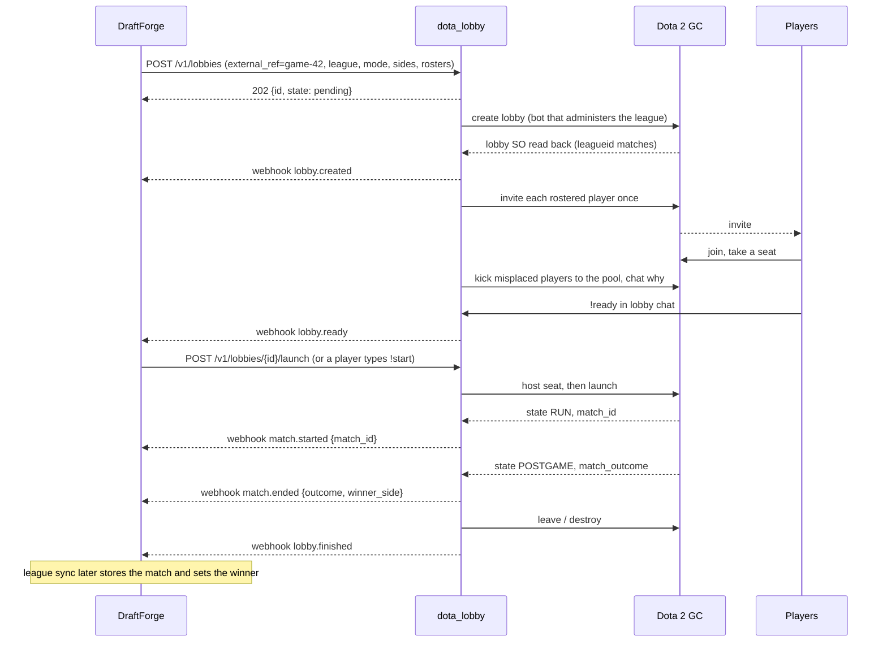

# 11 - DraftForge integration

How `dota_lobby` should host the Dota 2 lobbies for games run in DraftForge, the owner's tournament and bracket app. It covers what DraftForge does today, the recommended contract between the two services, the end-to-end flow, the lobby mechanics findings the design depends on, and the work DraftForge would need (as proposals for a later DraftForge change).

DraftForge was read at commit `02a46fd9` (version 0.9.71). Nothing in it was edited or run. Paths are relative to the DraftForge repository; `backend/` is the Django project and `frontend/` the web app. Labels follow the [index](README.md): **VERIFIED** means read in source or seen live, **REPORTED** means a third party reported it, **UNCERTAIN** means inferred or untested. Everything under "DraftForge today" is VERIFIED in DraftForge source unless marked otherwise.

---

## 1. Summary

- DraftForge has the lobby settings already (`game_mode`, `captains_draft_time`, `custom_game_name`, `lobby_steam_league_id`), but **no backend code reads them**. Nothing creates a lobby today.
- A DraftForge `Game` is one Dota match (bo1). Series are not modelled.
- `Game.radiant_team` / `Game.dire_team` are **bracket slot labels**, not in-game sides. The real side comes from the web hero draft (`DraftTeam.is_radiant`) when one was completed.
- Today a game gets its `gameid` and winner from the Steam league match sync, from manual linking, or from a staff "advance winner" click. Only the last one advances the bracket.
- DraftForge already has a service-to-service pattern that fits: an internal HTTP API under `/api/internal/` authenticated by an `X-Internal-Token` header plus an IP allowlist, and Celery workers that talk only to that API.

**Recommended integration:**

1. DraftForge creates a lobby with `POST /v1/lobbies`, passing `external_ref = "game-<Game.pk>"` as the idempotency key, the league ID, game mode, sides and rosters (32-bit `steam_account_id` per player).
2. `dota_lobby` invites the roster, enforces seating, runs the ready check and launches (on an API call, `!start` in lobby chat, or automatically).
3. `dota_lobby` pushes lifecycle events to a DraftForge internal endpoint as signed webhooks with a unique event ID and a per-lobby sequence number. DraftForge also polls `GET /v1/lobbies?external_ref=...` to reconcile anything a push missed.
4. DraftForge sets `Game.gameid` from the early `match.started` event, so the existing Steam league match sync can link the finished match. **The league sync stays the final authority for the winner.** The lobby's `match_outcome` is a fast, provisional result.

---

## 2. DraftForge today

### 2.1 Models

| Model | Relevant fields | Where |
|---|---|---|
| `Organization` | owner, admins, staff, `default_league` | `backend/app/models.py:507-547` |
| `League` | `organization`, `steam_league_id` (unique, nullable), admins, staff | `backend/app/models.py:574-600` |
| `Tournament` | `state` (future / in_progress / past), `league`, `game_mode`, `custom_game_name`, `captains_draft_time`, `lobby_steam_league_id`, `auto_create_hero_drafts`, `discord_send_*`; legacy `steam_league_id` is ignored | `backend/app/models.py:690-767`, `:803-815` |
| `Team` | `tournament`, `captain`, `deputy_captain`, `members`, `dropin_members`, `left_members` | `backend/app/models.py:818-915` |
| `Game` | `tournament`, `league` (nullable), `round`, bracket links (`next_game[_slot]`, `loser_next_game[_slot]`), `status`, `gameid`, `radiant_team`, `dire_team`, `winning_team` | `backend/app/models.py:917-1057` |
| `HeroDraft` / `DraftTeam` | web Captain's Mode draft, one per game; `DraftTeam.is_radiant` is the side the captain chose | `backend/app/models.py:1862-1936` |
| `CustomUser` | `steam_account_id` (32-bit, `IntegerField`, unique), `steamid` (64-bit, derived), `discordId` | `backend/app/models.py:100-132`, `:402-419` |

Notes:

- `Game.status` declares `pending`, `live`, `completed`. Code also writes `"scheduled"`, which is not a declared choice (`backend/app/views/bracket.py:385`, `backend/steam/functions/api.py:351`). No backend code sets `live`.
- `Game.gameid` is an `IntegerField`; match IDs are around 8e9. That works on SQLite (the current DB) and would overflow a 32-bit column on Postgres.
- `CustomUser.steam_account_id` is a signed 32-bit `IntegerField`; account IDs are approaching 2^31. A user may have no Steam ID at all and then cannot be invited.

### 2.2 Lifecycle

- A tournament goes future → in_progress only through `finalize_event_tournament` (`backend/events/services.py:908-913`), called by `EventViewSet.start_tournament` (`backend/events/views.py:724-748`). Nothing moves it to `past` automatically.
- There is no "ready to play" flag. The closest predicate is the hero-draft auto-creator: both teams set, both captains set, no hero draft yet (`backend/app/views/internal.py:924-950`, `backend/events/tournament_tasks.py:221-222`).
- Teams arrive in a game through a bracket save, `advance_winner` filling `next_game` slots, hero draft creation, or imports. When a game's teams change, a `pre_save` signal resets its hero draft (`backend/app/signals.py:185-340`).
- **Sides:** the hero draft's coin flip and side choice are stored on `DraftTeam.is_radiant` only and are never written back to `Game` (`backend/app/functions/herodraft.py:95-133`). Result matching already accepts this: `_determine_winner_from_match` scores both slot-to-side mappings (`backend/steam/functions/game_linking.py:109-186`).

### 2.3 How a game gets its result today

1. **League sync.** Celery beat runs `sync_all_steam_leagues_task` every 60 s (`backend/config/celery.py:35-38`), which stores `steam.Match` rows from the Steam Web API for each `League.steam_league_id` (`backend/steam/tasks.py:26-65`). It does **not** link games: `check_match_for_games` (`backend/steam/functions/game_linking.py:11`) has no caller.
2. **Auto-link** (`POST /api/steam/auto-link/`): on 10/10 player overlap, `_link_game_to_match` sets `gameid`, `winning_team` and `status=completed` (`backend/steam/functions/game_linking.py:188-218`). It does not advance the bracket.
3. **Manual link** sets `gameid` only (`backend/steam/functions/api.py:277-317`).
4. **Advance winner** (`POST /api/bracket/games/<id>/advance-winner/`, `backend/app/views/bracket.py:350`) is the only path that moves the winner (and, in double elimination, the loser) on and sets placements.

### 2.4 Lobby settings

- `GameMode` is `normal`, `captains_mode`, `turbo`, `custom` (`backend/app/models.py:93-97`). `GameType` (DOTA2 / DEADLOCK) names the game, not the lobby type.
- The settings are copied from the event template into the tournament (`backend/events/services.py:826-863`) and re-synced only while the tournament is `future` (`:916-945`). The tournament serializer does not expose them, so they cannot be edited after the start.
- The UI is `frontend/app/components/events/LobbyConfigSection.tsx`.

### 2.5 Service-to-service plumbing

- **Internal API.** `InternalServiceAuth` checks `X-Internal-Token` with `hmac.compare_digest` against `INTERNAL_SERVICE_TOKEN`, and an IP allowlist (`INTERNAL_SERVICE_ALLOWED_IPS`, default loopback plus RFC 1918; the client IP is the first `X-Forwarded-For` value) (`backend/app/auth.py:28-115`). Routes live under `api/internal/` (`backend/backend/urls.py:374-527`).
- **Workers.** Celery workers and the Discord bot never touch the ORM; they call the internal API through `backend/app/internal_client/` (`INTERNAL_API_URL`, `_get`/`_post`/`_patch`).
- **Template to copy.** Hero-draft auto-creation: `start_tournament` starts a self-rescheduling task (every 10 s) that polls `games-without-herodraft` and creates idempotently behind a `select_for_update` guard (`backend/events/tournament_tasks.py:181-259`, `backend/app/views/internal.py:955-1002`).
- **Notifications.** Discord DMs and embeds from Celery, de-duplicated with a `DiscordMessageLog` lease; participants come from `GET /api/internal/games/<id>/participants/` (`backend/app/views/internal.py:889-919`).
- **Live updates.** Django Channels; `TournamentConsumer` (group `tournament_<id>`) handles only `draft_event` today (`backend/app/consumers.py:121-168`).
- **Staff UI.** `frontend/app/components/bracket/modals/MatchStatsModal.tsx` already gates staff actions on league staff, not completed, and both teams set (`:199`), and holds the hero draft button (`:254-290`). The backend permission for per-game actions is `can_manage_game` (`backend/app/permissions_org.py:208-236`).
- **Concurrency.** Several organizations and tournaments can be in progress at once, so lobbies for different games overlap and must be keyed by `Game.pk`.

---

## 3. Recommended integration

### 3.1 Direction of calls

| From → to | Call | Purpose |
|---|---|---|
| DraftForge → dota_lobby | `POST /v1/lobbies` | create; idempotent on `external_ref` |
| DraftForge → dota_lobby | `GET /v1/lobbies/{id}`, `GET /v1/lobbies?external_ref=` | status, reconciliation |
| DraftForge → dota_lobby | `POST /v1/lobbies/{id}/launch`, `.../invite`, `.../roster`, `DELETE /v1/lobbies/{id}` | staff actions |
| DraftForge → dota_lobby | `GET /v1/leagues` | which leagues the bot pool can host |
| dota_lobby → DraftForge | `POST <DraftForge>/api/internal/lobbies/events/` | signed lifecycle webhooks |

DraftForge authenticates to `dota_lobby` with the existing API key (`X-API-Key` or `Authorization: Bearer`).

### 3.2 Webhooks into DraftForge

- **Auth.** Each delivery carries DraftForge's own `X-Internal-Token` (so the endpoint can reuse `InternalServiceAuth`) and an HMAC-SHA256 signature over the timestamp and raw body. The token proves the caller to DraftForge's existing auth; the signature proves the body was not changed and lets the receiver reject replays older than a few minutes. The `dota_lobby` host must be inside `INTERNAL_SERVICE_ALLOWED_IPS`.
- **Idempotency.** Every event has a globally unique `id` and a per-lobby `seq` starting at 1. DraftForge stores the highest `seq` applied per lobby and treats a repeated `id` as a no-op that still answers `2xx`.
- **Ordering.** `dota_lobby` delivers one event at a time per lobby, in `seq` order, retrying with backoff. A receiver that sees a gap can fetch the missing events with `GET /v1/lobbies/{id}/events?after=<seq>`.
- **Reconciliation.** A DraftForge beat task polls `GET /v1/lobbies?external_ref=game-<pk>` (or `?active=true`) for every non-terminal lobby every 30-60 s. The lobby's current `state` and `seq` are authoritative; events are a fast path.

### 3.3 Who owns the result

| Signal | Source | DraftForge action |
|---|---|---|
| `match.started` with `match_id` | lobby `match_id` | set `Game.gameid` (needs a 64-bit column) and `Game.status = "live"` |
| `match.ended` with `outcome`, `winner_side` | lobby `match_outcome` | record a **provisional** winner on the lobby row and show it; optionally let staff confirm it with one click into the shared advance-winner service |
| league sync stores the `steam.Match` for that `match_id` | Steam Web API | link the game by `gameid` (not by player overlap) and set `winning_team`; this is the **final** result, and it advances the bracket |

Rationale: the lobby outcome arrives within seconds and is right in the normal case, but it comes from one source that is still untested live, and unscored outcomes (64-69) need a human decision. The league sync is already DraftForge's source of truth for match data and works for ticketed matches. If the two disagree, the sync wins and the disagreement is logged. Unticketed lobbies have no Web API data, so for those the lobby outcome plus staff confirmation is the only path.

### 3.4 Side mapping

The bracket slot labels are not sides. DraftForge must send the real side of each team:

- hero draft completed: the side from `DraftTeam.is_radiant`;
- otherwise: `Game.radiant_team` on Radiant, `Game.dire_team` on Dire.

DraftForge stores the mapping it sent (on its lobby row) and maps `winner_side` back to a Team through it. `dota_lobby` echoes each side's `team_ref` in every result event so the mapping can also be checked on receipt.

---

## 4. End-to-end flow

1. **Game ready.** Both teams and both captains are set, and, if the tournament uses hero drafts, the draft is completed. Staff click "Create lobby" or an opt-in poller finds the game.
2. **Create.** DraftForge sends `POST /v1/lobbies` with `external_ref = "game-<pk>"`, `league_id` (the tournament's `lobby_steam_league_id`, else its league's `steam_league_id`, else none), the game mode, the region, the lobby name and password, and per side a `team_ref`, team name and roster of `account_id`s from `steam_account_id`. Players without a Steam ID are reported back as `missing` by DraftForge before the call.
3. **Bot selection.** `dota_lobby` leases a ready bot that administers the league (from the GC 7633 → 7634 list, with the configured list as a fallback), creates the lobby and reads `leagueid` back. A mismatch is a hard failure (`league_rejected`).
4. **Invites.** One automatic invite per rostered player. Staff can resend through the API, no more than once per 30 s per player and five times in total by default. Invites cannot be cancelled.
5. **Seating enforcement.** A rostered player on the wrong side or a stranger on a team is kicked to the unassigned pool, and the bot says why in lobby chat.
6. **Ready.** The lobby is `ready` when every rostered player sits on their side and, when the ready check is on, has typed `!ready`.
7. **Launch.** By API, by `!start` (any rostered player once all are ready, or a listed admin at any time), or automatically after a short countdown. The host takes its configured seat first.
8. **Match.** `match_id` appears at launch; `match.started` carries it to DraftForge.
9. **Result.** `POSTGAME` (or `RUN` with an outcome in 2..13) gives `match.ended`. Then the bot leaves and the lobby is `finished`.

---

## 5. Lobby mechanics the design depends on

### 5.1 Host seat before launch

The host must not occupy a player slot when the game launches, or the load waits for a bot that never connects.

| Strategy | Wire | Evidence |
|---|---|---|
| caster (broadcast channel) | 7149 `JoinLobbyBroadcastChannel` | go-dota2 maintainer recommends it (go-dota2 #77). **Four reports say a bot in the caster slot blocks or fails the load** (go-dota2 #69, #77; node-dota2 #545, #614), two of them recent. REPORTED. |
| player pool / unassigned | 7047 `JoinLobbyTeam(PLAYER_POOL=4, 0)` | Reported to work most consistently (node-dota2 #614, #545, #395, a 2026 league bot). One report says the GC ignored it for the host, possibly because the host was already in the pool. REPORTED. |
| self kick-from-team | 8047 with the host's own account ID | Reported to land in the pool (node-dota2 #532). REPORTED. |
| spectator | 7047 with `team=3` | Maintainer suggestion; no confirmed launch. UNCERTAIN. |
| no team | 7047 with `team=5` | Untested. UNCERTAIN. |

Design consequences:

- The strategy is an ordered, configurable list. Each step is confirmed by reading the host's own `team` field in the lobby SO; a step that changes nothing within a few seconds falls through to the next.
- The launch gate requires the host's `team` field to be **present** and not Radiant (0) or Dire (1). An absent field decodes as Radiant in go-dota2, so presence is checked explicitly.
- The strategy that took effect is recorded on the lobby and in `match.started`, and a launch that falls back to `UI` with one strategy is retried with the next one. The first live launches should record which strategy reaches `RUN`, once ticketed and once unticketed.
- A real player on each side is reported to be required for a launch (paralin/Dota2 #26, node-dota2 #395). REPORTED.

### 5.2 Launch and failure detection

- Launch is 7041 `CMsgPracticeLobbyLaunch`. go-dota2 sends an empty body; upstream added a `nonce` field that go-dota2 lacks. An empty body is reported to still reach `RUN`. REPORTED.
- State path: `UI(0) → SERVERASSIGN(6) → SERVERSETUP(1) → RUN(2) → POSTGAME(3)`. The numbers are not ordered; compare by name. VERIFIED enum, REPORTED order.
- There is no reliable launch reply, so detection is a timeout on the state change:
  - still `UI` with no `match_id` after `lobby.launch_settle_timeout` (2 min): launch ignored;
  - stuck in `SERVERASSIGN` / `SERVERSETUP` past `lobby.server_stall_timeout` (10 min): no server;
  - `RUN` then back to `UI`, often with `match_id` kept: a member (possibly the host) never loaded. REPORTED.
- The host stays in the lobby until `POSTGAME`: `PracticeLobbyLeave` is ignored during `RUN`, and abandon-then-leave showed players an error dialog. REPORTED. Pool size must cover peak concurrent games.

### 5.3 Result

- Primary: `CSODOTALobby.match_outcome` (field 70) with `state == POSTGAME`, or `state == RUN` with an outcome in 2..13. `game_state` is reported to stop updating mid-game, so it is display only. REPORTED.
- `EMatchOutcome`: 2 Radiant win, 3 Dire win, 4-13 neutral or custom, 64-69 not scored (poor network, leaver, server crash, never started, canceled, suspicious). VERIFIED enum. Note that outcome 2 is Radiant while `DOTA_GC_TEAM` 0 is Radiant.
- A finished match once stayed in `RUN` for 90 minutes; a 3 h backstop (`lobby.ingame_backstop`) ends tracking. REPORTED.
- Fallbacks if the lobby never reports an outcome: GC `RequestMatchDetails` (low daily quota), Steam Web API `GetMatchDetails` (ticketed only, 100,000 calls/day), OpenDota (3,000/day and 60/min without a key). For DraftForge the league sync already covers the ticketed case.

### 5.4 Roster, seating and series

- The host cannot move another member into a slot. It can kick from team (to the pool), kick from the lobby, flip the teams and shuffle. VERIFIED live. So enforcement is "kick misplaced players to the pool and tell them where to sit".
- Kick messages take a 32-bit account ID; members and invites use SteamID64.
- A member whose `team` field is absent is never acted on. Members with a `coach_team` other than 5 are coaches: never kicked as misplaced and not counted as players.
- `SetLobbyDetails` replaces the whole details set (VERIFIED live), so every update resends the full merged set: name, password, mode, region, league, TV delay, team details and series fields.
- `series_type` uses lobby numbering (0 none, 1 Bo3, 2 Bo5, node-dota2), not the league node numbering (Bo3 = 2). The client also offers Bo2, whose wire value is unknown. DraftForge games are bo1, so series stay out of the first version.
- Team names can probably be set through `team_details` (`CLobbyTeamDetails.team_name`); whether the GC keeps host-supplied names is UNCERTAIN until read back live.

### 5.5 Invites and chat

- An invite to a non-friend works and produces `InvitationCreated` (4502). There is no cancel; outstanding invites show in `pending_invites`. VERIFIED live. So: invite only rostered players, record the invite before sending, and invite once automatically. A player who blocks invites from non-friends can join with the lobby name and password instead.
- Lobby chat is the channel `Lobby_<lobby_id>` with type `DOTAChannelType_Lobby`. The join reply (7010) does not echo the job ID, so the join is sent by hand and the reply matched by channel name. Messages are pushed. VERIFIED live.
- Commands use `!`: the Dota client handles `/...` locally and never sends it. VERIFIED live.
- Commands are authorized by `CMsgDOTAChatMessage.account_id`, never by persona name, which is free text and not unique. The sender must also be a current lobby member.
- Command set: `!help`, `!teams` (expected and actual seats, who is missing), `!ready` / `!unready` (rostered players on their own side; reset when they move or leave), `!start` (any rostered player once everyone is ready, or an admin at any time; starts a short countdown), `!cancel` (admins; stops the countdown). Admins are the per-lobby list from the create request plus a configured list. Replies are rate-limited to about one message per second.

---

## 6. DraftForge-side work (PROPOSALS)

These are suggestions for a later DraftForge change. None of them exists today.

### 6.1 Data model

- New `GameLobby`: OneToOne to `Game` (a FK if series are ever added); `dota_lobby_id`, `external_ref`, `bot_name`, `state`, `last_seq`, `password` (stored encrypted or at least never serialized to non-staff), `league_id`, `radiant_team` / `dire_team` (the side mapping sent at creation), `match_id` (BigInteger), `outcome`, `winner_side`, `host_seat_strategy`, `last_error`, `pending_invites` (JSON), `created_by`, timestamps.
- New append-only `GameLobbyEvent` keyed by the event `id`, for audit and de-duplication.
- Tournament and the event template: `auto_create_lobbies`, `discord_send_lobby_info`, `lobby_server_region`, `lobby_dota_tv_delay`, `lobby_launch_mode` (manual / chat / auto). Add them to `LOBBY_CONFIG_FIELDS`, the event serializers and `LobbyConfigSection.tsx`, and expose the lobby fields on the tournament serializer so they can change after the start.
- Fixes to make alongside: `Game.gameid` → `BigIntegerField`; declare or stop writing `"scheduled"`; consider `CustomUser.steam_account_id` → `BigIntegerField`.

### 6.2 Endpoints

- User-facing, guarded by `can_manage_game`: `POST /api/games/<id>/lobby/` (create), `GET` the same path (status), `POST .../lobby/launch/`, `POST .../lobby/reinvite/`, `POST .../lobby/cancel/`.
- Internal (token + allowlist): `GET /api/internal/tournaments/<id>/games-ready-for-lobby/`, `GET /api/internal/games/<id>/lobby-spec/`, `PATCH /api/internal/games/<id>/lobby/`, and the webhook receiver `POST /api/internal/lobbies/events/` (verify the signature, de-duplicate on event `id`, apply in `seq` order).
- Extract the body of `advance_winner` (`backend/app/views/bracket.py:350-540`) into a service shared by the staff view, the lobby confirm action and the league-sync linker.

### 6.3 Tasks

- `create_lobby`, `launch_lobby`, `cancel_lobby` Celery tasks that call `dota_lobby` and write back through the internal API.
- `auto_create_lobbies(tournament_id)`, a 10 s self-rescheduling poller modelled on `auto_create_herodrafts`, started from `start_tournament`. Ready rule: both teams and captains set, and the hero draft completed when the tournament uses hero drafts.
- A beat task `reconcile_lobbies` every 30-60 s for non-terminal rows.
- Wire `check_match_for_games` (or a new linker) into the league sync so a stored match whose `match_id` equals a game's `gameid` links that game and advances the bracket; a game already completed by staff is only verified.

### 6.4 Settings, signals, UI

- Settings in both `backend/settings.py` and `config/settings_celery.py`: `DOTA_LOBBY_URL`, `DOTA_LOBBY_API_KEY`, `DOTA_LOBBY_WEBHOOK_SECRET`. Add the `dota_lobby` host to `INTERNAL_SERVICE_ALLOWED_IPS`.
- A signal next to `reset_herodraft_on_team_change` (`backend/app/signals.py:185`) that closes a lobby that has not launched when the game's teams change.
- `MatchStatsModal.tsx`: a lobby block with state, name and password (staff and participants only), pending invites, missing Steam IDs, the provisional result, and Create / Launch / Reinvite / Cancel. A lobby badge on bracket cards. A `lobby_event` handler on `TournamentConsumer` and the matching frontend store update.
- Optional Discord DM to participants with the lobby name and password, behind `discord_send_lobby_info`, de-duplicated through `DiscordMessageLog`.

### 6.5 Open questions

- **`captains_mode` with a web hero draft.** The lobby cannot import a web draft. Options: an All Pick lobby where players follow the web draft, or an in-client CM lobby and no web draft.
- **What `custom` means.** The UI says "Custom Lobby" but `custom_game_name` reads like a lobby name; an arcade custom game would need a custom game ID instead.
- **Unscored outcomes (64-69).** Whether DraftForge replays the game, lets staff pick a winner, or waits for the league sync.
- **Series.** If bo3 is ever wanted, DraftForge needs `Game.best_of` and a per-map result list; `dota_lobby` would recreate the lobby per map with the series fields set rather than relaunch one lobby (relaunch after `POSTGAME` is UNCERTAIN).

---

## 7. Live tests still needed

All can be run with the existing probe:

1. The host's raw member entry right after create: is `team` present, and what is it?
2. Each host seat strategy followed by a launch: does the lobby reach `RUN`? Ticketed and unticketed.
3. An empty launch body reaching `RUN`.
4. `POSTGAME` timing and `match_outcome` with a non-playing host.
5. Free-text `team_details` names read back.
6. TV delay wire values 0-4 for a non-league lobby.
7. The `team` value a coach carries.

## Sources

- DraftForge source at `02a46fd9`, paths as cited above.
- `dota_lobby` research: [01](01-lobby-protocol.md), [05](05-prior-art.md), [06](06-match-results.md), [09](09-live-probe.md).
- go-dota2 issues [#36](https://github.com/paralin/go-dota2/issues/36), [#51](https://github.com/paralin/go-dota2/issues/51), [#69](https://github.com/paralin/go-dota2/issues/69), [#77](https://github.com/paralin/go-dota2/issues/77); paralin/Dota2 [#26](https://github.com/paralin/Dota2/issues/26); node-dota2 [#395](https://github.com/Arcana/node-dota2/issues/395), [#532](https://github.com/Arcana/node-dota2/issues/532), [#545](https://github.com/Arcana/node-dota2/issues/545), [#583](https://github.com/Arcana/node-dota2/issues/583), [#614](https://github.com/Arcana/node-dota2/issues/614), [#688](https://github.com/Arcana/node-dota2/issues/688).
- [Steam Web API Terms](https://steamcommunity.com/dev/apiterms); [odota/core](https://github.com/odota/core) rate limits.
